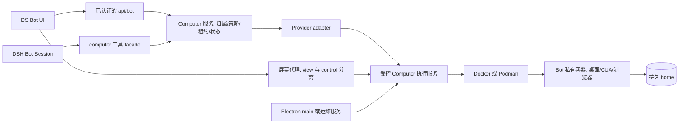
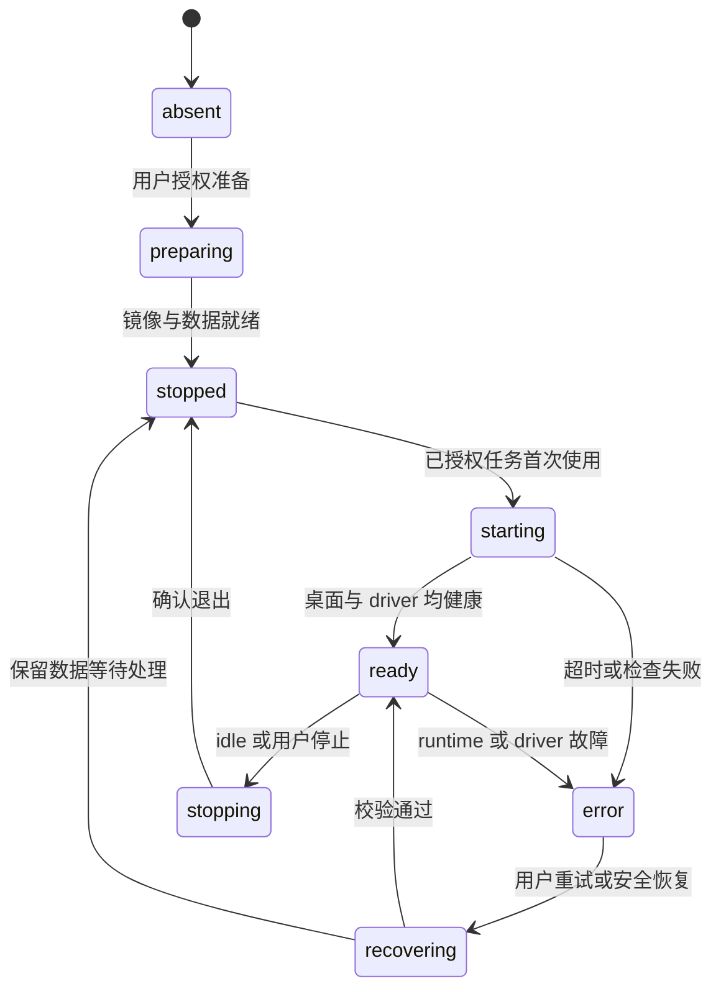
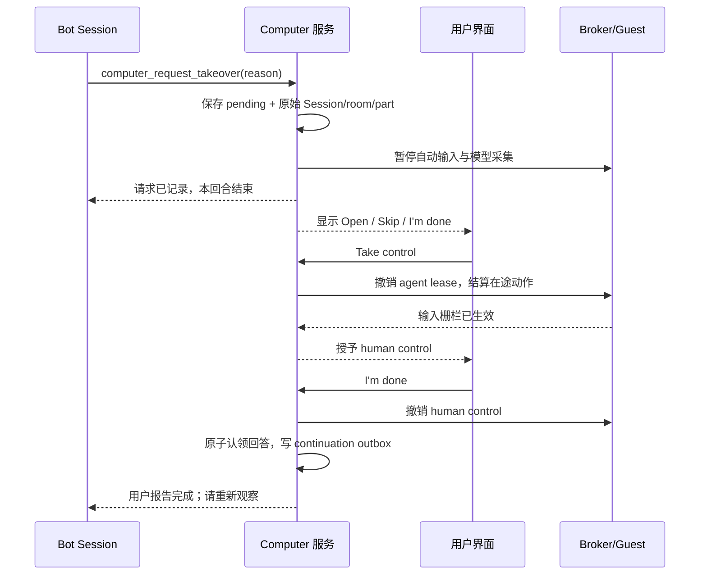

# DS Bot：CUA 私有桌面与计算机能力开发计划

- 日期：2026-10-31
- 状态：**开发中，当前交付范围见 §24.26（cua.17）；完整平台和发布验收尚未完成**。用户已授权在当前 fork 分支继续实现；本文保留历史检查点，早期百分比及缺口表不代表当前状态。
- 需求：基于 ds-bot 插件，为长期 Bot 增加类似 OpenMausBot 的 CUA 虚机、持久工作环境、可视桌面和人工接管能力。
- 名称解释：结合本地三个仓库，将需求中的 `ds-rot / openmausrot / grok rot` 按 `DS Bot / OpenMausBot / Grok Bot` 理解；本文不另造“ROT”协议或产品。
- 初始交付范围：源码调研与开发 Markdown。后续已运行 DSH 集成测试和真实 CUA 容器实验；没有使用真实视觉模型。当前实现和验证范围见第 24 节。
- 标记约定：**现状**来自本地代码或文档；**建议**是 DS Bot 的新设计；**待验证**是必须通过原型才能承诺的能力。示例配置、工具、接口均为拟新增，不是现在即可使用的命令。

## 1. 建议先做什么

**保留 DSH 作为唯一 Bot agent loop，在 ds-bot 中增加 Computer 管理与工具层，用受控的外部执行服务管理每个 Bot 的容器桌面，并在桌面内调用 CUA Driver。**

第一版用户体验应当是：给一个 Bot 启用“Private desktop” → 准备镜像 → 第一次使用时启动 → Bot 观察和操作 → 用户可以看到同一桌面并接管 → 文件和浏览器 profile 在下一次任务中继续存在。

推荐的最短路线：

1. 验证 DSH 的工具作用域、图片附件、取消和审批接口，完成 fake provider。
2. 接入一个**已经由测试环境准备好的 CUA 容器**，验证真实 screenshot → action → marker 的闭环。
3. 完成隔离、执行租约、接管、文件交付和聊天恢复，再做产品化的创建/启动/停止/重建。
4. 发布单 Bot 私有桌面 MVP；第二批解决多个 Bot 的资源配额和群聊派活。
5. Team Computer、云端 provider、真正的独立内核 VM 和用户宿主桌面作为后续独立里程碑。

不要把“通用任意 MCP provider”“Team 共享桌面”“多云平台”“宿主桌面控制”一起作为首版条件。MCP 是 CUA 的传输候选，不负责自动解决所有权、生命周期和安全边界。

建议首个可重复验证环境为 Linux x64 + Docker Engine；产品路线同时保留 Windows + Podman/Docker Desktop，Windows 路径映射必须有自己的验收。当前工作区在 WSL 挂载目录，不能据此认定 Windows 容器挂载已经可用。

## 2. 调研基线与证据入口

### 2.1 本地版本

| 仓库 | 本地路径 | HEAD | HEAD 日期 | 说明 |
|---|---|---|---|---|
| DS Bot | `/mnt/d/dsh/ds-bot` | `f823773b07ec6ca29d60b31c31af30218a68000d` | 2026-10-29 | 工作树有已有改动，本文按读取时工作树分析 |
| OpenMausBot | `/mnt/d/code/Robert/OpenMausBot` | `7de00e425848d5f1a2a845cb4784851b87d8cad2` | 2026-10-31 | 工作树有已有改动，不能把观察到的所有内容等同于该提交 |
| Rakazo | `/mnt/d/code/Robert/rakazo` | `256b0f4cc825d0505df982ca1d795b4316450812` | 2026-10-27 | 调研时跟踪文件无改动 |

日期和 hash 是可追踪基线，不表示上游最新版本。在线检索没有返回可用的补充资料，因此比较以本地源码为证据，不对 Grok Bot 本身的当前实现作推断。实现前重新确认依赖发布记录、兼容矩阵和镜像来源。

DS Bot 的 README 标注 DSH `0.2.1-rc.4`，插件包版本为 `0.2.4`；开发时应以实际锁定的 harness 与 app runtime 为准，不凭 README 的旧功能列表判断缺口。

### 2.2 DS Bot 证据索引

| 编号 | 文件 | 对本设计的影响 |
|---|---|---|
| D1 | [index.js](../../ds-bot/index.js) | `MODULES` + `install(rt)` 是 host 集成方式 |
| D2 | [tools.js](../../ds-bot/src/host/tools.js)、[capabilities.js](../../ds-bot/src/host/capabilities.js) | 已有 `defineTool`、Agent scope 注册、`tools.restrict/guard`、逐 Agent capability 挂载 |
| D3 | [browser-plugins.js](../../ds-bot/src/host/browser-plugins.js)、[browser/mount.js](../../ds-bot/src/host/browser/mount.js) | 以 Bot 为 profile owner；截图必须存 attachment，不能把 MCP base64 原样冒充 DSH image block |
| D4 | [browser/session.js](../../ds-bot/src/host/browser/session.js)、[浏览器插件设计](2026-10-21-browser-plugins.md) | 已有主动浏览、refs/script/task、发布审批、删除核对、付款交接；不只是只读 `read_browser` |
| D5 | [channel.js](../../ds-bot/src/host/channel.js)、[approvals.js](../../ds-bot/src/host/approvals.js) | `POST /api/bot` 的 endpoint/payload 协议；群聊隐藏 Session 已有审批桥接 |
| D6 | [permissions.js](../../ds-bot/src/host/permissions.js)、[privacy.js](../../ds-bot/src/host/privacy.js)、[隐私 Bot](2026-10-27-private-bots.md) | 只有用户改权限；隐私 Bot 不能入群；路径检查不是 OS 沙箱 |
| D7 | [parts.js](../../ds-bot/src/host/parts.js)、[turns.js](../../ds-bot/src/host/turns.js)、[images.js](../../ds-bot/src/host/images.js) | 换段/压缩、取消与 follow-up；文本模型可能把图像送去 OCR，不能把 OCR 视为坐标控制能力 |
| D8 | [app/main.mjs](../../app/src/main.mjs)、[bot-views.mjs](../../app/src/bot-views.mjs)、[preload.cjs](../../app/src/preload.cjs) | app 主进程已有 Bot browser 与子进程消息桥；没有现成 Computer bridge |
| D9 | [愿景](../vision.md)、[运行配置](2026-10-10-bot-runtime.md)、[DSH 让步](2026-10-13-dsh-concessions.md)、[安全模型](../../SECURITY_MODEL.md)、[UI 标准](../design/ui-standard.md) | 不 patch DSH、现有安全边界、MCP 日志限制、统一界面规范 |

### 2.3 OpenMausBot 证据索引

以下文件路径均相对本地 OpenMausBot 根目录，可按上表 HEAD 查找；本计划没有复制其实现代码。

| 编号 | 文件 | 已观察到的设计 |
|---|---|---|
| O1 | `server/container-computer.ts` | Local VM 管理、镜像 digest、CUA wheel hash、runtime 检测、资源与挂载检查、目标身份 |
| O2 | `server/container-mcp.ts` | 通过容器 runtime exec 调用 guest 内 `cua-driver mcp --socket ...`；桥接控制门禁 |
| O3 | `server/local-vm-settings.ts`、`server/local-vm-lease.ts` | shared/per-bot/pool 模式、容量、idle 设置、可续期 VM lease |
| O4 | `server/local-vm-profiles.ts` | 重建前抢救旧 Firefox profile；不覆盖已经持久化的 profile；安装应用保留是可选项 |
| O5 | `server/computer-control.ts`、`server/auto-vm-claims.ts` | 人工接管拒绝 Bot 输入；generation 约束；lazy claim；有限的启动网络重试 |
| O6 | `server/computer-observation.ts`、`server/screen-frame-source.ts` | 截图去重、截图统计、人工操作期间不采集给模型、不同 surface 不串缓存 |
| O7 | `server/desktop-computer.ts`、`docs/computer-use-integration.md` | 宿主桌面 CUA 由 Electron 拥有；private parent IPC grant；区别于 Local VM |
| O8 | `server/cloud-computer-tools.ts`、`server/computer-tool-list.ts` | 云工具参数校验和未知结果提示；筛掉 driver upkeep 等不适合模型的工具 |
| O9 | `apps/docs/content/docs/computers/local-vm.mdx` | 容器桌面、per-bot、Windows Podman 与 workspace mount 的产品说明 |
| O10 | `LICENSE`、`LICENSING.md` | 根许可证与 `enterprise/` 的例外说明，不能把整个仓库当作同一可复用范围 |

### 2.4 Rakazo 证据索引

| 编号 | 文件 | 已观察到的设计 |
|---|---|---|
| R1 | `docs/computer-runtime.md` | Agent 与 Computer runtime 分离；持久 home；Team/Private；screen 与控制边界 |
| R2 | `packages/adapter-kit/src/types.ts` | `SandboxProvider`、observation/action/file/terminal/screen contract |
| R3 | `packages/adapters/src/sandbox-factory.ts` | Docker、E2B、Daytona、Boat 等 adapter 工厂；缺配置明确不可用 |
| R4 | `packages/adapters/src/computer-tools.ts` | 图片块与元数据、相同画面省略、重复无进展动作保护 |
| R5 | `packages/adapters/src/computer-control.ts`、`computer-screens.ts` | user control 到期、撤销失败处理、screen ownership 与 lease fencing |
| R6 | `infra/sandboxes/supervisor/`、`infra/sandboxes/computer/` | 独立 supervisor 和 guest desktop runtime，不把 Docker socket交给 Agent |
| R7 | `docs/self-host.md`、`docs/self-host-sandbox-providers.md` | 网络限制、Windows/WSL、运行时成本与部署说明 |

**文档漂移提醒：**Rakazo `VISION.md` 仍描述共享 canonical browser identity；当前 `docs/computer-runtime.md` 描述每 Bot 独立 profile、不克隆不合并。不能据旧愿景声称当前默认共享登录。本方案选择与 DS Bot 已定设计一致的“每 Bot 独立登录”，实现前再核对相应 profile 代码和测试。[D4/R1]

## 3. 三个项目怎样取长补短

| 维度 | DS Bot 现状 | OpenMausBot 现状 | Rakazo 现状 | DS Bot 建议 |
|---|---|---|---|---|
| Agent loop | DSH Session | 自有服务适配多种 Agent 引擎 | Pi session 与 API/worker | 保留 DSH，不引入第二个完整 agent loop |
| 长期身份 | Bot + 分段 Session + 记忆 | Bot + computer selection | teammate + computer/home | Computer owner 绑定稳定 Bot id |
| 桌面执行 | 尚无 Computer provider | CUA Local VM 与宿主 CUA 分开 | provider-neutral actions + Linux desktop runtime | guest CUA 优先，统一 facade |
| 运行环境 | 宿主工具、Electron 浏览器；Docker 版整个 DSH 在容器内 | 本机容器桌面、云、VPS、宿主桌面 | Docker supervisor、多云及 desktop | 先本机私有容器；与现有 Docker 发行版分开 |
| 浏览器 | 每 Bot profile，refs/script/task | 内置 browser 与 CUA desktop 分开 | desktop browser 与页面工具协同 | 不跨环境偷换工具，不自动复制登录 |
| 人工介入 | browser handoff 与审批 | control lease、sign-in help | view/control capability、租约到期 | 原生 Computer 卡 + 可撤销控制权 |
| 持久状态 | DSH home、Bot workDir | durable mount + profile rescue | workspace checkpoint/import/export | 先持久卷，后 provider-neutral checkpoint |
| 并发 | own/group 多 Session | shared/per-bot/pool | Team 多 display | 每 Bot 一容器，同一容器串行执行 |
| 值得借鉴 | 身份、群聊、审批和插件体系 | CUA guest 桥、镜像验证、接管体验 | provider contract、租约 fencing、checkpoint | 原创实现，不移植整套产品栈 |

三个必须区别开的概念：

- **CUA**：本文指计算机界面操作能力；具体驱动是执行键鼠、截图、窗口/可访问性操作的组件。
- **Local VM**：OpenMausBot 对产品能力的命名，读取到的实现主要是 Docker/Podman Linux **容器桌面**。在 Windows/macOS 上 runtime 可能由 Linux VM 托管，但不等于每 Bot 一台独立内核 VM。[O1/O9]
- **Private Computer**：本方案的资源归属概念。容器、microVM、云实例都可承载；实际隔离强度必须显示清楚，不把容器称作绝对安全沙箱。

## 4. 首版范围与非目标

### 4.1 MVP 必须闭环

- 用户给 Bot 分配 private computer，默认关闭；无需用户手写容器命令。
- 一套受管 Linux desktop image，guest 内 CUA driver，固定版本与校验清单。
- 状态查询、截图、基础输入、打开应用/地址、明确的 guest 文件与命令工具。
- 只读 screen panel；可停止 Bot 并接管；登录请求卡与完成/跳过回路。
- 每 Bot 独立 workspace/profile；同一 Bot 的 own chat/group chat 竞争同一执行租约。
- 附件送入 guest、产物回到聊天；文件不能只留下一个用户无法访问的 guest 绝对路径。
- 创建、启动、停止、重建、删除运行实例、保留数据的明确区分。
- 假模型/假 provider 测试、真实 CUA 容器 smoke 和故障注入。

### 4.2 首版不承诺

- 用户宿主桌面 CUA、Windows guest、macOS guest、GPU 桌面。
- 任意 MCP server 无配置自动兼容；模型自动选择付费云或创建账单资源。
- 跨 Bot 共享登录、Team 多 display、多人同时控制。
- shell/截图内容“绝不泄密”、任意 GUI 动作“完美识别危险性”。
- 跨 provider 完整 OS 快照迁移、任意系统包随 workspace 搬迁。
- 自动修补 DSH 内部 API、从 DSH 安装目录导入私有文件。

## 5. 架构与部署拓扑



### 5.1 职责归属

| 层 | 负责 | 不应拥有 |
|---|---|---|
| ds-bot host | Bot 身份解析、权限策略、native tool、审批、状态、恢复、附件转换 | 交给模型的 runtime/socket 凭据 |
| provider adapter | 将内部 contract 映射到受管 MCP/执行服务；校验并裁剪返回值 | 第二个无限运行的模型 loop |
| Computer 执行服务（Broker） | runtime lifecycle、guest CUA 通道、持久数据、输入仲裁、screen gateway | 模型 API key、全部 DSH 数据 |
| guest | XFCE/X server、浏览器、CUA、guest 文件与进程 | Docker socket、宿主 home、DSH_HOME |
| Electron main | 桌面启动 Broker、私有进程握手、窗口与 viewer 生命周期、以后宿主 CUA | 用 preload 向网页暴露任意 exec |
| DSH Web 部署侧 | 运行并配置 Broker、TLS/网络拓扑、受限管理身份 | 从网页直接指定任意 SSH/Docker endpoint |

**容器内 CUA 不要求从 Electron 启动。**Electron/TCC 身份约束适用于未来的 macOS 宿主桌面控制；guest driver 在 guest 内由 supervisor 启动。插件 Web 模式也能连接运维配置的 Broker。[O1/O2/O7]

### 5.2 三种部署

1. **DS Bot app**：app main 启动受管 Broker，Host 通过私有握手连接；关闭 app 时撤销所有输入，按策略停本地实例。后台运行需用户显式启用，不能由“关窗口”隐式决定。
2. **DSH Desktop/Web 插件**：用户安装独立 Broker，插件使用其受限接口。screen 通过认证代理提供；浏览器不能直接访问服务器 `localhost` 的 viewer。
3. **DS Bot Docker 发行版**：Broker 与 Bot desktop 是 sibling services/containers。Docker socket 仅给 Broker，不给承载 DSH 的容器；原有 `docker/` 不能被当作每 Bot 沙箱。[D9/R6]

远端 Docker daemon 会让 bind mount 路径属于远端主机。首版只支持本机 daemon；检测到 remote context 必须拒绝并说明，不能写错机器。

## 6. DSH 集成验证清单：先验证，后排期承诺

当前代码提供了以下可参考入口，但存在入口不等于所有 Computer 场景已经支持。

| 问题 | 本地证据 | Spike 产物 | 失败时处理 |
|---|---|---|---|
| tool 只对选定 Bot 可见、直接调用也受限制 | D2 的 register/restrict/guard | own/group/subagent 工具面测试 | 公共 API 不够则提交 upstream 需求，不仅靠 prompt 隐藏 |
| CUA 图片进入模型 | D3 的 `attachments.saveImage` + `{type:'image', attachment}` | 一张 fixture 图的完整 model-request 检查 | 保存失败就返回不可观察，禁止凭空点击 |
| non-vision model 行为 | D7 的 OCR 路由 | text-only 时禁用像素动作 | OCR 文本只能辅助阅读，不默认允许坐标控制 |
| tool call 取消 | 工具 exec.signal、turn/stop | 输入前取消、输入中取消、超时未知结果 | 不假装远端执行已经停止 |
| 群聊审批和接管 | D5 的 approval/request；D4 现有群浏览器交接有局限 | 同群另一 Bot 继续工作的用例 | 自建 Computer pending 状态及恢复，不能复用个人 `show_view` 充数 |
| scoped MCP 调用 | D2 的 MCP plugin mount | 验证公开 API 是否允许 discovery/call/filter | 没有公共 API 则自有 Broker client；不读 DSH 内部 MCP 实例 |
| WebSocket 与二进制 screen | D5 目前只证明 buffered POST route | DSH 官方可用扩展点、认证和 streaming probe | 无扩展点则独立 Broker screen gateway；不 patch DSH |
| 重启后 handoff 恢复 | D7/D5 的队列与 Session 路由 | 当前 part 恢复且不重复投递 | 持久 outbox + 幂等 request id |

工具注册遵循 `agent/created` 与能力更新流程。每次执行还必须重新检查绑定和权限，不能只在 tools/list 时检查。子 Agent 继承最上层 Bot 的归属，但首版不自动继承 Computer 写权限；需要显式运行授权。

普通 MCP capability 会直接向 Agent 暴露服务工具；Computer 专用模式必须避免“facade + 原始 MCP”同时挂载造成绕过。能力中心可存配置与状态，但实际执行走受管 adapter。[D2]

## 7. 数据模型与持久化

### 7.1 拆开选择、实例和授权

不要把 `mcp` 放进 UI 的 mode 枚举：它是传输；不要把 `private` 当作 provider：它是归属。

拟新增 Bot 绑定示例：

```json
{
  "computer": {
    "schemaVersion": 1,
    "selection": "private",
    "computerId": "cmp_example",
    "executionPolicy": "computer-only"
  }
}
```

- `selection`：首版 `off | private`；后续增加 `team`，暂不做含糊的 `auto`。云端部署由实例的 `provider` 表达，不混入归属选择。
- `executionPolicy`：`computer-only` 或 `assisted`，见第 10 节。
- 关闭绑定不删除实例和文件。
- Main Bot 可以提出配置建议，不能自授 Computer 权限或改授权模式；UI 保存才生效。

实例元数据由 Computer store 保存：

```json
{
  "schemaVersion": 1,
  "id": "cmp_example",
  "owner": { "kind": "bot", "id": "bot_example" },
  "provider": "local-container",
  "isolation": "container",
  "workspaceKey": "home_example",
  "desiredState": "stopped",
  "generation": 4,
  "imageManifestId": "desktop-v1",
  "resourceLimits": { "cpus": 2, "memoryMiB": 4096, "pids": 512 },
  "lastCheckpoint": null
}
```

运行态：`phase`、`health`、`controlOwner`、`lease`、`activeOperation`、`lastError` 单独管理。外部 runtime 的运行状态必须 inspect，不以 `desiredState` 或旧 JSON 为准。

### 7.2 存储职责

```text
<bot-home>/computers/
  registry.json                 # 非秘密配置，单写者与原子替换
  operations.jsonl              # operation id、状态和脱敏摘要
  pending-handoffs.json          # 待用户处理/待投递的记录

<broker-owned-data>/
  instances/<computer-id>/       # runtime metadata
  homes/<workspace-key>/         # 浏览器 profile、工作文件；不混放 DSH 数据
  checkpoints/<workspace-key>/   # 明确版本、校验、原子提交
  credentials/                  # 仅 Broker 可读，不进入 UI/模型
```

`bot-home` 跟随 `config.home`，不能硬编码 `~/.dsh`。VM home 不允许放进团队 workDir，也不自动挂载个人工作目录。Windows 的 Unix mode 600 不提供等价 ACL，需要单独的目录权限方案。

`state.json` 只保存绑定和必要引用；截图、流式内容、凭据不入 roster。复用已有 home lock 控制插件单写者；Broker 再用实例级锁。两边写入失败时以 operation journal 进行补偿，不依赖跨进程同时写成功。

### 7.3 身份与变更

- 真实 Bot/Session/Group 身份从执行上下文解析，模型参数不接受任意 `botId` 或 runtime target。
- Bot 改名不改 computer id；换段不换 home；复制 Bot 默认 `selection: off`，不复制 profile、grant 或凭据。
- 切换绑定前取消运行、撤销 token、递增 generation；新任务才获得新目标。
- 删除 Bot 默认停止并保留其 Computer 数据归档。另设“永久删除 Computer 数据”，用户明确确认。
- 隐私 Bot 删除后保护继续存在，不能把旧 home 分配给另一个 Bot。[D6]
- 重启时：reconcile 已登记资源；未登记且带本产品 label 的资源进入隔离/待处理，不直接删；没有 label 的资源绝不接管。

## 8. Provider contract 与工具设计

### 8.1 内部 provider 能力

这不是现有 DSH API，是拟新增的自有 JavaScript/JSDoc 接口：

| 方法 | 输入关键字段 | 输出/语义 |
|---|---|---|
| `inspect` | computer handle | phase、driver health、实际隔离类型、能力、故障原因；无副作用 |
| `ensureReady` | operationId、配置、signal | 幂等创建/恢复，返回实例 generation |
| `observe` | execution context、capture options | fresh frame + 元数据，不授予输入权 |
| `perform` | action batch、fence、operationId、deadline | 已完成数量、结果确定性、可选新 observation |
| `execute` | argv、guest cwd、deadline | job id、退出状态、有限输出；可取消整个进程组 |
| `read/write/list` | workspace 相对路径、大小限制 | guest 文件；不能解析为宿主文件 |
| `issueViewer` | user principal、view/control、lease | 仅 UI 使用的短期票据；provider 原始地址只在 Broker 内 |
| `revokeControl` | lease id、generation | 确认所有输入通道失效，否则保持 blocked |
| `checkpoint/restore` | revision、quiesce policy | 持久 workspace 一致版本；不承诺 RAM/OS 完整快照 |
| `stop/removeRuntime` | operationId、expected generation | 不删持久 home |
| `purgeHome` | 用户批准的准确目标 | 独立破坏性动作，模型无此工具 |

能力发现需细分 `observe`、`pixelInput`、`semanticInput`、`files`、`exec`、`viewStream`、`humanControl`、`checkpoint`。不支持的能力不展示或明确报不可用，绝不回落到宿主。

### 8.2 模型工具面

| 工具 | 参数要点 | 说明 |
|---|---|---|
| `computer_status` | 无目标 id | 显示分配目标和状态；只读，不创建/拉镜像 |
| `computer_observe` | 可选区域 | 返回截图、frame、坐标系、generation、时间 |
| `computer_act` | actions、observationId | 少量有序输入，见下方约束 |
| `computer_open` | HTTP(S) URL | 在已绑定 guest 打开，返回 launch requested 后需观察 |
| `computer_launch` | 已登记 application id | 不接受任意宿主可执行路径 |
| `computer_exec` | argv、cwd、timeoutMs | 仅 guest；不能因 argv 形式就认定无危险 |
| `computer_job` | jobId、poll/cancel | 查询自己的长进程，拒绝跨 Bot id |
| `computer_files` | list/read/write、path、受限内容 | 初版限制大小；有访问/写权限检查 |
| `computer_import` | attachmentId、目标相对目录 | 从用户附件导入，不接受任意 host path |
| `computer_export` | workspace 相对文件、说明 | 保存到 DSH attachment，聊天可直接下载 |
| `computer_request_takeover` | reason、需要用户做什么 | 持久请求、结束本次 Computer 工作，等待用户回答 |

不向模型暴露镜像拉取、daemon 配置、driver 更新、录像配置、重置权限、删除 home 等运维工具。Raw CUA list-tools 必须映射到已审的 allowlist；driver 新增工具默认不启用。[O8]

### 8.3 动作与结果示例

```json
{
  "observationId": "obs_example",
  "actions": [
    { "type": "click", "x": 320, "y": 240 },
    { "type": "text", "text": "A sample note" }
  ]
}
```

所有数值均为**建议初始限额，需基准测试调整**：单批最多 8 个动作；text 最多 4,000 字符；wait 最多 2 秒；一个 batch 最多 15 秒；涉及提交、删除或外发时必须拆开单步。

返回业务结果：

```json
{
  "operationId": "op_example",
  "outcome": "unknown",
  "completedActions": 1,
  "uncertainActionIndex": 1,
  "retryPolicy": "observe-first",
  "code": "bot/computer-result-unknown"
}
```

结果必须区分 `not-started / completed / rejected / unknown / partial`。timeout 或 abort 只表示调用方不再等待，不证明 guest 未执行；不能简单将所有超时标为安全重试。[O8/R4]

幂等键由服务器生成并绑定 `computerId + generation + turn + callId + actionHash`。同键不同参数拒绝；同键已经完成返回 receipt；已经执行但未确认返回 unknown；新 tool call 不沿用旧键假装同一次动作。

### 8.4 图片与坐标

- MCP 的 base64 图片先校验 media type、字节数、解码尺寸，再经 `attachments.saveImage` 存为 DSH image attachment。[D3]
- 图片持久化失败即 `observation-unavailable`，不能只给一句文本仍允许像素输入。
- 观察元数据包含 native size、image size、scale、crop origin、display id、generation。所有点击坐标统一为观察图坐标，由 adapter 转成 native 坐标。
- viewport resize、display 变化、takeover、重启令旧 observation 失效；拒绝 stale frame，要求重拍。
- 相同 frame 的图片去重必须按 **Session/上下文可见性** 记账，不能全 Bot 去重：群聊 B 没看过 own chat A 的图片；换段/压缩丢图后必须重新附图。
- 相同动作连续 3 次画面无变化时阻止继续重复，提示换工具/观察/交接；不把字节哈希不同当作任务进展。[R4]
- 无图像输入模型默认只能用结构化 browser/file 工具；需要 CUA 像素动作时要求换视觉模型或人工接管。自动 OCR 的二次模型调用必须被计入数据外发和用量。[D7]

## 9. 生命周期、并发与恢复

### 9.1 生命周期状态



控制状态 `none / agent / taking-over / human / blocked` 与生命周期正交；不生成 `ready-human-sleeping` 一类组合字符串。

### 9.2 执行租约

首版一个 Private Computer 同时只能有一个执行者；同 Bot 的 own chat、多个群和子 Agent 都可能并发，所以不能只用 botId 当锁 owner。[D7/O3]

Lease 字段：`computerId, generation, leaseId, ownerSessionId, turnId, fencingEpoch, expiresAt`。参考参数：TTL 30 秒、每 10 秒续期；Broker 以自己的单调时钟判断。

- GUI、guest shell、文件写入、导入导出、browser CDP 都经过同一个仲裁入口。
- 占用时返回 busy 与可公开摘要，不让一次工具调用无限等待。允许有界等待或持久待执行请求，不能死锁群聊。
- 一次工作拥有跨多个动作的短期租约，避免每次点击之间别的 turn 改写桌面。
- release/heartbeat 必须匹配 generation 与 leaseId；迟到的旧请求不能释放新 lease。
- Broker 在动作开始前检查 fence；在可中断批次的每步之间再检查；返回时再次验证。
- 输入途中不能撤销已发生的点击；接管要先等待当前动作结算、释放所有按键/鼠标状态，再显示“你已接管”。
- 插件 dispose、turn cancel、Bot delete、权限撤销、capability detach、driver crash 都必须触发清理。

### 9.3 启动与 idle

- `status`、列表、打开设置不会启动桌面；用户点 Start 或已授权任务第一次需要时启动。
- 下载大镜像是用户设置动作，显示大小/进度/错误，不藏在一个模型工具超时里。
- 同一实例并发启动共享 operation，取消最后一个 waiter 后按配置中止启动。
- 首版默认最多 2 台运行，单台建议 2 CPU / 4 GiB，idle 30 分钟；这些是预算起点不是最低要求。
- 预览帧不能不断刷新 idle，execution/user lease 才是活动依据。
- 等登录时可 hold 30 分钟，到期提示用户，任务记录保留；不无限占用资源。
- 初版 managed container restart policy 为 no；由 Broker reconcile，避免 runtime 自动启动绕过授权。
- Shell 后台 job 必须登记 owner、deadline 和保活策略；否则 idle 时明确会停止，不能承诺后台工作继续。

### 9.4 重启与不确定结果

Broker 重启后增加 epoch、撤销旧控制 token，inspect 实例并校验数据，不自动重放 journal 中未完成动作。已发出但无 receipt 的记录统一 unknown；下一个 Bot 回合重新观察。

如果 provider 真的丢失实例，恢复 home 到新实例；原实例只是暂时网络失联时不能同时起第二台写同一 home。需要租约确认失效或人工恢复操作。

## 10. “接入 Computer”与“Bot 已隔离”是两件事

### 10.1 两种执行策略

| 策略 | 行为 | 产品承诺 |
|---|---|---|
| `assisted` | 保留原有 host shell/files，加上显式 `computer_*` | 为 Bot 增加远程手脚；不能宣称整个 Bot 在虚机里 |
| `computer-only` | Computer 任务期间，禁用会执行宿主命令/读写宿主文件的工具与未审 MCP；工作工具映射到 guest | 已审核工具调用限定在 Computer；DSH Host 进程本身仍不在 guest |

推荐私有桌面默认 `computer-only`，但必须先通过工具面审计。需要覆盖 native tools、`run_code`/PTC 嵌套调用、subagent 继承、`working_directory`、Office、browser_script、动态 MCP 与 skills 隐含的 host 命令。[D2/D9]

不能靠隐藏 schema 或一句“只用 VM”提供安全保证。所有原始执行入口都要有执行时 guard。若 DSH 公共接口无法封住某条路径，首版只能发布 `assisted` 并写明边界，或等待 upstream API，不能私改 DSH。

Computer-only 的变更应在新回合/新 part 生效，记录实际工具面；运行中切换必须先停止原工作。现有 DSH 工作目录不设置成 `/home/dsbot/...`，这是 guest 路径，宿主无法直接使用。

### 10.2 权限与风险不能机械套用

DSH permission preset 不会自动把网络 MCP 调用变成 guest 文件沙箱。Computer 必须有独立的服务端策略；不放宽既有 DSH 权限，也不声称 DSH 已替自定义工具完成检查。[D6]

首版建议两档 Computer grant：

- **Observe only**：状态与截图；没有 GUI 输入、exec、文件写入。截图仍可能含敏感数据。
- **Operate assigned desktop**：用户允许在明确实例内操作；危险或不明确的副作用仍逐次批准/人工处理。

只有用户更改 grant、实例绑定、共享范围、持久目录和网络能力。Main Bot 的团队管理权不是系统管理员权限。

## 11. 审批、接管与群聊回路

### 11.1 副作用策略

| 行为 | 建议处理 |
|---|---|
| status/观察 | 必须已有查看授权；人工保护输入期间暂停模型观察 |
| 滚动/聚焦/普通编辑 | 有操作 grant 后允许；状态变化再验证 |
| 发布/发送/上传/下载 | 优先结构化操作；复用本次审批，来源和实际产物匹配 |
| 删除 | 展示准确目标，审批前后重检；不确定则交给人 |
| 付款/购买/转账 | 继承现有浏览器决策，由人完成 |
| shell、任意 script、未知 GUI 按钮 | 不能根据命令名/按钮文本认定安全；按任务授权及剩余风险询问或 handoff |
| 创建付费实例、扩容、永久删 home | 仅用户管理面操作 |

**局限必须公开：**截图、按钮文本、模型给出的 `risk: low` 都不能证明一次任意 GUI 动作没有外发影响。已有浏览器识别也是启发式，不能无条件扩展成通用 CUA 的安全保证。若需要严格禁止在线交易，必须限制可操作应用/网络或把未知交互交给人；guest shell 与浏览器 script 不能成为旁路。

审批记录绑定 `computerId + generation + leaseEpoch + actionHash + observed target`，同意后重新校验。审批时用户改变了页面、目标、文件或实例就失效。

### 11.2 接管请求



“交还控制权”和“我完成了”是不同事实。前者只解除控制；后者产生用户回答，但仍不是页面状态的证据。

### 11.3 群聊和换段

- Computer takeover 有自己的 pending 记录与原生组件，不依赖模型生成的 `show_view`。`show_view` 现状只适合 own chat。[D2/D5]
- 记录 `requestId, botId, sourceSessionId, roomId?, sourcePart, computerId, generation, reason, status`。
- 群里请求只恢复该 Bot 的原始群工作，不把群上下文搬到 Bot 私聊。其他成员可继续。
- 回答时通过稳定 owner 找到当前有效 part；删除、退群、替换实例后旧卡变 expired，不恢复错误 Session。
- 用 `requestId` 认领与去重；outbox 成功投递后标记 consumed；失败可重试，不产生两条用户回答。
- 应用重启后保留待答卡，但旧 lease 不恢复。显式确认目标仍在，再恢复操作。
- 用户在普通聊天中撤销任务，取消关联 pending、审批和 Computer 队列；不能在随后点击旧卡时重新开始。

## 12. 屏幕流、文件与秘密

### 12.1 只读屏幕必须在服务端只读

noVNC 的客户端 viewOnly 开关不足以授权。必须使用服务端只读连接，或能验证/丢弃输入消息的 gateway；控制票据不能从只读票据推导出来。

- view/control 两种权限；短期票据绑定用户会话、computer id、generation、用途与过期时间。
- 浏览器 WS 无任意 Authorization header 能力时，用同源 cookie 及一次性 handshake 设计；不要把长期 secret 放 query string。
- Cookie/auth/Origin/CSRF 校验以现有 DSH 认证为入口，Broker ticket 仅经已认证接口签发。
- WebSocket upgrade 时核验目标，连接期间跟踪撤销；不能只检查建连时。
- 失效/重建必须断开旧连接，保证它不会看到下一个 Bot 的 display。
- iframe 或独立 viewer 不载入任意 provider HTML；优先自带固定版本 viewer，严格 CSP、postMessage origin/source 检查。
- remote Web UI 通过同源代理访问服务端桌面，不能返回 `127.0.0.1:6080` 让远程用户误连自己的电脑。
- stream 不走 buffered JSON `state` 轮询；插件只送摘要。[D5]
- 禁用 Electron Node integration、任意导航和从 viewer 到主窗口的通用 IPC。

### 12.2 文件传输和交付

- `computer_import` 只接收本次授权上下文可访问的 DSH attachment；Host 验证 attachment 所有权，流式写入 guest 临时文件，校验后 rename。
- `computer_export` 验证 workspace realpath、文件类型和大小，再创建 DSH attachment；用户得到可下载链接。
- 路径校验与打开文件之间防 symlink race；拒绝绝对路径、`..`、符号链接逃逸、设备文件、FIFO、socket。不要只校验字符串前缀。
- 建议单文件 25 MiB、文本预览 128 KiB 起步；实际取 DSH/产品现有限额更严格者。上传压缩包先按展开后总字节数与 entry 数检查。
- 接管期间默认阻止 Bot 的 shell、读写与采集，避免通过文件或 clipboard 观察用户正在输入的秘密。
- 两个 Bot 协作以显式 artifact transfer 交付；不共享宿主目录来绕开 private computer 边界。

### 12.3 秘密保护的实际边界

**文本 redactor 无法识别截图像素中的密码，也无法保证编码、拆分、二维码中的秘密被移除。**[D6/D7]

首版应当：

- provider/runtime 凭据只在 Broker；不注入 guest；不复用给 Bot 的普通 secret 命名空间。
- 应用登录用人工接管，保护输入期间停止自动截图、AX/DOM 抽取、clipboard、shell/read-file 等观察通道。
- human view 可以看到自己的输入，模型 preview 与录制关闭，Give back 后重新确认页面适合观察。
- Bot 确需应用 secret 时使用明确引用、限定目标和时限；不要把全部 `DSH_SECRET_*` 注入 guest。
- 已登录 profile 本身就是凭证；workspace checkpoint 包含 profile 时按敏感备份保护，默认不跨 Bot 导出。
- 持久截图 attachment 会进入会话历史，应告知用户并提供保留策略；首版不承诺安全擦除历史图片，须依赖公开 attachment/session 删除能力。
- 压缩上下文不是删除持久图片；OCR 缓存也可能含屏幕敏感文本，不能遗漏。
- DSH 让步 C6 指出 MCP 响应日志有脱敏限制；Computer adapter 不能把 token 送入 MCP URL，也不能承诺能清洗所有上游日志。若公共出口不足，需要 upstream 修复或使用不返回秘密的 Broker 协议。[D9]

## 13. Local VM 实现要求

### 13.1 镜像与运行时

建议建立 `computer-runtime/` 独立目录，管理 guest image 和 Broker；不把它混进现有 DSH Docker 发行版。

- 基础系统、桌面、浏览器、CUA 版本由 lock manifest 管理；OCI digest、driver artifact SHA-256、架构、来源与 notice 都有记录。
- OpenMausBot 本地 O1 的 guest driver 常量是 `0.37.0`，而 package/docs 中另有宿主 driver 版本；这些不是 DS Bot 应直接采用的统一版本。首版通过矩阵测试选定一套。
- 先选一个 guest 浏览器；可偏向 Chromium 以便后续语义浏览器集成，但必须先验证 CUA 实际窗口和输入兼容性。不要把 OpenMausBot 镜像内 Firefox 说成已经是 Chromium。
- 不对运行中的 driver 自更新；发布新镜像，维护窗口替换。
- 探测 runtime 的 installed/daemon reachable/image present/desktop ready/driver ready 分开显示。
- 运行时选择保存为配置，不因另一个 runtime 更先出现在 PATH 就切换镜像仓库。

### 13.2 启动安全检查

| 检查 | 要求 |
|---|---|
| 资源身份 | app-owned labels + computer id + workspace key + image digest 一致；不只比容器名字 |
| runtime context | 本机 daemon；远端 context 首版拒绝 |
| namespaces | 无 privileged、host network/pid/ipc，禁止宿主设备透传 |
| capabilities | 最小集合；桌面 supervisor 所需权限通过测试确认，不复制一组未验证参数 |
| 用户 | Bot/driver/browser 非 root；如果 init 要短暂 root，必须验证降权路径 |
| 挂载 | 只有登记的专用 home；不含 DSH_HOME、用户 home、根盘、Docker socket |
| 端口 | guest 内部 CUA socket；viewer 仅 loopback/私有网络，不发布 0.0.0.0 |
| 出网 | metadata、控制平面、宿主/LAN 的实际限制做网络测试，不只在 open_url 校验 |
| 限额 | CPU/RAM/PIDs/磁盘水位；日志有界；共享内存按浏览器需求配置 |
| 启动健康 | X display、截图尺寸、CUA MCP list/call、viewer 均有独立检查 |

Docker Desktop/Podman VM 中的网络行为不能套用原生 Linux iptables 假设。若 restricted egress 不可证明，应明确显示 open egress，不假装隔离；不自动降低策略继续启动。[R7]

### 13.3 Windows 与 WSL

- 将 `/mnt/d/...`、`D:\...`、Podman machine 内路径分开处理，不靠字符串替换推导 bind source。
- 创建临时 mount probe，由宿主与 guest 双向读写随机 marker 校验路径确实相同；probe 不触碰用户数据。
- runtime CLI 用 executable + argv 启动，避免 cmd/PowerShell 拼接；处理含空格、中文、非 ASCII 用户名。
- 浏览器 profile 放在 Broker 管理的数据卷；若 Windows bind mount 的锁和 sqlite 行为不稳定，选 named volume + 显式导出，而不是绕过校验。
- 检查 WSL/Podman machine 可用资源，缺容量给出可操作诊断。
- guest X11 权限或 `/dev/uinput` 不可用时返回实际错误；不能为了让某个键盘路径工作给容器 privileged 或挂宿主输入设备。[O1/O9]

## 14. 持久化、重建与备份

| 状态 | 停止/重启 | 重建同版本/升级 | 跨 provider |
|---|---|---|---|
| workspace 文件 | 保留 | 保留，验证 revision | 经导出/导入恢复 |
| browser profile | 保留 | 停浏览器后一致备份；版本兼容需验证 | 不承诺凭据/OS keychain 可移植 |
| 内存进程和 GUI 窗口 | stop 后丢失 | 丢失 | 不迁移 |
| 系统 apt 包 | 容器未删除时可能保留 | 默认丢失 | 不迁移 |
| 用户目录内工具 | 在持久 home 内则保留 | 架构兼容时恢复 | 不能保证跨 CPU 架构 |
| driver/runtime 配置 | 跟随镜像和 Broker | 使用目标 release | adapter 自己配置 |

重建事务：停接新任务 → 撤销所有 screen/input lease → 取消/结算进程 → 浏览器退出并 flush → 创建 checkpoint → 校验 → 创建新实例 → health check → 原子切换 active generation → 旧实例退役。

失败回滚保留旧 home/checkpoint。浏览器 profile 的格式升级可能不可逆，因此恢复旧镜像时同时恢复升级前 checkpoint，不能让旧浏览器直接读已升级 profile。

首版实现本机 durable volume，并在开放重建/升级前提供本机一致备份与恢复；普通持久卷不等于备份。P4/P5 的 checkpoint 仅需覆盖本机回滚，使用 staged archive + manifest + hash + 原子 revision 更新；保留最近 2 个成功版本起步，配额与过期策略可设置。跨 provider checkpoint 和远端备份后置。对活动 browser profile 不做无锁热拷贝。[O4/R1]

`Remove runtime`、`Reset desktop`、`Permanently delete data` 三个动作分开。卸载插件不应默认删 home；归档保留需要容量提示与用户清理入口。

## 15. 与现有浏览器、文件和隐私设计的关系

- 现有 Electron browser 和新 guest browser 是两个工作环境，不能共用相同工具名让模型猜当前目标。
- UI 同时显示 `Browser` 与 `Computer`，并标出实际执行位置；Computer 内网页任务可先用 CUA。
- 后续 `computer_browser_*` 连接同一个 guest desktop 里的浏览器，不连接另一份隐形 headless browser。
- 同一工具族在新 turn 内固定目标；不得在 CUA 失败后自动调用宿主 `browser_script`。
- 现有 `browserGrants` 不自动授权 Computer；Computer grant 也不授权宿主 browser。
- 不自动同步 cookies。Team Computer 也保持每 Bot 独立 profile；共享登录需另行设计与用户授权，涉及修改 D4。
- “Private Computer”表示独立执行环境；“隐私 Bot”是现有聊天/文件可见性规则，两者不是同一个开关。
- 隐私 Bot 不能入群，不得因启用 Computer 变成可共享；向其他 Bot 导出文件仍按现有私密外发审批。[D6]

## 16. UI 与接口草案

### 16.1 UI 入口

1. Settings → Computers：runtime、镜像准备、资源配额、实例列表、存储占用、诊断。
2. Bot settings → Computer：Off / Private desktop、绑定实例、实际隔离类型、操作授权。
3. 右侧 panel 增加 Computer tab：screen、状态、Take control、Give back、Stop Bot、Files、Activity。
4. 群详情显示成员的 Computer 状态；仅暴露用户有权查看的条目。
5. 接管卡放在触发聊天及该 Bot 的待处理区；定位原始上下文，不复制敏感截图到群里。

普通 UI 不露出 socket、token、MCP command、docker inspect 内容。高级诊断显示脱敏后的版本、错误码和安全检查结果。

按 [UI 标准](../design/ui-standard.md) 使用 `--bt-*`、既有字号/尺寸、spring 形变、退出动画、reduced-motion；源文案英文，中文通过 `i18n.js`。屏幕缩放必须 letterbox，点击按图像实际区域映射，不能把黑边或 CSS 坐标直接发到 guest。

loading/error/offline/busy/human-control/awaiting-login 都有明确视图。屏幕断流时显示“最后更新于 …”，禁用输入；不能把冻结截图伪装成 live。

### 16.2 沿用 api/bot envelope

以下为拟新增 endpoint，继续使用现有 `POST /api/bot` body，不凭空改成另一套 REST 路由。[D5]

```json
{
  "endpoint": "computer-bind",
  "payload": {
    "botId": "bot_example",
    "computerId": "cmp_example",
    "expectedRevision": 7
  }
}
```

| endpoint | 作用 | 校验 |
|---|---|---|
| `computer-catalog` | provider/runtime 与能力 | 只读，无副作用 |
| `computer-state` | 状态、正在工作者、pending 摘要 | UI 身份；不返回 secrets |
| `computer-bind` | 分配/解绑 | 用户、revision、运行停止后切换 |
| `computer-prepare` | 准备镜像 | 用户，返回 operation id，后台进度 |
| `computer-start/stop/recreate` | 生命周期 | 用户授权、目标 generation、幂等 id |
| `computer-operation` | 查询长任务进度 | owner 与有界响应 |
| `computer-view-ticket` | 签发只读票据 | 已授权 UI，短期，无启动副作用 |
| `computer-takeover` | 请求人类控制 | 先 fence，再签 control ticket |
| `computer-release` | 交还控制 | session/lease/generation 全匹配 |
| `computer-handoff-answer` | done/skip/returned | requestId 去重，恢复原始聊天 |
| `computer-export` | 用户文件下载 | workspace 路径校验、大小限制 |
| `computer-remove/purge` | 删实例/永久删数据 | 不同确认内容，严格限定资源 |

响应沿用 `{ok,value}` / `{ok:false,error:{code,message,details}}`。screen 是独立数据流；state 只含 `phase, health, viewAvailable, controlState, updatedAt, operationId`。

`READS` 列表不能把 start、ticket control、file write、prepare 放进去。多 Host 只读模式不应自行启动 Computer；是否转发当前 owner 签只读票据要单独验证，首版可直接不可用。

### 16.3 错误和诊断

| code | 处理 |
|---|---|
| `bot/computer-off` | 引导配置，不重试 |
| `bot/computer-runtime-unavailable` | daemon/平台诊断 |
| `bot/computer-not-ready` | 等待明确的启动 operation |
| `bot/computer-busy` | 等执行者释放，不能抢占 |
| `bot/computer-human-control` | 等用户交还，不重试输入 |
| `bot/computer-stale-generation` | 刷新绑定与观察 |
| `bot/computer-stale-observation` | 重新截图 |
| `bot/computer-result-unknown` | 核实效果，不重放 |
| `bot/computer-policy-denied` | 展示原因，不绕路 |
| `bot/computer-image-incompatible` | 保留数据，要求重建/升级 |
| `bot/computer-workspace-full` | 停止新写入，用户清理 |

建议事件：`requested / started / ready / action-completed / action-unknown / takeover / released / stopped / checkpointed / failed`。只记 id、tool、耗时、动作数、bytes、错误码；完整截图、网页原文、command env、ticket URL 不进入诊断日志。

## 17. 模块改动清单

以下是建议拆分，不要求第一批就创建所有空文件。

```text
ds-bot/src/host/computer.js           # install(rt) 与模块联接
ds-bot/src/host/computer/
  contract.js                         # 自有 contract 与 version 校验
  owner.js                            # Bot/Session/Group 绑定
  store.js                            # registry、operation、handoff/outbox
  policy.js                           # tool gate、grant、审批
  leases.js                           # execution/human/lifecycle
  tools.js                            # native DSH facade
  observations.js                     # 图片附件、坐标、可见性、去重
  handoff.js                          # 接管与恢复
  providers/fake.js
  providers/broker.js                 # 后续按需添加 remote adapter

ds-bot/src/client/
  computer-settings.js
  computer-panel.js
  computer-handoff.js
  computer-state.js

computer-runtime/
  broker/                             # 独立受限服务，运行时管理
  desktop/                            # guest Dockerfile、启动、健康检查
  runtime.lock.json                    # 镜像和 driver pin
  test/                               # contract/guest/安全/故障用例

app/src/computer-bridge.mjs            # 主进程启动和 private handshake
```

现有文件改动：

| 文件 | 改动理由 |
|---|---|
| `ds-bot/index.js` | 安装 computer 模块；顺序须让 privacy/policy 在 provider 前执行 |
| `store.js`、`roster.js` | 绑定、复制/删除/换段/迁移的 lifecycle 调用 |
| `tools.js`、`capabilities.js`、`agents.js`、`constants.js` | 限制工具面、避免原始 MCP 绕过、Agent 模式不要误获得 Computer |
| `channel.js` | 新 endpoints、只读保护、DTO 白名单 |
| `turns.js`、`parts.js`、`groups.js` | cancel、pending 恢复、换段时重新附图、group continuation |
| `prompt.js`、`images.js` | 执行环境说明、vision gate、OCR 边界 |
| `secrets.js`、`privacy.js` | 引用校验、脱敏、私有归档与产物外发 |
| `client/index.js`、`browser-pane.js`、`overlays.js`、`frame-layout.js` | 实际右 panel tab 与响应布局集成，不能只改 right-panel.js |
| `client/i18n.js`、`styles.js`、`member-status.js` | 文案、主题、等待与错误状态 |
| `app/src/main.mjs`、`preload.cjs`、host lifecycle | app bridge、退出、崩溃和重启 |
| `ds-bot/package.json`、构建脚本 | 新 UI 依赖、打包 include、锁版本与 licenses |

UI 源码变化后 `npm run build` 生成 `client.js` 并一并提交，禁止手改生成文件。仅写本计划无需更新 bundle。

## 18. 开发阶段、依赖和验收

### 18.1 里程碑表

估算针对 1 名熟悉仓库的开发者，不含上游 API 等待、跨平台签名或新硬件获取；是人日范围，不是交付日期承诺。

| 阶段 | 工作 | 预计人日 | 依赖 | 出口 |
|---|---|---:|---|---|
| P0 | DSH API/vision/tool isolation spike，固定 threat model | 3–5 | 本计划评审 | 可行性报告，缺口明确 |
| P1 | contract + fake + 工具 + 单写者 store + lease | 5–8 | P0 | 两 Bot/多 Session 隔离测试通过 |
| P2 | 已准备 CUA guest 的真实连接与附件闭环 | 4–7 | P1 | 真截图、真输入、guest marker 可核对 |
| P3 | 审批、接管 UI、群恢复、file import/export | 6–10 | P1/P2 | 用户能看到、接管、交还并拿到产物 |
| P4 | 镜像准备、生命周期、持久 home、reconcile | 7–12 | P2/P3 | 不丢数据的 stop/recreate/crash 测试 |
| P5 | Linux 发布基线、Windows runtime/挂载矩阵与升级回滚 | 6–10 | P4 | 各标注支持的平台均有 smoke 证据 |
| P6 | 多 Bot 配额、定时任务、资源管理与长 job | 4–8 | MVP | 两 Bot 并发独立运行 |
| P7 | Team Computer/remote provider/手机/宿主 CUA | 分别估算 | 稳定 contract | 独立设计评审，不捆绑首版 |

P0–P5 合计约 31–52 人日；可以先在 P4 验证后提供 Linux 技术预览。即使多人开发，也要先冻结 P0 contract，不应把所有适配器一起开工。

### 18.2 P0 要交付的可运行实验

- 最小 native DSH tool 返回一张已存储的 image attachment，检查真实请求结构。
- fake computer 让两个 Bot 的 own/group Sessions 调用，证明 owner 与 lease 不串。
- audit “computer-only”全部现有工具，列出 blocked/allowed/needs-upstream 表。
- 一个 fake MCP/受限 Broker 调用，只挂 facade，原始 driver 工具不可达。
- API 取消、group approval、handoff conclude/follow-up 完整走通。
- screen upgrade 的 DSH 公共接口证据；不足时写出独立 gateway 方案和认证链。

这些实验通过再锁定实现路线。遇到缺少 DSH 能力，不通过复制私有内部模块解决。

### 18.3 建议 PR 拆分

| PR | 内容 | 必须证明 |
|---|---|---|
| 1 | 设计 + DSH spike 结论 | 模型 loop 不变，公共 API 足够或缺口明确 |
| 2 | contract、fake、owner、store | 身份/状态/迁移稳定 |
| 3 | leases、policy、native tools | 同 Bot 多 Session 不交错，拒绝执行可测 |
| 4 | CUA adapter、observation、attachment | 图片路径正确、frame 坐标正确 |
| 5 | pending handoff、group resume、审批 | 不重复恢复、不把群内容带到私聊 |
| 6 | UI panel/settings、view/control gateway | 服务端只读、撤销有效、断流禁用输入 |
| 7 | 文件交付与 job 管理 | 真实产物可下载、guest 路径不泄到 host |
| 8 | Local runtime lifecycle、image lock | 不接管用户容器、安全检查 fail closed |
| 9 | checkpoint/recreate/upgrade | profile 一致备份、失败保留旧数据 |
| 10 | Windows/WSL、发布文档和操作指南 | 路径映射与 runtime 矩阵有真实证据 |

后续代码开发从最新 `dev` 的 `feat/<issue>-<name>` 开始，合入 `dev`；不重置用户工作树、不 rebase 已推分支、不改 CHANGELOG.md。当前 checkout 没有本地或 origin/dev 引用；实施前先确认上游 remote 与基线，再建分支。本文只新增计划文件，不据此切换现有工作分支。

## 19. 测试矩阵与验收证据

### 19.1 自动化测试

| 层 | 用例 | 可观察断言 |
|---|---|---|
| 单元 | action 参数、路径、图片、坐标、状态机 | 非法请求零 provider 调用 |
| 身份 | own/group/part/subagent、复制/删除/私有归档 | 同 Bot owner 连续、跨 Bot 拒绝 |
| 租约 | 过期、迟到 release、接管 race、cancel | 旧 generation 没有副作用 |
| 模型上下文 | 图像重复、换段、不同 Session、OCR | 没看过图的 Session 收到图片；非视觉不点坐标 |
| 审批 | 同意/拒绝/超时/页面变化/权限撤销 | 同意仅对应准确动作，拒绝不执行 |
| 幂等 | retry、response lost、process crash | 已执行的不重放，未知必须观察 |
| handoff | 重启、双击、退群、原 part 已归档 | 只恢复一次正确工作 |
| workspace | symlink race、zip bomb、磁盘满、读写中断 | 不逃出 home，旧数据可恢复 |
| viewer | 只读伪造输入、token 到期、display 复用 | 后端拒绝，旧 WS 断开 |
| 网络 | DNS/IP/redirect/IPv6 metadata、host gateway | 策略覆盖 shell/浏览器实际网络，不只是 URL 表面 |
| lifecycle | dirty image、外来容器、版本不匹配、daemon crash | 拒绝复用；不会删用户资源 |
| compatibility | 功能关闭、纯 DSH Agent、原 browser 与 MCP | 旧功能不受影响 |

测试优先注入 runner/clock/provider，避免 unit test 调真实 Docker 或模型。fake 无法证明真实 runtime 隔离，真实容器 smoke 不能省略。

### 19.2 真实 guest smoke

使用 `.dsh-test-computer-<run-id>/` 与独立端口，启动 mock model、专用 Broker 和带 test label 的容器：

1. 创建 Bot A/B，分配不同 home。
2. guest 中固定 fixture 页显示随机 challenge 和按钮。
3. mock model 发 observe → click → read marker；fixture 后端生成 marker，不能由测试直接伪造成功。
4. 检查 DSH attachment 与真实截图尺寸；验证点击坐标映射。
5. 创建文件和独立站点 cookie，重启/重建后读回，A 不能读到 B。
6. 用户 takeover 后注入旧 agent call、CDP、shell 和 file write，全部拒绝。
7. 模拟一次请求已执行但 response 丢失，证明按钮没有被点两次。
8. 关浏览器/driver/runtime 后状态准确，清理所有本轮资源。

mock model 证明工程链路，不证明模型视觉推理能力。实际视觉模型测试是另一个显式运行的验收，不放进无密钥 CI。仓库规定 UI PR 的真实服务/真实模型 GIF 另按 [record-browser-gif](../../.agents/skills/record-browser-gif/SKILL.md) 执行，不把 fake UI 当实证。

### 19.3 性能预算（待测目标）

- 已启动 guest 的 screenshot p95 ≤ 2 秒，普通输入到新截图 p95 ≤ 3 秒。
- ready 期间成功阻断接管后的新 agent 输入；UI 只有确认 fence 生效才变为 human。
- 首次下载镜像独立计时；已存在镜像的启动 p95 目标 ≤ 30 秒，超时显示诊断。
- 开启 2 个桌面时记录实际内存、CPU、PIDs；不把配置上限当实际成本。
- preview 可见时建议 1–2 fps 起步，隐藏时暂停；模型 observation 按动作发生，独立限频。
- 记录 screenshots captured/sent、actions、unknown、approval latency、boot time、运行分钟数，不记录原图内容。

### 19.4 仓库检查

行为实现完成按 AGENTS.md 运行：

```sh
cd ds-bot
npm test
node scripts/build-client.mjs --check
npm run lint
```

修改 host/index 时跑现有隔离 smoke，并增加 Computer fixture；修改 app 时按 app package scripts 跑对应测试。所有进程/容器必须在 finally 清理，只删除本次 test id 资源；不要用全局 docker prune。文档阶段只检查 Markdown、引用、JSON 和设计一致性，不宣称通过了行为测试。

## 20. 发布、运维和回滚

- `computer.enabled` 默认 false；feature flag 关闭时不挂工具、不拉镜像、不启动桌面。
- 发布包分别声明 plugin/Broker/protocol/image/CUA 版本兼容范围，不只判断 semver 大小。
- 升级前停新任务、checkpoint、校验剩余磁盘；在空白测试实例先健康检查再切生产绑定。
- Runtime 升级失败保留旧版本与 home，允许用户回退；不让 Bot 自动修改 runtime lock。
- 诊断导出仅版本/检查结果/错误码；对路径、URL、进程环境做白名单处理，绝不打包 DSH_HOME 或完整 profile。
- 网络/模型失败：保留任务和文件，停止重复输入；容量不足：拒绝新实例，现有聊天继续。
- Broker 崩溃：吊销控制、报告 unavailable；重启只 reconcile，不重放输入。
- 卸载：停止受管服务并询问是否保留数据；默认保留，尤其隐私归档。
- 后续 README/README.zh.md 同步、SECURITY_MODEL.md 增加 Computer/Broker/guest 边界、NOTICE/SBOM 按实际依赖更新；本提案不先把未实现能力写成 README 功能。

## 21. 待决策项与推荐默认值

以下用于设计评审，**不阻塞本次计划文档交付**，也不表示用户需要现在逐项确认。

| 决策 | 推荐默认值 | 原因/改变点 |
|---|---|---|
| 命名 | UI “Private desktop”，技术实体 Computer | 避免把容器误称每 Bot 独立 VM |
| 首个 provider | local-container + guest CUA | 贴合需求、可无云账号测试 |
| 配额 | 每 Bot 一个持久 home，最多 2 台运行 | 私有性明确，控制本机资源 |
| 默认启用 | off，用户选择后懒启动 | 兼容旧用户，不隐式消耗磁盘/资源 |
| Computer-only | 通过 P0 工具审计才默认开启 | 不把额外 MCP 当成整个 Bot 的隔离 |
| 操作授权 | 用户授予，不允许 Main Bot 自授 | 延续“只有用户改权限” |
| 群聊 | 各成员自己的 Computer | 延续独立 profile；共享 Computer 后置 |
| 登录共享 | 不共享、不自动复制 | 遵守现有浏览器设计 |
| 持久数据删除 | 删除 Bot 默认保留归档 | 避免丢数据与泄露隐私归档 |
| 网络 | 按平台报告实际受限/open 状态 | 不承诺不存在的 egress 隔离 |
| 宿主桌面 | 不进入 MVP | TCC/输入权限/宿主安全单独设计 |
| 独立内核 VM | 作为后续 provider | 若用户实际要求更强隔离，必须另估虚拟化与镜像工作 |
| Team home | 显式授权，浏览器仍独立 | 涉及新共享语义，需单独批准 |

涉及改变既有浏览器策略、隐私 Bot 规则、角色权限或 DSH 数据位置的实现，按仓库流程先开设计 Issue。新提案进入 `docs/plans/` 时标记草案，不追加到“已定设计”索引伪装已批准。

## 22. 完成定义

第一版只有满足下面清单才可以称为“ds-bot 获得 CUA 私有桌面能力”：

- [x] DSH 仍是唯一 Bot loop；无 DSH patch、私有模块依赖。
- [ ] 用户从 UI 完成设置，Bot 可在真实 guest 上观察、输入、执行并交付文件。
- [x] own/group/换段维持同一 Bot Computer；同一 Computer 的动作不会交错。
- [ ] 用户看到的是 Bot 实际操作的桌面；接管、交还、停止和登录恢复闭环。
- [x] stale token、旧 frame、旧 lease、旧 generation 都不能误操作新目标。
- [x] unknown result 不自动重试；图片持久化失败不继续像素输入。
- [x] secret、profile、截图与 OCR 的真实风险和保留范围有说明；不存在“像素已被文本脱敏”的虚假保证。
- [ ] 启用 CUA 后原有宿主工具的边界明确，computer-only 有执行时验证证据。
- [x] 重启、重建、升级失败不丢持久文件；删除实例和删数据是不同动作。
- [ ] 每个平台有独立 smoke；fake、mock 与真实视觉测试证据清楚区分。
- [ ] 新依赖来源、版本、许可证、NOTICE、SBOM 按实际引入内容核对。
- [x] 所有测试用独立数据/端口/容器；测试后清理，不接触用户 DSH 数据。

上述勾选只记录当前已有实现和自动化证据；没有勾选的项目仍然未完成。
尤其不能把 assisted 模式的工具边界说明当成 computer-only 的执行时隔离，
也不能把 WSL 内的真实 Docker 测试当成 Windows GUI 验收。详细证据见 §24.9。

## 23. 文档变更

- 2026-10-31：完成三个本地项目的结构与关键 Computer 路径对照；提出 DSH 保留 agent loop、Computer facade、guest CUA、受控 Broker、私有桌面 MVP、接管/恢复/持久化与后续 provider 路线。本文是可拆任务的开发草案，不代表功能已实现。

## 24. 实现进度记录（2026-10-31）

本批在用户指定的现有 fork checkout 上开发，实际分支为 `cua/2026-10-31`；
没有切换到上游 dev、重置已有改动或提交发布。第 18 节的通用分支建议不覆盖本次明确指示。

### 24.1 第一批底层实现（约 25%）

| 领域 | 代码入口 | 当前行为 |
|---|---|---|
| 插件集成 | `ds-bot/src/host/computer.js` | 默认关闭；仅在 Bot Agent scope 注册 4 个工具，执行时复核归属；拒绝子 Agent |
| 身份与状态 | `computer/service.js`、`store.js` | 稳定 Bot owner、持久绑定、revision/generation、原子写、损坏 fail closed |
| 执行租约 | `computer/leases.js` | 同一 Bot 的 own/group Session 互斥；turn end 撤销；审批等待续租 |
| 图像 | `computer/service.js` | DSH attachment 保存成功后才授权像素动作；按归一化后的尺寸换算；检查图片仍在当前上下文 |
| 策略 | `computer/service.js` | `observe/operate`；仅 `assisted`；每批 `allowed-once`；审批后画面变化则不发输入 |
| 回执 | `computer/service.js`、Broker `input.mjs` | 日志记录 pending/completed/unknown 等；重复 call ID 不重放；CUA `unverifiable` 保持 unknown |
| Broker | `computer-runtime/broker/` | 私有 IPC、受限 Docker/MCP 调用、取消后退休 transport、断连后禁止自动重连 |
| 容器 | `computer-runtime/desktop/` | 固定 digest + wheel hash；非 root、断网、资源限制；独立 `/home/cua` volume |
| 输入 | Broker `input.mjs` | 每次观察一个 click/text/key/scroll；滚动是有符号行步数；不提供 shell 或任意 MCP |
| 生命周期 | `channel.js`、`roster.js` | state/bind/start/stop/takeover/release API；删除 Bot 时停止并归档 Computer，保留 home |
| 测试 | `test/computer*.test.js`、`dev/computer-smoke.mjs` | fake 隔离与故障、真实 DSH scoped tool/attachment、真实 guest 与离线网页 marker |

当前启动方法、API、能力与限制见
[Computer runtime 开发说明](../../computer-runtime/README.md)。
本批验证记录见 [VALIDATION.md](../../computer-runtime/VALIDATION.md)：
1319 项单测通过、2 项跳过，真实 Computer 输入闭环通过；
完整 Web smoke 仍有可在未修改 HEAD 复现的选模型连接重置，不能标记为全绿。

### 24.2 第二批：约 50% 开发检查点

按用户要求继续在原分支开发，以 Windows 桌面应用为测试入口。
**约 50% 是对 P0–P5 总体实现工作量的估计，不是完成项的精确比例，也不表示验收门禁全部通过。**
Windows 界面人工验收由用户执行；本轮不再继续 Windows GUI 测试。

| 领域 | 代码入口 | 本批实现 |
|---|---|---|
| 设置与桌面 | `src/client/computer-pane.js`、Bot settings/详情入口 | off/observe/operate、启停、PNG 轮询、接管与交还、错误状态和中英文文案 |
| 人类输入 | `computer/service.js`、`computer-model.js` | 每窗口随机票据、60 秒有效期、5 秒一次性 frame、输入前重拍比较、点击/右键/滚动/文本/单键；不自动重试 unknown |
| 预览隔离 | Broker 两个 MCP session | 人类只读预览不覆盖模型 capture；隐藏/卸载停止轮询；未加载、过期或失效图像禁用输入 |
| 暂停恢复 | registry `humanPaused` | 关闭面板或重启不自动交还模型；旧窗口不能输入/交还；显式停止可恢复 |
| 文件传输 | `broker/files.py`、`computer-files` | 人类接管时导入/列出/下载 `/home/cua/DSBot` 平面文件，最大 256 KiB；拒绝覆盖、路径逃逸及链接，不解压归档 |
| Windows 桥 | `providers/transport.js`、Broker `--stdio` | Windows Node → 固定 WSL argv → Linux Broker → 本地 Docker；JSON 私有管道，无 shell 插值 |
| 桌面启动 | `app/src/computer-patch.mjs`、`start-cua.ps1` | 显式配置启用、使用公开 profile patch API、保留 Bot 原有配置、默认独立测试数据目录 |
| 驱动撤销 | Broker `revoke` | 按实际 active session 撤销并校验，轮换 session 名；避免 `revoke --all` 导致驱动全局暂停后无法恢复 |
| 崩溃核对 | Broker reconcile | 新 Broker 遇到旧运行容器先停止，必须显式重新启动；保留独立 home |

本批自动化证据：插件全量测试、构建校验和 lint；桌面应用测试；Linux 真实
DSH tool → Broker → guest 输入/文件闭环；原生 Windows Node → WSL 真容器桥接。
具体数量与限制以 [VALIDATION.md](../../computer-runtime/VALIDATION.md) 为准。
界面回归还覆盖相同 PNG 不再触发 load 时仍可使用新 frame、隐藏时丢弃在途截图、
重复点击只发送一次、关闭面板不自动交还。

### 24.3 与完整目标方案的差距

**不能把本批标记为完整 MVP 或可发布版本。**

- P0 的 scope/guard、attachment normalization、vision gate 有测试；完整 model-request 图像往返、群审批恢复、screen 公共扩展点与 `computer-only` 工具审计仍需补齐。
- P1 的核心 store/lease/provider/facade 已有实现；handoff/outbox、操作日志容量清理和迁移仍未完成。
- P2 已接通真实 CUA guest；composed smoke 是脚本调用真实 DSH tool runtime，不是真实视觉模型推理。
- P3 的设置、只读桌面、人类输入和手动文件传输已经实现；登录卡、群恢复、模型产物作为聊天附件交付未完成。只有手动下载，不应报告已交付到聊天。
- P4 已有 start/stop、持久 home、启动时 reconcile；镜像准备进度、备份、重建、升级回滚、配额和崩溃后自动资源回收未完成。
- P5 已有 Windows/WSL 源码启动和原生桥接 smoke；Windows GUI 人工验收、Podman、安装打包、完整 SBOM 和真实模型 GIF 仍待完成。
- 桌面固定断网；联网登录需先完成 egress 策略。当前为 assisted，原宿主工具权限不变。
- PNG 全图比较保守拒绝动态页面、光标闪烁等变化。只读预览与模型动作使用独立 CUA session，审批等待时仍可更新画面；真正的瞬时 busy 会保留上一张画面并标记等待，刷新成功前禁用输入。审批结束先等待在途截图完成，再重拍校验和输入；接管/停止会取消在途截图。
- 完整 Web 回归门禁未绿：第一批选模型 ECONNRESET 在未修改 HEAD 复现，本批重跑在 host 启动阶段超时。
- Windows 应用已启动并加载 Computer 开关，但首次“预览版说明”确认无法保存；关闭 Computer 配置的基线亦复现。原因未定位，没有修改或绕过 DSH。

### 24.4 后续开发顺序

1. **完成 P0 缺口**：mock model request 带图验证、群审批/取消、公共 guard 下的 `computer-only` 审计。
2. **P3 恢复和交付**：接 handoff/outbox、登录卡与群恢复，增加模型文件导出与聊天附件；依据用户 Windows 反馈修正界面。
3. **P4 数据生命周期**：镜像准备、同一 home 的 recreate、备份与原子恢复、失败保留旧数据、资源配额与自动回收。
4. **P5 平台和产品化**：解决回归门禁、Windows/WSL 矩阵和打包、许可证/SBOM、性能、真实视觉模型验收。

前述剩余项继续遵循第 19 节测试矩阵；fake 通过不能替代真实驱动证据，
桥接 API 通过不能替代 Windows GUI 人工验收。

### 24.5 用户授权新增：YOLO 免审批（2026-10-31）

按用户明确要求增加每个 Computer 的 `approvalMode: required | yolo`，与
`executionPolicy: assisted` 的工具隔离含义分开。默认 required；旧 registry 缺少字段
时同样按 required 处理。用户通过 Private desktop 的 CUA 审批模式选择 YOLO，
该选择持久保存。模型工具不提供改变模式的入口。

YOLO 仅跳过 `approval.request`，继续检查图像附件、所属 Bot/Session/turn、
执行租约、generation、operate grant、输入前截图一致性及幂等回执。人类接管
仍暂停模型观察和输入。切换模式经现有 bind/barrier 撤销等待中的操作，增加
generation；关闭 YOLO 后恢复每次审批。此功能不改变断网策略或宿主工具权限。

### 24.6 第三批：约 75% 开发检查点（2026-10-31）

本节取代 §24.3 中已经完成的缺口状态。按用户要求，在 `cua/2026-10-31` 上继续完成下一批约 25% 的开发工作。**总体约 75% 是实现工作量估计，不是精确计数，也不是 Windows 验收通过率。**

本批交付：

- **P0 实际回合闭环**：使用公开 `AgentRegistry`、`AgentLoop`、`LlmRuntime`、`ToolRuntime` 和真实 `LocalAttachmentStore`，由无密钥 mock adapter 驱动完整回合。证明 `computer_observe` 的截图进入下一次模型请求，导入/导出保留字节，`computer_request_takeover` 结束回合，回答后新回合读取同一请求的 continuation。不是商业视觉模型推理质量测试。
- **P3 文件交付**：新增 `computer_files/import/export`。只允许当前 Session 上下文中实际存在的文件附件；限制 256 KiB、平面文件名、不覆盖。导入遵守 operate grant 与 required/YOLO；有持久幂等回执，不确定结果不重放。导出返回 DSH FileBlock，聊天可下载。
- **P3 原生接管与续跑**：新增持久请求、聊天 dock 卡和桌面面板回答入口。Done 需要该窗口有效 control token；Skip、Give back 与 Done 区分。保存原 Bot/Session/group，跟随有效群分段，不把群任务发往私聊。用户消息/取消、离群、删除、重绑阻止旧请求续跑；最终 inbox 插入再次检查，重启重投也携带同一请求身份。
- **P3 outbox**：`pending → queued → sending → delivered/unknown`；请求 ID 确定性去重，回答原子认领，预检失败可重试，dispatch 不明确时只核对真实 inbox/history。不把 resume 的“准备发送”队列当作送达证明，不承诺跨存储事务的 exactly-once。
- **P4 配额与 idle**：每个 team host 默认最多 2 台运行桌面，启动串行准入；默认闲置 15 分钟停止，保留文件；活动回合、在途操作、人工接管除外。配置可调整，属于运行数量限制，不是全宿主磁盘配额。
- **P4 checkpoint/restore/recreate**：先停止 guest，通过无网络、非 root、无 host bind 的 helper 将 home 复制到新备份卷，校验文件树与 SHA-256 manifest。恢复先生成并验证新 home，再发布新的 registry revision/generation，旧 home 保留；重建容器前自动备份，不删除当前 home。真实容器测试已验证恢复前后字节与重建后持久性。

本批实现边界与设计细化：

- checkpoint 使用 **staged 文件树 + manifest + hash**，代替 §14 原设想的 archive，避免引入 tar 解包路径风险；符号链接保留但不跟随，socket/device/FIFO 不备份并记录跳过数量。停止后的浏览器 home 才允许复制。
- 每份备份上限 128 MiB / 10000 entries；最多保留两份备份与两个恢复前 home，满额拒绝，不自动删用户数据。尚未提供备份清理 UI。崩溃可能留下未引用 staging volume，旧 home 不受覆盖，但自动垃圾回收尚未完成。
- 同镜像本地恢复已经实现；跨镜像升级、跨 provider 和灾难恢复不包含在内。
- 普通聊天消息会使关联开放卡失效，避免旧卡重启旧任务；已经开始执行的回合仍由 DSH 的正常取消机制处理。
- 新增 UI 英文源文案和中文翻译；Windows GUI 验收按用户安排由用户执行。

剩余主要工作：P0 `computer-only` 全工具审计；P3 完整群协作/中断边界和实际视觉模型验收；P4 镜像准备进度、全磁盘配额、日志/备份清理、崩溃 staging 回收、升级/回滚矩阵；P5 Windows GUI、安装包、Podman/其他架构、SBOM、性能与发布门禁。断网约束仍保留。

本批最终验证：插件全量测试 **1358 通过、2 跳过、0 失败**；client 构建与 `--check`、插件/Broker lint 通过；Python 文件/备份边界测试共 5 项通过；真实 Linux composed smoke 已验证附件往返、checkpoint 恢复与重建。通用 Web smoke 因本地缺少所要求的 `deepseek-harness` checkout，未进入测试；已停止自己的 bench。Windows 本批不代测，也不复用旧结果宣称新 GUI 已通过。详细证据见 `computer-runtime/VALIDATION.md` 的 75% 检查点。

### 24.7 第四批：约 85% 开发检查点（2026-10-31）

本节取代 §24.6 中已经补齐的缺口。**约 85% 仍为 P0–P5 实现工作量估计，不能表示完整 MVP 或发布验收通过。** Windows GUI 按用户安排由用户测试。

本批实现：

- **存储事务意图与恢复**：新增 `computer/lifecycle.js`，在 checkpoint、restore、recreate、rollback 和显式删除前持久保存操作身份、generation 与目标。重启或 `Finish recovery` 核对未完成操作：丢弃未发布的备份/新 home，幂等完成用户已请求的删除；未提交切换仍以 registry 中旧 home 为准。清理失败保留意图并拒绝启动、重绑、模型访问和接管，不把错误吞掉后继续输入。
- **回滚与容量清理**：停止后可切回保留的旧 home，原当前 home 进入保留列表；可明确删除备份和旧 home，释放两份上限。Broker 拒绝删除当前卷、其他 Computer 的卷、被任意容器引用的卷或无 staging 标记的临时目标。不扫描并猜测删除历史遗留卷。
- **操作日志维护**：停止后可以清理当前 Computer 的 action/handoff 日志。先推进 generation 并撤销旧观察/控制/租约，再原子删除回执，避免旧请求作为新动作重放。其他 Computer、文件和聊天记录保留。
- **界面**：恢复面板新增中断提示、完成恢复、切回旧 home、删除备份/旧 home、清理操作历史。删除需内联确认；确认记录固定 Bot 和 generation，桌面身份或 generation 变化即失效。英文源文案与中文翻译同步。
- **运行环境交付**：新增 `runtime.mjs check/build/bundle/verify`。check 只读核对本地 Linux x64 Docker 和固定镜像；build 明确执行锁定构建并显示进度；bundle 生成独立源码运行时及 SHA-256 文件清单，拒绝覆盖已有目录。Windows 源码启动脚本接入 check。独立包不是 Electron 安装包、签名证明或完整 SBOM。
- **P0 审计**：`computer-runtime/TOOL_POLICY.md` 记录原生宿主工具、PTC/嵌套调用、子 Agent、browser、动态 MCP/skill、Bot 派活和 hooks 的边界。公开 guard 对直接/嵌套执行的拒绝已有证据；工具名称白名单不能证明所有间接效果都在 guest。`computer-only` 继续明确拒绝，不提供失实的隔离开关。
- **通用 bench**：增加显式 `DSH_CLI` 公共可执行入口与可配置启动等待时间，允许在没有 Harness 源码 checkout 时尝试 Web 回归；不引用或修改安装内部实现。此模式不包含 checkout 专用 browser-picker overlay。

验证覆盖真实 Linux guest 的旧 home 切回、明确删除释放容量、当前字节保留，以及“已完成 staging 但 host 未提交”故障后的定点清理。另有 fake-provider 重启恢复、失败保持阻塞、幂等删除、跨 Computer 日志保留、UI 过期确认、卷归属/引用与运行时清单篡改测试。最终数量及 Web 门禁结果见 `computer-runtime/VALIDATION.md` 最新一节。

仍未完成的主要项目：Electron 安装包集成/签名、Windows GUI 人工验收、完整磁盘配额、跨镜像升级迁移和回滚、联网 egress 策略、Podman/其他架构、完整 guest SBOM、真实视觉模型质量与性能验收。当前断网、assisted、同镜像本地恢复的边界不变；未知历史 orphan 仍需操作者核对，不承诺任意断电场景自动清理。

### 24.8 第五批：约 90% 开发检查点（2026-10-31）

本批继续收敛 P4/P5。**约 90% 是实现工作量估计，不是发布门禁通过率，也不表示跨镜像升级已经实现。** Windows GUI 仍由用户验收。

- **应用打包集成**：`beforePack` 生成经过校验的 Computer runtime，`extraResources` 放到 asar 外的 `computer-runtime/`。新增 `npm run runtime:computer`，只复制本仓库 Broker、helpers、recipe、lock、文档和 notices，不下载镜像或启动 Docker。构建采用临时目录、互斥锁和发布前校验，失败保留上一份有效 payload；可修复损坏的生成目录。
- **包内路径与完整性**：新增应用内 verifier，固定 manifest v1 文件集合并核对 SHA-256、协议和 driver 版本，拒绝缺文件、符号链接、路径逃逸和错误内容。只有显式 `broker.bundled: true` 才解析 payload；不启用时不检查运行时。现有显式 Broker 路径保持兼容。校验不是密码学来源签名。
- **Windows WSL 路径**：在选定的 distribution 内用固定 argv 调用 `wslpath`，将已校验的包内 Broker 路径转换为绝对 Linux 路径；不经 shell、不接收模型提交的路径。配置继续由用户提供 Linux Node 和 immutable image ID。该路径的自动测试使用模拟转换，不代替 Windows GUI/安装器验收。
- **镜像归属持久化**：registry 增加可选 `runtimeImage`；新 home、backup、staged home 增加镜像标签。Host 与 Broker 都拒绝不兼容镜像接管旧数据，即使原容器已移除也不放行。切换 grant/审批模式不会丢失 image pin。restore 的 manifest/image 校验仍保留。
- **旧数据兼容**：旧 registry 只有在能从同镜像容器/带镜像标签的 home 核实归属，或证明确实没有 home 时，才自动补记 pin。没有容器、没有镜像标签但仍有 home 的历史数据不猜测升级。仅当没有 home、旧 home、checkpoint 或未完成存储事务时，允许纠正空分配的镜像配置，并推进 generation；这不是数据迁移。
- **打包运行验证**：新增 `app/scripts/check-computer-runtime.mjs`，校验 payload 后使用全新随机测试身份跑真实 Broker 截图、文件写入和 stop/start 持久性，再清理自己的容器/卷。真实 composed smoke 增加换镜像拒绝且旧 home 字节保持不变的检查。

本批代码测试和打包 payload 验证不能替代 NSIS/签名分发验收。应用全量测试在本 WSL 环境遇到既有安装缺少 Linux native binding 的阻塞，不修改 DSH 或用户安装数据来绕过。最终测试结果与具体限制见 `computer-runtime/VALIDATION.md`。

下一阶段仍需完成：有旧 home 时的真正跨镜像迁移及成对回滚；完整磁盘配额/水位策略；联网 egress；Podman/其他架构；完整 guest SBOM；真实视觉模型质量/性能、Windows GUI 与签名安装包验收。通用 Web 的模型选择失败也仍需解决。当前仍默认关闭、断网、assisted。


### 24.9 第六批：跨镜像事务、存储诊断与交付证据

本批不再用工作量百分比代替完成定义。§22 仍有未满足项，**整个原计划尚未全部完成**。
本节覆盖已有本地容器 MVP 的实现收尾，不宣称 P6/P7 已交付。

| 本批交付 | 行为与边界 | 验证 |
|---|---|---|
| 显式跨镜像升级 | `broker.images` 是最多 4 个额外 immutable ID 的有序列表；仅向后升级，当前默认镜像保持不变；用户显式发起 | Host/Broker 双重允许列表校验，Windows argv 模拟测试 |
| 升级事务 | 停止、撤销、保存 checkpoint；空白候选真实截图检查；新卷恢复；候选再次检查；最后原子发布 image/home/generation | 真实 Docker 使用独立 Computer 与两份临时派生镜像 |
| 成对回滚 | `previousImages` 将旧 home 与旧镜像绑定；回滚不把旧浏览器指向升级后的 home；跨镜像 checkpoint 直接 restore 被拒绝 | 旧/新 profile marker 独立核对；重新绑定不丢元数据 |
| 故障恢复 | intent 含 candidate image/home；未发布候选只按已验证归属清理；旧 home 与 backup 保留 | 候选不兼容、健康检查失败、成功后响应丢失、服务重建测试 |
| 资源配额 | 普通启动与升级候选共用 runtime-start 临界区；达到运行数量限制时不先分配 checkpoint | 配额拒绝和并发管理单元测试 |
| 存储诊断 | 面板可查当前 home 文件字节、条目数与 Docker 文件系统余量；不跟随 symlink；复制前留 256 MiB + 两倍 payload 余量 | Python 低水位拒绝测试；真实 Docker 诊断 |
| 镜像与恢复 UI | 仅显示配置顺序内的后续镜像；升级、回滚与恢复入口；存储水位和不支持硬配额的真实说明 | React 行为测试；Windows GUI 仍交用户 |
| Windows 启动入口 | `start-cua.ps1 -UpgradeImages ...` 解析并核验已安装镜像，传入固定 argv；不暗中拉镜像 | 参数与 Broker 通道单元测试，脚本原生操作待用户验收 |
| SBOM 与 notices | 实际 pinned guest 导出 501 个 dpkg/Python 包的 CycloneDX 清单；许可证证据路径/hash；payload 加入 inventory helper 和 CUA MIT 文本 | `evidence/guest-sbom.cdx.json`；打包清单现在含 18 个文件 |
| 性能基线 | 本机缓存启动 1.838 秒；10 次截图 p95 648 ms；升级事务 7.708 秒 | `evidence/local-performance.json`；不代表视觉模型延时或 Windows GUI 性能 |

镜像顺序是操作者声明的兼容顺序，不是自动浏览器版本识别。本次派生镜像的浏览器/CUA 版本相同，
因此证明迁移/回滚事务，而没有完成真实跨浏览器版本的兼容矩阵。镜像候选、原镜像及对应备份仍被引用时必须保留配置与本地镜像。

#### 仍未完成的开发与验收项

| 项目 | 当前边界 / 后续要求 |
|---|---|
| 全部设置均从 UI 完成 | 当前仍需 CLI 或 Windows 启动参数准备镜像、配置 provider；没有图形化镜像下载/准备向导和持久后台进度 |
| 硬磁盘配额与持续写入限制 | 现有 named volume 只做扫描与复制前水位检查，没有可证明的硬配额；其他进程仍能并发消耗空间 |
| 联网 egress | 保持真正 offline；没有受限联网代理、域名策略和目标平台网络验证，不能用于互联网登录任务 |
| computer-only | 公共 DSH 接口不能证明所有间接宿主副作用受控；保持拒绝该模式，不修改 DSH 绕过，详见 TOOL_POLICY.md |
| Windows GUI 与安装器 | 用户负责 Windows GUI 测试；未完成 NSIS/签名发行验收。只验证打包 hook、payload、路径映射与真实 Broker |
| 平台与浏览器矩阵 | Docker Linux x64 基线；Podman、其他架构、真实跨浏览器版本仍未认证 |
| 视觉模型与性能 | 已验证 DSH 图片附件和真实像素输入；未使用真实视觉模型评估任务成功率，输入到新帧的完整预算尚未测齐 |
| SBOM 发布审查 | 已生成实际包清单，未完整枚举所有静态链接库，也未完成所有 OS 包再分发审查 |
| App 全量测试环境 | 既有 app/node_modules 缺 Linux native binding；本批相关 app 测试通过不等于全量 app 通过 |
| Web 偶发首轮连接中断 | 捕获到 ECONNRESET；后续干净运行首轮通过，根因未证实，不把未复现写成已修复 |
| P6/P7 | 已有运行数限制与 idle stop；长 job 调度、Team Computer、remote/mobile/宿主 CUA 仍是未实现的后续阶段 |

可复现命令、最终测试数量及清理情况记录在 `computer-runtime/VALIDATION.md`。


### 24.10 插件安装后的入口可发现性修复

用户安装 CUA 插件后看不到入口。原因是三个 UI 入口都以 `roster.computer === true`
为条件，而该字段反映运行时是否已配置并启用，不是插件是否提供 CUA。
修复将字段存在且为 boolean 视为 Host 支持 Computer：false 显示设置说明，true 显示运行面板；
旧 Host 没有该字段时仍不暴露无支持的入口。Bot 设置、详情菜单、右侧面板保持一致，群聊不显示私有桌面入口。

未配置页不轮询 Computer API、不启动 Broker、不下载镜像、不更改 DSH profile。
文案区分插件开关、运行时开关与源码启动脚本，避免把安装 npm 插件误认为已安装整个桌面环境。
源码/本地修复包不自动替换用户已经安装的版本。图形化运行时准备仍是 §24.9 的未完成项。

### 24.11 OpenMausBot 首次准备流程调查

用户要求核实 OpenMausBot 的“一键启动”。已沿本地源码核对首次设置、Windows
runtime 选择、镜像准备、内置 MCP bridge、就绪等待、已有桌面升级和云端创建路径。
结论与逐文件依据见 [CUA 首次准备与一键启动](2026-10-31-cua-one-click-setup.md)。

OpenMausBot 本地路径仍要求可用的容器 runtime，但应用管理镜像与桥接参数，
Windows 优先 Podman；不要求另配 Linux Node 来运行桥接。DS Bot 当前的 WSL
连接是实现选择，不是不可消除的用户配置要求。下一交付重点应是通用 DSH 插件
内的运行时交付、原生容器连接与可恢复准备流程，而不只是独立 app 启动脚本。

此项是调查和待开发方案，不增加已实现功能的完成比例。

### 24.12 插件内准备流程与原生 Windows Docker

按 §24.11 的方案，已接入插件内“准备并启动”、Broker payload 交付、
固定引擎发现、镜像构建、持久进度、取消/重试和真实截图就绪检查。
Windows 可由原生 Node/Electron 连接本地 Docker named pipe，不再强制另配
Linux Node 和 Broker Linux 路径。已有 WSL 配置继续保留。

详细实现与尚未完成的 Podman/系统安装/OCI 发行项见
[首次准备方案 §8](2026-10-31-cua-one-click-setup.md#8-开发记录插件内准备与-windows-原生-docker)。
此项不等于完成全部 CUA 计划；Windows GUI 仍由用户验收。


### 24.13 Podman adapter 与固定镜像候选发行

已实现显式 Podman 选择、Windows 专用 machine 准备、连接/存储身份固定及 Broker
所有 helper 适配，并补充固定 digest 镜像消费与手动候选发行 workflow。
Podman 实机、实际镜像发行和系统安装验收尚未完成，不计为全部计划完成。
参见 [2026-11-01 开发记录](2026-11-01-cua-podman-and-image-release.md)。

### 24.14 noVNC 实时人工接管

接管后默认在流式桌面上直接操作，支持拖动、键盘、滚轮和文本发送；保留显式的
快照控制切换。首次收到可显示画面前不启用输入。Host 每次写入校验接管凭据和
generation，Broker 再次解析 RFB，只允许普通键盘/指针事件，并限制一个活动控制端。
模型仍使用原来的观察帧授权流程，接管不会放宽模型权限。

失焦、页面隐藏或断线时保留最后画面并暂停，用户手动恢复后才能继续控制。
客户端有独立心跳；关闭控制端先在原 VNC 连接上松开按键/鼠标，再检查 X11 输入状态。
清理失败则阻止复用，撤销时停止无法确认状态的桌面，避免把残留输入带回 Bot。
关闭面板本身不会让 Bot 自动继续。

实现合同与验证范围见 [屏幕流方案](2026-11-01-cua-screen-stream.md)，实际测试结果见
`computer-runtime/VALIDATION.md`。Windows GUI、原生输入法和签名安装器仍由后续验收覆盖；
通用 Web 回归仍存在连接重置，不能据此宣布整个原计划完成。

### 24.15 回归运行环境定位与流式性能实测

本批补齐 P5 的部分验收证据，没有扩展模型权限或改动 DSH。

- 在原 WSL/Windows 挂载依赖环境复现首轮连接重置：请求等待 19.591 秒，
  同期服务端事件循环阻塞 19.814 秒，等待期间没有进入请求处理。
- 将同版本、同 integrity 的全部 654 个依赖安装到独立 Linux 目录，保持源码、
  mock 模型、完整 52 步测试与断言不变后，回归 **52/52 通过**，两端诊断无
  `ECONNRESET`。这支持修正 WSL 测试依赖的位置；不宣称修复了所有环境里的历史断连。
- 增加可选、无正文/凭据的 HTTP 诊断和更明确的 smoke endpoint 错误，
  不重试动作、不改变 socket timeout。可按文档复现，不依赖临时修改 DSH。
- 真实 noVNC 控制新增输入到指定应用像素变化的 10 次采样，以及首帧、重连、
  失焦/断线清理时间。三种传输均通过；原始样本随仓库保留，不能代替 Windows
  Electron、互联网网站或真实视觉模型的性能验收。

执行方法见 [CUA 回归与性能验证](../dev/cua-verification.md)，结果见
`computer-runtime/VALIDATION.md`。完整原计划中的平台矩阵、签名发行、真实模型评估、
工具隔离及后续 P6/P7 仍需分别完成。

### 24.16 组合输入与分块文件传输（已实现，Windows 待用户验收）

- `click.count` 接受 1 或 2；`key.modifiers` 接受 Control/Shift/Alt/Super，
  key 扩展为单个 ASCII 字母数字及 F1–F12；`drag` 接受起止坐标、按钮和
  100–2000ms 时长。一次一个动作，沿用审批、观察帧消费、接管隔离和 unknown 禁止重放。
- 对照固定 cua-driver 0.37.0 的公开 `describe` 输出实现。click 传 capture_id；
  drag/press_key 公开接口没有该字段，由 Host 与 Broker 校验观察帧和 fence。
- 文件上限 16 MiB，每块最多 256 KiB。客户端只在收到块确认后更新进度，
  支持取消，卸载/接管撤销后不继续传输。文件在临时区完整校验后原子发布，禁止覆盖。
- Broker 持有传输标识、大小、顺序和有效期；过期/取消/撤销清理临时文件。
  导出使用固定快照，避免分块读取混合不同版本。继续拒绝目录、符号链接和硬链接。
- 模型附件仍要求当前 Session 来源并沿用导入审批、调用去重与不确定结果语义。
  UI、Host、Broker、guest 都独立限制大小，IPC 不承载整份大文件。

本批已完成 Host/Broker/guest/模型工具/面板的完整接入。另修复后台预览未返回时
用户点击接管或选择文件被忽略的问题：等待正在进行的只读刷新后再执行一次操作。
真实页面 marker 确认 Ctrl+A、双击、拖拽；真实浏览器面板验证大文件往返、
在途块取消及同名文件保护。文件系统测试包括 16 MiB 边界和发布时替换临时路径，
发布通过已校验的文件描述符执行。完整验证结果见 `computer-runtime/VALIDATION.md`。

仍有明确边界：传输不自动续传；每桌面一次传输；断线后两分钟空闲过期，
崩溃遗留超过十分钟的 staging 在下一次传输清理；手动文件校验需要 localhost
或 HTTPS。不涉及真实视觉模型成功率、Windows IME/签名发行、限制联网、硬配额、
computer-only 工具隔离或后续 P6/P7，它们仍是独立工作。

### 24.17 文件上限调整为 200 MiB

按用户要求，统一客户端、Host、Broker 和 guest 的单文件上限为
200 MiB（209,715,200 字节），每块仍为 256 KiB，不放大 IPC 消息。
浏览器使用固定版本的 MIT 许可 @noble/hashes 增量 SHA-256：上传预检分块读取，
发送时只读取当前块；下载边接收边校验，避免为校验再次读取整份 Blob。
保留文件最终 SHA-256、取消、禁止覆盖、观察与接管凭据的边界。
大文件快照和最终发布的单次等待延长，其他块请求仍采用原有超时；
磁盘保留水位独立于文件上限。验收需要真实 200 MiB 往返和超限一字节拒绝。

Host 的附件读取与导出改为按已验证长度预分配一个结果缓冲区，避免收齐块后
再次合并整份文件；浏览器下载仍需保留最终 Blob，但校验不再生成额外整份副本。
增量校验不依赖 WebCrypto，替代 §24.16 的校验接口对 localhost/HTTPS 的要求；
应用原有的认证和连接策略保持有效。模型附件仍使用 DSH 公共附件 API。

已完成：真实浏览器与 guest 完整往返 209,715,200 字节，长度与 SHA-256 一致，
取消与禁止覆盖继续通过。1452 项单元测试通过、2 项跳过；通用 52 步回归通过。
测试包为 `0.2.5-cua.8`，Windows 桌面由用户验收。细节见验证记录。

### 24.18 人工清理传输文件

继续 P3 文件交付与 P6 资源管理，补充 `/home/cua/DSBot` 平面文件列表的删除入口，
显示列表内常规文件总大小及运行时磁盘可用空间。单文件传输上限仍为 200 MiB；
清理允许删除超过传输上限的常规文件，不读取整份内容。

- 用户必须持有当前桌面的接管凭据；确认记录绑定 Bot、generation、controlToken、
  文件名和列表版本。更换桌面或失去接管会清掉确认。模型文件工具不新增 delete。
- 删除前有独立确认。提交即消费确认；丢失响应只提示刷新列表，不自动重放。
- Host 与 Broker 白名单校验文件名和版本；活动传输期间 Broker 拒绝删除。
- guest 以 no-follow 目录句柄操作，拒绝路径、隐藏名、目录、符号链接和硬链接。
  列表版本是 inode、设备、长度、mtime、ctime 的摘要；检查时发现修改、替换或
  文件消失则拒绝，要求重新列出。授权对象仍是该平面文件名：Linux 没有按 inode
  比较后原子 unlink 的接口，这不是对恶意 guest 并发改名的 inode 级 CAS 保证。
  最终 unlink 不跟随叶子链接，不会递归删除或删除链接指向的内容。
- 可用空间属于容器文件系统；列表大小不包含隐藏 staging、目录或其他 home 文件。
  不把它表述为硬配额或整个 home 用量。

验证包括真实面板取消/确认、文件变更后拒绝、身份失效、传输互斥、链接/路径拒绝、
删除回执丢失不重试，以及大于传输上限文件的清理。Windows 桌面仍由用户验收。

已完成上述真实面板验收、10 项文件系统测试、1455 项单元测试（另 2 项跳过），
通用 Bot 回归 52/52 通过。构建、生成文件校验和 lint 通过；交付测试包
`0.2.5-cua.9`，解压后 23 个运行时文件及客户端一致性校验通过。

### 24.19 原生桌面服务故障恢复

按后续优先级完成第一项：面板新增带全局影响确认的“恢复桌面服务”。
后台任务撤销所有桌面的旧输入/接管/观察/流，取消并等待普通操作落定，
等待旧原生 Broker 退出，再校验相同引擎连接并逐一停止和核对受管桌面。
保留 home、checkpoint 和 unknown 回执；成功后推进 generation，旧 handoff 取消，
桌面保持 stopped，用户显式启动；关闭面板不重复提交。

覆盖跨窗口旧确认、恢复期间互斥、失败保持阻断、连接切换拒绝和回执不重放。
真实面板终止专用 Broker 后恢复两台桌面，确认旧凭据失效，手动启动后两个
独立 home 的 marker 均保留。旧 WSL stdio 桥接，以及生命周期操作未确认时
Broker 异常退出的情况，继续要求重启 DSH 并检查恢复状态。
细节见 [服务恢复方案](2026-11-01-cua-service-recovery.md)。

1463 项单元测试通过、2 项跳过；真实面板与解包后的 Broker 恢复握手通过，
构建、生成文件校验、lint 及通用 Bot 回归 52/52 通过。交付测试包 `0.2.5-cua.10`，Windows GUI
仍由用户验收；预构建镜像发行等后续优先项不计为本批完成。

### 24.20 预构建镜像候选验证与导入

按第二优先级补齐发行代码：真实桌面 smoke 在清理成功后输出绑定 image ID 的
结构化记录；发布候选后必须在独立 runner 上匿名拉取固定 digest，验证其 image ID、
user/platform/protocol/driver 与已测试镜像一致，才生成最终候选 artifact。

新增发行工具，绑定仓库、完整 commit、当前配方及构建/拉取/smoke/SBOM 的 SHA-256；
只读 verify 和显式 promote 都拒绝过期配方、证据篡改、错误来源或镜像替换。
promote 原子更新源码 lock，不提交、不发布、不变更已有桌面。首次准备核对发行
image ID，已安装桌面继续使用原有 pinned image。具体步骤见
[镜像发行操作说明](../dev/cua-image-release.md)。

1470 项单元测试通过、2 项跳过，通用 Bot 回归 52/52 通过；真实缓存镜像完成截图、
文件往返、checkpoint 与重启并输出成功报告。安装路径测试覆盖固定 digest 拉取、
镜像替换拒绝、旧 image 保留、下载失败与取消。构建、生成文件、lint、YAML 解析及
解包后 23 个运行时文件和实际本地引擎检查通过。测试包 `0.2.5-cua.11`。

本批完成的是发行实现与本地验证。没有推送或公开 GHCR 镜像；源码 lock 仍不含
publishedImage，首次准备仍走本地构建。真实公开发布、独立 runner 匿名下载、
用户端无缓存首次准备和 Windows GUI 验收仍待执行，不计为已完成。

### 24.21 本机文件选择与批量上传

按用户要求，文件选择使用浏览器/Electron 原生文件窗口，允许多选。在 Windows
桌面应用中打开 Windows 文件选择窗口。选择本机文件不要求先接管虚机；选中后
显示队列，接管后由用户显式点击“上传所选文件”启动。

单个文件保持 200 MiB（209,715,200 字节）上限，不对整个批次合计套用单文件限制。
开始前校验整批的大小、平面文件名和批内重复名；不支持目录或覆盖已有文件。
文件依次校验、分块传输并提交，不并行占用同一桌面的传输通道；展示当前文件、
序号、字节进度及逐文件结果。取消/失去控制/失败时停止余下队列，保留已成功文件；
回执不确定时提示检查目标，不自动重试或重放整批。更换 Bot 清空本地待传队列。

验证：1475 项测试通过、2 项跳过；真实浏览器通过原生 filechooser 入口选择文件，
完成 1,048,607 字节往返和 SHA-256 核对、中文名/空文件批量上传、批量取消及
同名文件保护。覆盖每文件恰好 200 MiB、超限一字节和批次合计超过 200 MiB 的
选择校验；本轮未重复全量 200 MiB 实传。构建、生成文件校验和 lint 通过，
交付 `0.2.5-cua.12`，Windows 原生窗口实机体验由用户验收。

### 24.22 高优先级安装、资源管理与真实镜像交付

实现 Windows 经确认的固定 WSL/winget 引擎安装、持久步骤和重启标识；安装器要求
重启时等待新启动周期，结果不确定时只检查、不重复安装。重启后打开 DSH 可接续
已授权准备。需要 Windows 应用安装程序；Windows 真机系统安装未在用户机器执行。

增加资源面板，持久保存运行数量、闲置停止和磁盘告警，拒绝旧 revision 覆盖及
强停正在运行的桌面。真实磁盘采样标注时间、失败/过期状态，后台扫描不延长闲置
计时。Podman rootful/XFS 新 home 可申请硬配额，启用前要求内核 EDQUOT 探针通过；
Docker 普通卷只有告警，现有 home、备份和引擎根层不会被冒充为整盘配额。

真实镜像已发布：源码 `c4ac3e9d2b713c7ca492b6258ef1ecd8f5fbb4cf`，GitHub Actions
`41285990416` 的构建/发布、独立干净 runner 匿名下载和桌面 smoke 均成功。
默认 lock 已导入其已验证的 GitHub Release 分片包及 SHA-256、image ID、recipe。
首次准备改为校验下载并导入镜像；已有桌面保留原 image pin。

1497 项单元测试通过、2 项跳过；通用 Bot 52/52；真实面板资源保存/磁盘读取和
多文件传输回归通过。测试包 `0.2.5-cua.13`。Podman/XFS 实机强制配额、Windows
GUI/安装与重启验收仍待对应环境验证，Windows Docker 整盘配额仍未实现。
详见 [高优先级交付说明](2026-11-01-cua-high-priority-delivery.md)。

### 24.23 大容量备份与镜像更新管理

完成本轮两个高优先级项目，方案见
[大容量备份和更新](2026-11-01-cua-backups-and-updates.md)。备份默认 20 GiB，
资源面板可设置 1–1024 GiB；保留每文件上传 200 MiB。复制/校验分块执行，
增加后台进度、取消和关闭面板后继续运行，登记校验与长任务超时同步升级。
仍使用持久化恢复意图、新建暂存卷及完整性验证，失败不覆盖当前 home。

新增镜像更新面板：检查可信仓库最近发行及不可变 evidence 提交，下载分片并
校验哈希与镜像兼容性，持久保存准备好的 image pin，动态注册到 Broker，
重连/重启保持允许列表。下载不改变现有桌面。升级前绑定 generation 和目标
镜像再次确认，沿用备份、候选桌面验证和旧 image/home 配对回退。
GitHub 下载页无法连接时，可使用同一仓库的官方资产 API，校验要求不变。

真实 Linux 容器及 React 面板完成 256 MiB 备份、关闭/重开页面查看结果、恢复
SHA-256 核对；本地发行测试包经过完整 archive 校验/引擎导入/动态注册后，
完成确认升级及回退，文件哈希和旧 home 均保留，无浏览器未捕获异常。
公开发行 evidence 与 manifest 可读取，官方资产通道可下载；本环境公网速度
过慢，整包测试由操作员取消并清理，**未声称本轮完成公网整包下载验收**。
发行本身此前的独立 CI 验证仍见 24.22。Windows GUI 验收由用户执行。

最终验证：1510 项测试通过、2 项跳过；构建、生成文件校验、lint 通过，测试包
`0.2.5-cua.14` 已独立解包核对 24 个运行时文件、安装后的加载器和新模块。
详细证据与公网测试边界见 `computer-runtime/VALIDATION.md` 的 cua.14 记录。

### 24.24 安全清理与镜像断点续传

完成 cua.14 后的两个高优先级项，设计见
[安全清理与镜像续传](2026-11-01-cua-cleanup-and-resume.md)。镜像更新面板内新增
存储清理：列出托管镜像、带 CUA 标签的卷及引用原因，逐项确认；删除前重新验证
引擎、登记版本及资源摘要。默认镜像、当前/归档桌面、checkpoint、旧 home、恢复
日志和引擎容器引用均受保护，不使用 force/prune。镜像成功删除后释放准备名额，
重启保留 allowlist 结果。仅可证明属于本团队的孤立本地卷可删除；身份不明的
其他团队卷保留，缺少镜像身份的旧卷会保守阻止镜像删除，不自动改写标签。

下载在插件独立 home 保留当前发行的分片缓存。完整分片重新校验复用，部分分片
通过 Range 续传，校验 Content-Range；不支持 Range 时仅重下当前分片。取消、
断网、Host 重启保留进度，重启后重新检查发行再继续；换发行或用户清除缓存才
丢弃旧进度。导入前再次逐片 SHA-256 校验，成功导入清理缓存；仍保留固定发行
证据、平台/driver 验证和升级确认，不改变单文件上传 200 MiB 上限。

验证覆盖保护引用、陈旧确认、未知归属、失败/中断删除、Broker 重连 allowlist，
以及缓存损坏、取消续传、Range 降级/拒绝、官方资产 API 续传和缓存互斥。
真实 React + Broker + Docker 删除测试孤立卷并保留运行桌面 marker；引擎中已有
未知镜像身份的外部旧卷时正确拒绝镜像删除，未改动用户资源。真实本地 HTTP
中断保留 128 KiB，Range 续传后校验并导入同一测试镜像。后者是小型传输测试
镜像，不代表完整桌面发行包的公网下载或 Windows GUI 验收。

最终验证：1524 项单元测试通过、2 项跳过、0 失败；构建、生成文件校验和 lint
通过，App 相关测试 7/7，隔离 mock DSH 回归 52/52。交付 `0.2.5-cua.15`，
已独立解包核对 25 个运行时文件及安装后的模块加载，详见 VALIDATION.md。

### 24.25 五项管理能力（cua.16）

完成 [后续五项管理计划](2026-11-01-cua-management-next.md) 的当前交付范围：旧卷
证据核验、每桌面 CPU/内存与网络配置、外部 home 备份导入导出、持久任务队列，
以及隔离域名代理与磁盘低水位保护。Windows 下载支持原生保存选择器或 64 MiB
编号分片；导入支持多选和校验。全部维持生成文件、原生 Broker、存储恢复日志及
任务 generation/turn 隔离。实际 Docker、React 浏览器和 DSH AgentLoop 已覆盖主链。
支持范围与验收证据见新计划及 VALIDATION.md；不把采样磁盘保护称为 Docker 硬配额，
不把桌面网络限制称为 Agent 全工具隔离，Windows GUI 测试仍由用户执行。

### 24.26 一次性定时桌面任务（cua.17）

继续 P6，桌面任务支持可选执行时间（查看者本机时区，最多未来 366 天）。
保存绝对时间戳，未来任务不会阻挡立即任务，到期后按时间顺序参与现有队列。
复用 30 秒派发检查；DSH、桌面和 Bot 必须可用，不唤醒宿主或自动启动桌面。
重启保留未执行任务的计划时间；已运行或投递不明的任务仍需核验，不自动重放。
无效或显式空时间拒绝提交，不能降级成立即任务；未填写时间的界面不发送该字段。

单元测试验证磁盘重载、到期及排序、暂停/取消和输入边界；真实 React 浏览器
验证 Asia/Shanghai 与 America/Los_Angeles 的本地时间转换及刷新保留。
Windows GUI 仍由用户验收。此批未实现 guest 浏览器语义工具、周期桌面任务、
computer-only、Docker 硬配额或 P7 独立运行后端。

### 24.27 同桌面浏览器、长任务与周期任务（cua.18）

已实现用户授权的三项，设计及边界见
[虚机浏览器、长任务和周期任务](2026-11-01-cua-browser-and-recurring.md)：

- `computer_browser_observe/act` 使用可见 guest Firefox 和原有 profile，
  支持语义观察、打开、点击、填写、返回、标签页切换。保留截图上下文、
  generation/turn、审批/YOLO、接管和输入结果日志；陈旧元素拒绝操作。
- 长任务持久化步骤、百分比、等待原因、用时和结果。总时限/无进展时限
  可设置，默认 60/10 分钟；到期即拒绝新调用，30 秒检查负责暂停和撤权。
- 每日/每周计划保存 IANA 时区，支持错过后补一次或跳过。成功后才安排
  下一次；失败/不确定/中断需核验。保留最近 20 次结果及累计次数。

真实 Docker/Firefox 验证表单、导航、新标签页同步、陈旧页面拒绝、释放后
重新连接、桌面重启后 profile 保留，以及现有普通 Firefox 不被自动关闭。
真实 Chromium/React 验证周期表单、进度、超时暂停、恢复和运行历史。
Windows GUI 仍由用户验收；不宣称 computer-only、Docker 硬配额或独立后端完成。
