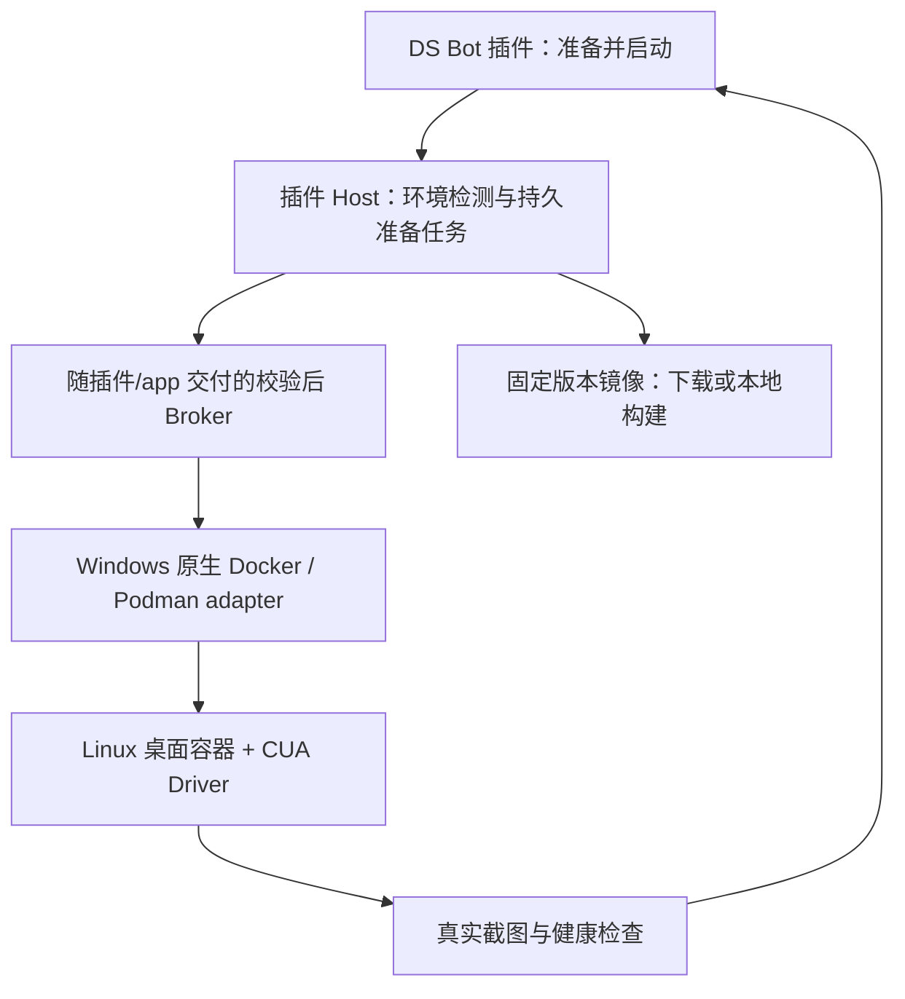

# CUA 首次准备与一键启动：OpenMausBot 源码调查

日期：2026-10-31。状态：**调查完成；A–C 功能已实现，Windows 首次无缓存与 GUI 验收未完成；D–E 尚未完成。具体证据见 §8。**

## 1. 结论

用户指出的问题成立：安装插件后，不应还要求普通用户填写 Broker 路径、
Linux Node 路径、WSL distribution 和镜像 ID，才能找到可用的私有桌面。
这些参数属于运行时实现，应该由产品发现、准备、校验和保存。

但 OpenMausBot 的本地桌面也不是在一台没有任何虚拟化环境的 Windows 上，
点击一次就能跳过所有系统准备。它有明确的四步首次设置：

1. 安装容器运行环境。
2. 启动容器运行环境。
3. 点击 Prepare Cua desktop，下载固定基础镜像并构建应用专用镜像。
4. 创建/启动私有桌面；后续复用已有镜像、容器和持久目录。

Windows 优先 Podman，Docker 可选。应用直接调用宿主上的容器 CLI，
由容器运行环境承担 Linux 运行层；应用自己的 MCP 桥随程序交付。
没有要求用户另配一个装有 Linux Node 的 Ubuntu distribution 来运行桥接。

它还提供云端电脑：通过 Boat API 创建/唤醒远端 sandbox，驱动已预装，
客户端无需本地 Docker/Podman。不能把云端体验当成本地零依赖的证明。

**DS Bot 应借鉴的是完整的运行时交付和首次准备流程。现有 WSL Broker 是已实现的
连接方式，不是 Windows CUA 必须采用的唯一架构。**

## 2. 调查范围和证据等级

- OpenMausBot 本地 checkout：`/mnt/d/code/Robert/OpenMausBot`。
- HEAD：`7de00e425848d5f1a2a845cb4784851b87d8cad2`，提交日期 2026-10-31。
- 核对当前工作区源码、安装配置、文档和验证说明；不声称该提交等于用户所装发行包。
- DS Bot：当前 `cua/2026-10-31` 工作区，包括此前尚未提交的 CUA 实现。
- 本轮未运行 OpenMausBot 安装器、未安装系统组件、未创建或操作用户的桌面。
- 网络工具没有返回可用结果，因此结论以本地源码为准，不宣称核实了在线最新版本。
- 下列 OpenMausBot 路径相对其根目录，DS Bot 路径相对本仓库；行号对应本次快照。
- 本文只分析实现思路，没有复制 OpenMausBot 业务代码到 DS Bot。

## 3. OpenMausBot 的真实调用链

### 3.1 首次准备不是一个万能 Start

`src/components/LocalComputerSection.tsx:1334` 明确渲染四个 Step。

| 步骤 | UI 实际行为 | 后端依据 |
| --- | --- | --- |
| 安装 runtime | 展示安装命令或 Podman 安装指南；不是调用自动安装 API | `server/container-computer.ts:1177` 的 `setupCommands()` |
| 启动 runtime | 展示启动命令或提示打开容器应用 | 同上 |
| 准备镜像 | 点击按钮，POST `/api/local-computer/pull` | `server/routes/computers.ts:287` |
| 启动桌面 | 按 missing/stopped 状态发 run/start | `containerComputerAction()`，`container-computer.ts:932` |

Windows 安装提示是 `winget install -e --id RedHat.Podman-Desktop`。
Podman 的启动提示是 `podman machine init; podman machine start`。
这里是**供用户执行的提示字符串**，不是应用悄悄执行安装或提权。

`containerComputerAction()` 在 runtime 不存在或 daemon 不可用时返回错误；
`run` 在镜像未准备好时也拒绝执行。由此可以确定：全新本地机器的 Start
不会自动包办 runtime 安装、系统启用和镜像准备。

### 3.2 运行环境由程序发现

`server/container-computer.ts:218` 的 `containerRuntimeStatus()`：

- Windows 依次考虑 Podman、Docker；其他平台另有 Apple container 分支。
- Windows 用 `where.exe` 探测 CLI。
- 用 `podman info --format json`、Docker info 等检查实际可用性。
- 选择可用且健康的 runtime；只有安装但没有启动时仍能给出明确诊断。
- `server/env-path.ts:68` 包含 Windows Podman 常见安装目录。

该实现不是要求同时安装 WSL、Docker 和 Podman。Windows Linux 运行层由选定
runtime 承担。仓库的 Podman 自托管方案明确采用 WSL2；不能据此推导所有配置
都无需 WSL，也不能把自己另配 Ubuntu/Linux Node 当作必备条件。

### 3.3 镜像不是用户手抄的 ID

`prepareManagedImage()`（`server/container-computer.ts:921`）执行：

```text
pull 固定 digest 的 trycua/xfce-cua 基础镜像
  → 创建临时构建目录
  → 写入 managedImageDockerfile()
  → runtime build -t 应用镜像
  → 删除临时构建目录
  → 再次检查镜像/桌面状态
```

- 基础镜像固定多架构 manifest digest。
- CUA Driver 固定 `0.37.0`；按架构选择 wheel，验证 SHA-256。
- 镜像内配置桌面启动、driver socket、持久工作目录以及 supervisor。
- 应用标签包括 driver、基础镜像、image layer 和归属信息。
- 应用构建标签用于查找；复用时还核对 inspect 得到的 image ID 和容器标签，
  不是只信任可变 tag。

首次下载和构建仍需要时间及联网。该路径通过等待命令结束和 UI pending 状态工作，
不是可直接照搬的持久后台下载任务系统。不能把现有 spinner 描述成精确下载百分比。

### 3.4 Windows 桥接无需额外 Linux Node

`containerComputerMcp()`（`server/container-computer.ts:1161`）用
`process.execPath` 启动应用自带 `container-mcp`，设置 `ELECTRON_RUN_AS_NODE`。

`server/container-mcp.ts:20` 再执行：

```text
应用 Node/Electron
  → 内置 stdio MCP bridge
  → podman/docker exec -i -u cua ...
  → guest 内 cua-driver mcp --socket ...
```

Linux socket 在 guest 内被 driver 使用，不要求 Windows Node 直接打开 Linux socket。
Windows 到 Linux 的运行层交给容器 CLI/engine，不经过“用户填写的 Linux Node”。

这不等于 OpenMausBot 没有桥接层；桥接被程序交付和管理了。
DS Bot 的 Broker 仍应保留为独立受限边界，只需调整其交付和宿主连接方式。

### 3.5 “容器 running”不等于“桌面可用”

`containerComputerStatus()`（`server/container-computer.ts:467`）核对：

- 镜像和容器归属。
- 回环地址上的 viewer、资源与能力限制、持久目录挂载。
- Driver 版本、socket 状态和 `health_report`。
- 实际 `get_desktop_state` 截图，并检查图像完整性。

`src/lib/local-vm-readiness.ts:1` 在容器运行但桌面未就绪时，每两秒再次读取状态，
默认最多等待 60 秒。面板的 `act()` 和 Bot 面板都会等待 readiness。

`server/index.ts:11816` 的 `readyLocalVmForTurn()` 能为符合条件的桌面创建/唤醒，
并等待 driver 准备好。它受 runtime、已准备镜像、容量和生命周期条件限制，
不负责为全新机器安装依赖。

### 3.6 后续升级也有自动化

`server/desktop-updates.ts` 不仅记录状态：

- 发现应用拥有的旧桌面或留下的持久目录与当前版本不兼容。
- 对多个桌面合并镜像准备，避免重复 build。
- 等待工作回合或用户操作释放桌面。
- 保存浏览器资料和应用相关数据，再重建已有桌面。
- 失败记录可解释状态，并保留重试路径。

这是“已有环境后续使用省事”的另一原因。它不能证明从未配置过的新机器
也会自动安装 runtime。DS Bot 已有显式升级/回滚事务，不宜直接改成无提示替换。

### 3.7 云端、本机桌面、Local VM 必须区分

| 模式 | 实际位置与启动方式 | 为什么看起来很省事 |
| --- | --- | --- |
| Local VM | 本地容器引擎中的 Linux 桌面；Windows Podman 优先 | 准备完成后复用镜像和数据，应用代管参数 |
| Cloud computer | Boat API 创建或唤醒 sandbox | 服务端预装 driver，本地只接 API 和 viewer |
| This computer | 控制实际宿主桌面 | 打包原生 CUA driver，不是创建隔离虚机 |
| Podman 整套自托管 | 应用服务、Caddy 和桌面都在 Podman 运行环境中 | 脚本集中准备 machine、socket、Compose 和配置 |

云端依据：`server/boat.ts:1072` 的 `provisionBoat()` 要求已配置账号，
创建或复用 sandbox、等待就绪、申请桌面链接；源码说明 sandbox 已自带 driver。
这不是不需要账号和服务端基础设施的本地替代品。

安装器依据：`electron-builder.yml:167` 交付 Windows 原生 CUA 可执行文件/SDK；
`nsis.oneClick` 是应用安装器设置，不是 Local VM 自动安装 Podman 的开关。

自托管依据：`deploy/podman/README.md` 和 `maus.ps1`：
WSL2/Podman 先安装；setup 再创建或启动命名 machine，准备 Compose、socket、配置。
这条脚本路径不能冒充桌面安装器已实现的首次设置流程。

## 4. DS Bot 当前缺口

| 环节 | 当前实现 | 对用户的实际影响 |
| --- | --- | --- |
| 入口 | 未启用 runtime 时已显示 ComputerSetup | 能发现功能，但只是说明页 |
| 插件交付 | `ds-bot/package.json` 的 files 不含独立 computer-runtime | 安装 `.tgz` 不等于获得 Broker payload |
| app 交付 | app 的打包 hook 已可带校验过的 payload | 仅独立 app 路径受益，普通 DSH 插件不能依赖它 |
| Windows transport | `providers/transport.js:6` 强制 WSL distro/Linux Node/Linux entrypoint | 暴露三项本可隐藏的配置 |
| Broker endpoint | `broker/boundary.mjs:1` 仅接受 Unix socket | 不能直接启用 Windows Docker named pipe |
| runtime 命令 | Broker、checkpoint、MCP 多处硬编码 docker | 增加 Podman 不能只改一处 executable |
| 镜像准备 | `runtime.mjs` 有 CLI build/check；Linux x64 校验 | UI 无法执行、恢复或观察准备任务 |
| 运行时启用 | `computer.js:8` 不 enabled 就立即返回 | 尚无未启用状态下的 setup service |
| 配置保存 | app 读环境变量中的配置文件，启动时生成 patch | 用户在通用 DSH 安装插件后没有同等入口 |
| 启动脚本 | `start-cua.ps1` 检查现有镜像并启动独立数据目录 | 无法给正在运行的通用 DSH 自动补齐配置 |

因此此前“底层功能接近完成”的工作量估计，不适合表示普通用户可用程度。
**安装插件 → 准备环境 → 看到桌面**这一条关键路径仍未交付。

## 5. 建议采用的架构

推荐 Windows 原生连接本地容器引擎，复用受限 Broker。
先补原生 Docker 路径以复用已有协议和存储实现，再以独立 adapter 接 Podman。
Podman 通过实际测试后可作为新用户推荐入口；不要迫使已有 Docker 用户换引擎。
既有 WSL 路径继续用于兼容已经创建的数据，不能静默切换引擎导致桌面“消失”。



这是一项架构调整方案，不表示当前 Broker 已能安全在 Windows 原生运行。
不改变 DSH agent loop，不修补 DSH 内部文件，不绕过现有 Computer 权限、租约、
generation、人工接管和工具范围。

### 5.1 通用 DSH 插件必须是首要交付入口

- 将轻量 Broker、guest helpers、lock、recipe、manifest 和 notices 纳入插件发布产物。
- app 和插件从同一份受控来源打包，不长期维护两份手工复制的 runtime。
- manifest 校验复用为一个公共模块；哈希清单只能检查内容完整性，来源仍依赖可信发行包。
- 在已安装插件包中解析 runtime 路径，验证实际文件与版本；不引用源码仓库路径。
- 通过现有 `api/bot` channel 加 setup API，使用插件自己的数据目录保存选择与任务。
- 不依赖 `app/src/computer-patch.mjs` 或 Electron 私有 bridge 才能启用。
- 使用已有公开 Host 能力管理子进程、持久文件与消息；若实际宿主禁止这些能力，
  明确返回 unsupported，不修改 DSH 绕过限制。

### 5.2 启用和启动分开

setup service 可在 runtime 未就绪时存在；读取设置页不应下载、build、启动或安装。

建议区分 `supported`、`configured`、`preparing`、`ready`、`blocked`，
而不是继续用一个布尔值表达全部状态。旧 roster 布尔值兼容保留。

配置优先级必须明确：

1. 管理者显式禁用时，不允许 UI 绕过。
2. 既有显式 Broker 配置继续生效。
3. 未配置时，用户点击准备后保存插件管理的 runtime 选择。

“配置缺省”与“显式 false”需制定迁移规则。不能简单将所有 false 改成自动启用。
动态启用也不能重复安装工具、监听器和 idle timer；服务管理器负责一次注册、
按状态提供服务，关闭和插件卸载时统一清理。

### 5.3 Native adapter 是完整适配，不是字符串替换

| 部分 | 必须补齐 |
| --- | --- |
| 发现 | CLI 位置、版本、引擎类型、Linux guest 架构、健康、存储身份 |
| Broker 启动 | Windows Node/Electron 运行已验证入口；不继承模型密钥 |
| Docker endpoint | 校验本地 named pipe；拒绝任意网络 endpoint，固定已核验 context |
| Podman endpoint | 识别本地 machine 与 connection 的对应关系，不能把任意 SSH URL 当本地 |
| inspect | Podman 字段/能力集规范化，维持已有隔离断言 |
| 命令 | main、MCP、checkpoint、storage、file helper 均使用固定 adapter |
| 存储 | named volume 标签、UID/GID、恢复/升级 helper、挂载语义逐项验证 |
| 退出 | windowsHide、子进程退出/中断、stdio backpressure、Broker 崩溃回收 |

将 engine identity 和 endpoint 与 Computer 数据绑定；镜像 ID 属于具体 image store。
只按“哪个 CLI 当前优先”切换会丢失原卷和镜像的视图，应禁止静默切换。
多引擎机器的选择保存后固定，迁移必须是独立明确操作。

### 5.4 镜像和 Broker 配置由程序管理

- Broker 随包交付，不要求用户下载安装独立 Node 或填写 entrypoint。
- 第一阶段在 Host 任务中调用现有固定 recipe 构建，UI 展示真实阶段和有界日志。
- 后续发布经过测试的 OCI 镜像，按 digest 拉取，减少用户机器上的 build 负担。
  当前没有据此调查而产生的新镜像仓库或可用发行 artifact，不能先填写虚构 URL。
- recipe 和 OCI 发布都要验证 driver/protocol/arch/归属，再保存本地 immutable ID。
- 不接受模型提供的下载 URL、Dockerfile、shell、image tag 或执行参数。
- 把来源 manifest digest 与最终本地 image ID 分别保存，不能混为一个标识。
- 默认离线 guest 不因镜像准备需要联网而改变；联网桌面属于另一个明确功能。

### 5.5 可恢复的准备任务

建议新增只对用户管理通道开放的操作：

| 操作 | 含义 |
| --- | --- |
| `computer-setup-state` | 读取环境、选择、任务和下一步；无变更副作用 |
| `computer-setup-prepare` | 提交一个有 ID 的准备任务；重复点击合并 |
| `computer-setup-cancel` | 取消当前准备任务；核对已产生资源再结束 |
| `computer-setup-retry` | 从重新核对后的步骤继续，复用完整缓存 |

推荐状态：

```text
not-configured → checking
  → needs-runtime / needs-system-action / runtime-stopped
  → preparing-image → verifying-image → configuring
  → starting-desktop → checking-desktop → ready

失败 → failed（stage、可解释错误、可重试性）
取消 → cancelling → cancelled
```

任务与 UI 组件生命周期分离；关面板再打开应恢复同一任务。
重启 Host 后先 reconcile 引擎真实状态，不根据旧日志盲目重放创建或删除。
image preparation 按 engine+digest/recipe 合并，桌面创建按 Bot 身份幂等处理。

build 进度不伪造百分比；有可信字节总量时才显示下载百分比。
长任务使用后台 job 与状态更新，不让一次 UI HTTP 请求承载整个安装过程。
取消不做全局 prune，只清理由本任务明确拥有的临时资源。

### 5.6 初次 Windows 系统依赖的产品体验

已有健康引擎：一个“准备并启动”按钮完成镜像准备、配置、创建和等待截图。

尚未安装引擎：页面显示缺失项和安装入口。第一阶段提供经过验证的官方安装引导；
要实现应用内安装，则作为独立安装任务，限定来源/参数并正确显示系统提示与结果。

需要 Windows 虚拟化、系统权限或重启的步骤必须明确显示。用户接受系统操作后，
任务保存断点，重新打开继续。不能把需要重启的系统配置承诺成无等待、无交互。

WSL2 如果由 Podman machine 或所选 runtime 管理，就不再要求用户选择额外 Ubuntu、
安装 Linux Node 或维护 Broker 的 Linux 路径。

远程访问 DSH Web 时要显示“运行在 DSH 服务所在机器”，不能把服务器准备误写成
在浏览器所在的 Windows 上安装。远端用户管理权限必须沿用 Host 的真实授权边界。

## 6. 开发顺序和完成门槛

| 批次 | 工作 | 必须交付的证据 |
| --- | --- | --- |
| A | 插件 runtime 交付、setup service、配置迁移、任务记录 | 实际 npm tarball 内含 payload；隔离安装能发现路径；未配置时不再只有静态说明 |
| B | Windows native Docker adapter、endpoint 固定、完整 Broker helper 适配 | 原生 Windows Node 到 Linux guest 的创建、截图、输入、文件、备份/恢复与退出 |
| C | UI 准备并启动、构建日志、取消/重试/刷新恢复、自动保存 | 已安装 Docker 且没有桌面镜像的 Windows 上从插件 UI 完成首次启动 |
| D | Podman adapter、machine 检测/启动、Windows 挂载和存储矩阵 | 真实 Podman 跑同一套生命周期与数据测试；多引擎不串库 |
| E | 引擎安装引导、系统重启恢复、OCI 固定镜像发布 | 干净 Windows 环境记录完整首次设置；签名/分发按发行要求验收 |

每批按变更执行仓库要求的 build、单测、lint 和 Host smoke。
普通 UI/adapter 模拟测试不能替代原生 Windows 验收；Windows GUI 仍由用户测试。
开发中只使用自己的临时数据、容器、卷和端口。

### 最低用户验收

1. 在现有 Windows DSH 中安装插件，**无需源码仓库或 start-cua.ps1**。
2. 打开一个 Bot 的私有桌面，看到环境检测结果和唯一明确的下一步。
3. 已有健康 runtime 时，点击准备并启动后，无须手填任何 Broker/Node/image ID。
4. 首次有阶段、错误和重试反馈；关闭/重新打开面板不丢任务。
5. 桌面截图可用后才显示 Ready；driver 慢启动不会把入口移除。
6. 重启应用后仍能找到同一桌面及文件；停止后再次启动不重复下载/初始化。
7. 原有 WSL 桌面和用户其他容器保持归属明确，不自动迁移或删除。
8. Docker/Podman 未安装、未启动、磁盘不足、下载中断时各有具体处理方式。
9. 系统禁用虚拟化/需要重启时正确停在对应步骤，重启后可继续。
10. 通用插件和独立 app 各自验收，不能用后者通过来代替前者。

## 7. 对原开发计划的修正

这项工作属于原计划 P4 的镜像准备和 P5 的平台/发行交付缺口，直接影响用户首次使用。
优先级应高于新增远程 provider、共享电脑或更多模型动作。

交付表达应分开记录：

- CUA 操作与数据生命周期已实现的范围。
- 普通插件用户首次启动链路是否完成。
- 原生 Windows 与实际安装包是否验收。

本轮只新增调查与改造方案，没有新增一键启动功能，没有替用户更改已装插件或运行环境。

## 8. 开发记录：插件内准备与 Windows 原生 Docker

用户批准方案后，在同一分支实现以下改动；本节取代前面的“本轮只新增调查”状态。

- 插件 npm files 包含生成的 `computer-runtime/`，build/prepack 从共同源码准备
  19 个文件和 manifest。新增 `build-computer-runtime.mjs --check` 检查内容与源文件一致。
- 插件先用自身可信 verifier 检查完整 payload，再导入 runtime；app 打包时将插件
  payload 放到 asar 外，CLI 可以读取真实构建目录。
- `computer/setup.js` 提供持久 setup job、每两秒保存的有界日志、重复请求合并、
  task ID 限定取消、失败重试和 Host 重启后的 interrupted 状态。
- `computer-setup-state/prepare/retry/cancel` 接入现有用户管理通道，不注册为模型工具。
- 配置缺省时提供准备流程；显式 false 禁用，显式 Broker 配置优先。
  既有 registry 没有 setup 配置时拒绝猜测原引擎，保留原 WSL 路径。
- `engine.mjs` 检查本地 Docker、Linux x64 guest、Windows named pipe/Unix socket，
  保存 engine ID 和 endpoint；更换 daemon 后拒绝静默重建。首次 build 前就保存选择。
- Broker 原生运行于 Windows Node/Electron，MCP、checkpoint、文件 helper 统一使用
  已选 Docker executable。WSL transport 继续兼容。
- 准备流程使用固定 recipe 构建，自动取得 image ID，创建 observe-only 桌面并等待
  真实 preview。用户可随后开启 operate 和 YOLO。guest 仍断网。
- 前端状态独立于 roster revision 更新；准备阶段不提前跳走丢失日志，面板关闭不取消
  后台任务。初次准备有 Docker 安装入口和系统重启提示。

新增 `ds-bot/dev/computer-setup-smoke.mjs`，在隔离目录测试插件 payload 的发现、
首次镜像准备、真实截图、文件往返、checkpoint 和停止/再启动；只清理本次生成的
Computer 身份及卷。测试不使用用户 DSH 数据。

**尚未完成：**Podman adapter/machine 管理、应用内安装系统 runtime、自动系统重启恢复、
预构建 OCI 镜像发行、签名安装器和 Windows GUI 人工验收。Docker 首次构建仍依赖
镜像 registry 和 Python 包索引网络；无可信字节总量时只显示日志和阶段。

最终测试结果、Windows 原生链路与通用 Web smoke 的限制记录在
`computer-runtime/VALIDATION.md`，不以单测数量代替 Windows 用户验收。

本轮最终验证：插件单测 1394 通过、2 跳过；build、生成文件校验和 lint 通过
（lint 有警告）；原生 Windows 缓存镜像链路、实际构建取消以及解包后的插件链路通过。
通用 Web smoke 51 通过、1 项首次模型选择出现 `fetch failed`，仍作为未解决例外保留。
首次无缓存构建在下载阶段超出测试预算，不能据此宣称 C 批次验收完成。
本地测试包为 `artifacts/ds-bot-0.2.5-cua.2.tgz`，没有发布或替换用户已装插件。


## 9. 2026-11-01：Podman adapter 与镜像候选发行

D 批次已增加实验性 Podman adapter、显式引擎选择、专用 machine 准备、固定连接与
存储身份，以及所有 Broker/helper 路径的适配。由于本机没有 Podman，真实生命周期
验收尚未完成，不能把 D 标为已验收。

E 批次已增加手动候选镜像构建/验证/发布 workflow，插件支持 lock 中固定 digest
的发行镜像；当前没有发布镜像，也没有填写虚构 digest。自动系统安装、签名发行、
干净 Windows 首次无缓存及 GUI 验收仍待完成。准备任务支持在重启后由用户重试，
保留原先明确选择的 Podman machine 准备步骤，不在应用启动时重放系统修改。

细节见 [Podman 与镜像交付](2026-11-01-cua-podman-and-image-release.md)，最终测试
与仍未解决的 Web 连接问题见 `computer-runtime/VALIDATION.md`。
