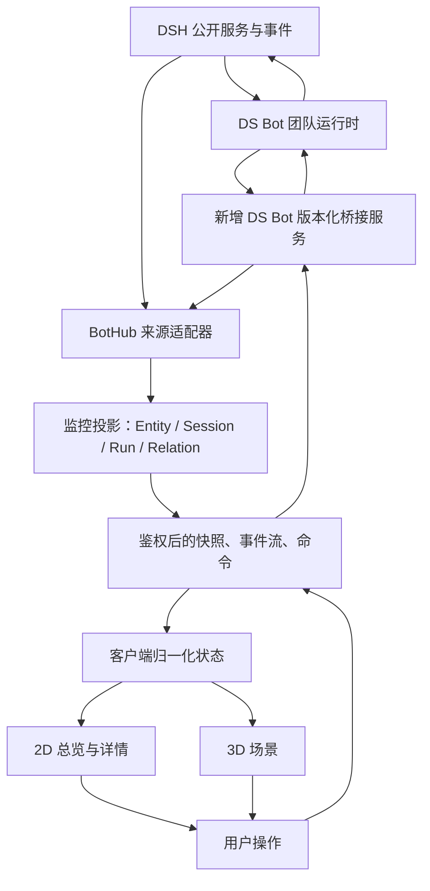
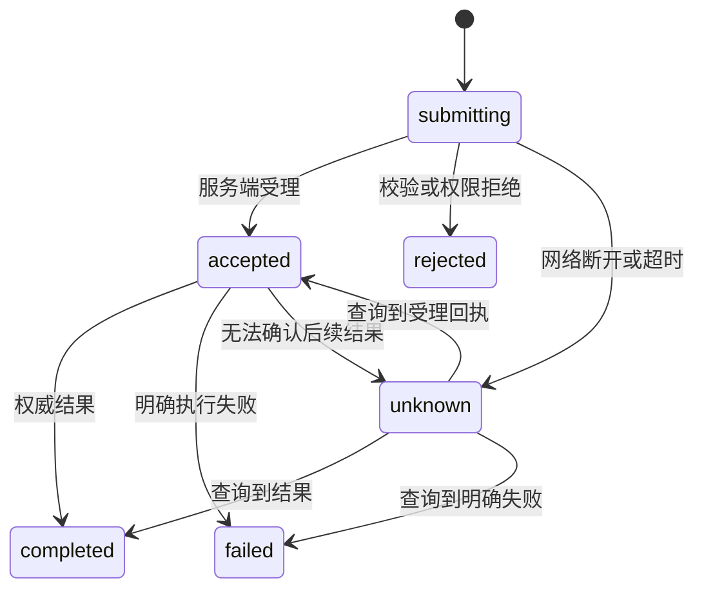

# dsh-bothub：Bot / Agent 运行监控与 3D 交互插件开发计划

- 编写日期：2026-11-07。
- 状态：**整体路线图仍为提案；用户已授权按 MVP 推进，首个开发切片已实现并完成本地验证**。实际范围、取舍与验收见 [MVP 记录](2026-11-07-dsh-bothub-mvp.md)，不能将本文所有后续能力视为已实现。
- 目标：在现有 `ds-bot` 与 DSH 上增加独立插件 `dsh-bothub`，提供可信的运行监控、3D 团队视图和指向真实会话的交互。
- 命名：本仓库现有包名是 `ds-bot`；新包按需求命名为 `dsh-bothub`，产品显示名暂定 `BotHub`。
- 参考代码：本机 `D:\code\Robert\crewhub\crewhub`，对应 WSL `/mnt/d/code/Robert/crewhub/crewhub`。
- 调研基线：DS Bot 本地 HEAD `ae0ee82`，工作区包版本 `0.2.16`；CrewHub 本地 HEAD `1bd8bb8e`，前端包版本 `0.19.5`。版本均指本地快照，不表示上游最新发布。
- 限制：DS Bot 工作区存在大量未提交修改；尝试获取 `origin/dev` 时，远端报告该分支不存在。本文以本地文件为证据，不宣称基于最新 `dev`。本地实现保留现有工作区，提交 PR 前须确认正确上游与目标分支。
- 交付范围：开发计划及获准实施的首个 MVP；不复制 CrewHub 源码或素材，不启动用户的 Bot，不修改 DSH。验证只使用隔离测试台和仓库 mock model。

阅读导航：

- 产品定位与范围：第 1–4 节。
- 架构、数据与接口：第 5–11 节。
- 3D 交互、隐私、存储与性能：第 12–15 节。
- 代码拆分、排期、任务与测试：第 16–19 节。
- 风险、待决策项、验收与来源：第 20–24 节。

## 1. 建议结论

**建议做，并且把它定位为“团队运行的可视化观察与操作入口”。**

DS Bot 已经负责长期身份、记忆、模型、群聊、派活与执行。BotHub 应把这些真实状态变成易懂的空间界面，让用户看见谁在做事、在哪个会话做事、在等谁、哪里需要用户介入，并能从场景直接打开对应会话或发送消息。

推荐组合：

> DSH 执行 Agent → DS Bot 管理团队语义 → BotHub 整理监控数据 → 2D / 3D 展示 → 用户操作交回现有执行通路。

第一版的成功标准是：用户能在几十秒内找到需要关注的 Bot，并完成一次有效干预。角色精细程度、办公室装饰数量和动画复杂度不作为首版成功标准。

### 1.1 为什么适合建立在 DS Bot 上

1. 长期 Bot 身份可以成为稳定的 3D 角色；会话换段后不用重新生成一个“人”。
2. 群聊可以映射成协作房间，成员的实际工作会话可以成为房间中的活动实例。
3. 派活与等待关系可以成为可点击的协作连线。
4. 审批、提问、失败等状态可以在空间中集中提示。
5. 已有 React 客户端、主题、模型执行和测试模型可以继续使用。
6. 监控与 3D 本身不应新增模型调用；用户发消息时才进入现有 Agent 流程。

### 1.2 建议采用的产品边界

| 层次 | 负责什么 | 不承担什么 |
|---|---|---|
| DSH | Session、Agent 回合、模型请求、工具执行、原生审批与会话界面 | BotHub 的场景布局 |
| DS Bot | Bot 身份、群成员、私聊/群聊映射、派活、权限、记忆 | 3D 渲染、镜头与摆设 |
| BotHub host | 统一监控投影、受控查询、操作分发、事件恢复、布局持久化 | 第二套 Agent 调度器 |
| BotHub client | 2D 总览、3D 场景、详情、时间线、用户操作入口 | 自行判断操作权限或执行工具 |

不建议另起一套 Python 后端、Agent 数据库或新桌面壳来承接首版需求。这样会重复身份、状态、认证和部署工作，也会增加与 DS Bot 数据不一致的机会。

## 2. 调研证据与可借鉴内容

### 2.1 CrewHub 的实现观察

以下结论来自指定的本地代码；具体文件索引见第 23 节。

| 参考点 | 本地实现证据 | 对 BotHub 的启发 | 采用范围 |
|---|---|---|---|
| 3D 技术栈 | `frontend/package.json` 使用 React、Three.js、React Three Fiber、Drei | React 页面与 3D 场景可以分层组织 | 重新选版本，不照搬依赖清单 |
| 场景入口 | `World3DView.tsx` 组织 Canvas、房间、角色及详情界面 | 一个场景根，业务面板独立 | 保留这种职责划分 |
| 角色组件 | `Bot3D.tsx` 组合外观、活动提示、状态、移动与点击 | 角色是业务实体的视觉投影 | 原创模型与动画，减少首版移动逻辑 |
| 分级聚焦 | `WorldFocusContext.tsx` 管理 overview / room / bot 等层次 | 全局 → 房间 → 角色三级导航足够直观 | 首版只实现这三级 |
| 实时订阅 | `sseManager.ts` 管理共享 SSE 与重连 | 避免每个角色单独建连接 | 每个页面一条受控数据流 |
| 会话更新 | `useSessionsStream.ts` 有重连拉取、轮询回退、合并更新与本地缓存 | 状态恢复与渲染节流需要单独设计 | 借鉴机制，不保存原始会话到浏览器缓存 |
| 多来源连接 | `backend/app/services/connections/base.py` 抽象不同 Agent 来源 | 提前定义身份与能力模型 | 首版只做 DS Bot / DSH |
| 父子会话 | `sessionUtils.ts` 有基于 key 格式的子会话判断 | 子 Agent 应有父子关系可视化 | 使用 DSH 明确关系，不猜名称格式 |
| 场景暂停 | `World3DView.tsx` 在页面隐藏时停渲染 | 监控页面不能持续无意义占 GPU | 作为首版验收项 |
| 网格与寻路 | `lib/grid/`、`botMovement.ts` 等组织布局与移动 | 后续可扩展房间编辑和空间导航 | 首版固定席位，不做寻路系统 |

**需要主动避免的问题：**

- “最近有 token 变化”只能辅助判断活跃度，不能证明某个回合已经完成。
- 只比较更新时间和 token 数量，可能漏掉审批、能力或状态的变化；BotHub 使用显式版本与字段更新。
- 一个 Session 不等于一个长期 Bot，也不等于一次执行。
- 角色在场景中走动不证明真实发生了派活；派活必须能追溯到实际关系或事件。
- 不将 CrewHub 的任务看板、会议系统、外部连接器和场景编辑器全部塞进首版。

### 2.2 原创与许可证边界

CrewHub 本地 `LICENSE` 为 GNU AGPL v3，README 标注 AGPL-3.0。本仓库要求原创材料，并限制第三方代码的引入条件。因此本计划采用以下工程边界：

1. 参考其功能拆分、信息组织和通用技术方法，独立实现 BotHub。
2. 不复制、翻译移植或改名搬运 CrewHub 的组件、着色器、布局 JSON、角色造型、图标、文案及素材。
3. 不通过 iframe 嵌入 CrewHub 来冒充新的 DSH 插件。
4. 3D 角色采用独立设计，优先程序化几何；装饰先使用少量原创几何体。
5. 新增依赖逐项检查实际发行版本的许可证；符合仓库规则后记录来源与所需 notice。
6. 若以后确实希望复用 CrewHub 代码，先取得适用授权并重新评审发行方案；不能把 AGPL 代码简单改标为 Apache-2.0。

这是本提案的实现边界；不把“可阅读源码”解释为“可按本项目许可证复制”。

### 2.3 DS Bot 已具备的能力

| 能力 | 当前证据 | 可用程度与注意点 |
|---|---|---|
| 独立插件入口 | `ds-bot/index.js` 的 `name`、`inject`、`apply` | 可以按现有 DSH 插件模式设计新包 |
| 客户端发现与打包 | `package.json` 的 `./client`、`dsh.client`；`scripts/build-client.mjs` | React / ReactDOM 由宿主提供；不能直接复制普通 Vite SPA 的装载方式 |
| 团队快照 | `channel.js` 的 `state` 分支 | 有 Bot、群、普通 DSH Agent 登记、只读状态及实时状态 |
| 当前活动 | `turns.js` 的 `activityView()`、`workView()` | 已有 thinking / searching / working / sending / waiting / alert 等分类 |
| 活动说明 | `doingOf()` | 有工具名、摘要、目标等，但展示前仍需字段白名单与敏感信息处理 |
| 会话运行起点 | `turnsView()` | 可用于已知执行的持续时间；不能替代完整 Run 模型 |
| SSE 通知 | `feed.js` 的 `api/bot/feed` | 有 hello / revision / live / message / stream |
| 发消息 | `channel.js` 的 `send` | 最终进入 `sessionController.prompt`，当前使用 queue 模式 |
| 审批与群停止 | `approval-answer`、`stop-member-work`、`stop-room-work` | 可以复用语义，但须补作用域校验与操作回执 |
| 用量 | `usage`、`run-stats` | 后者依赖可选的 `sessionProjections`，可能返回 null |
| 普通 DSH Agent | `agents.js` 与 `state.agents` | 当前为团队的普通 DSH 入口，不能当成任意外部 CLI Agent 的支持证据 |
| 主题及 UI | `docs/design/ui-standard.md`、客户端主题与动作模块 | 颜色、字体、弹簧、低动态效果应沿用既定要求 |
| 模拟与测试 | `dev/mock-llm.mjs`、`dev/bench.sh`、现有测试 | 可用无密钥数据建立回归场景 |

### 2.4 必须补齐的缺口

1. **现有 feed 不是完整事件日志。** 没有用于断线补发的 SSE `id` 和统一事件序列；`revision` / `live` 主要用于通知重新取状态。
2. **现有消息流覆盖有限。** `feed.js` 的聊天与文本流依赖 `chatOwners`；不能据此承诺普通 Agent、全部群成员会话、子 Agent 均有完整流。
3. **Bot 活动有聚合损失。** `workView()` 优先展示私聊，其次群工作；监控全部并发执行需要额外的逐 Session 映射。
4. **状态读取可能产生初始化行为。** 当前 `state` 分支在非只读状态下会调用 `bootstrap()`。新监控只读接口不得因为打开面板而创建 Bot 或触发问候。
5. **当前发送接口不等于可靠幂等命令接口。** `send` 在服务端生成新的随机 `requestId`；客户端超时后重发可能被视为新消息。
6. **现有接口不是已声明稳定的跨插件契约。** 没有看到可直接依赖的版本化 DS Bot 监控服务，需要在 DS Bot 自己的边界上补充。
7. **停止和审批不能靠统一按钮猜测。** 需要明确到会话、回合、审批请求和群范围。
8. **公开 UI 插槽与宿主兼容性还需实测。** 现有代码的使用是线索，不等于所有目标版本都提供同样的公开 API。

## 3. 用户场景与验收目标

### 3.1 场景 A：查看团队

用户打开 BotHub，看到团队成员、当前运行数、等待输入数、失败数以及数据连接状态。切换到 3D 后，相同数据映射到工位和协作房间。

验收：

- 2D 与 3D 展示相同的成员和统计。
- 用户能按名称、角色、群、状态筛选。
- 所有状态有文字解释，不能只依赖颜色与动作。
- 数据未就绪、团队为空、桥接服务缺失是不同的状态。

### 3.2 场景 B：找到需要介入的执行

某 Bot 在一个群工作时等待审批，同时私聊还在运行。总览优先标出需要用户介入；点击角色后列出两个执行上下文，用户选中对应的群工作。

验收：

- 不因为私聊活跃而隐藏群内审批。
- 操作入口显示目标会话及所属群。
- 等待审批与等待另一个 Bot 有不同标记。

### 3.3 场景 C：通过 3D 发消息

用户点击 Bot，镜头聚焦，右侧出现详情和快捷输入。发送前界面明确显示“发给谁 / 哪个会话”；发送后可打开完整原生聊天查看结果。

验收：

- 一次确认产生一次请求。
- 消息实际进入 DSH / DS Bot 会话，可在原界面查到。
- 会话换段时重新解析目标，避免写入过时段。
- 超时后显示“结果待确认”，不会静默重发。

### 3.4 场景 D：查看协作关系

用户选择一个 Main Bot，看到它派给其他 Bot 的工作和等待关系；点击关系线打开证据摘要或对应会话。

验收：

- 关系来自真实派活或明确父子关系。
- 连线区分“等待结果”“已返回”“失败”“仅发送消息”。
- 没有关系数据时不生成装饰性协作连线。
- 此场景完整版本放入 v0.2；v0.1 只显示真实等待摘要。

### 3.5 场景 E：连接中断与恢复

DSH 重启或网络短暂断开，角色保留最后已知位置，显示数据陈旧；重连后重新取快照并恢复订阅。

验收：

- 断开不会把所有 Bot 改成失败或空闲。
- 连接健康与 Agent 工作状态独立展示。
- 恢复后没有重复角色、重复消息或重复执行。

## 4. 版本范围

| 功能 | v0.1 可用首版 | v0.2 监控增强 | v0.3 以后 |
|---|---|---|---|
| DS Bot 身份与群 | 完整 | 增强过滤 | 跨实例选择另行设计 |
| 普通 DSH Agent | 已登记会话的发现、状态与打开；以公开 API 验证为门槛 | 扩大可观测范围 | 外部来源接入 |
| 子 Agent | 有明确父子数据时展示；不完整时说明缺失 | 完整父子树与生命周期 | 多来源父子关系 |
| 2D 总览 | 必须 | 高级筛选 | 更多布局 |
| 3D 场景 | 单场景、固定工位、群房间、三级聚焦 | 原创外观扩展、布局编辑 | 可选寻路与多场景 |
| 详情与活动 | 当前状态、执行列表、最近结构化事件 | 历史检索与统计 | 更多分析 |
| 发消息 | 明确目标的快捷发送与原生会话跳转 | 更多受控操作 | 外部 CLI 交互 |
| 停止 | 可验证的单执行停止、现有群范围停止 | 增强批量预览 | 不自动恢复任务 |
| 审批 / 提问 | 提示并打开原生处理入口 | 验证完整契约后内嵌部分卡片 | 不做自动代批 |
| 协作关系 | 等待摘要 | 真实派活图与子 Agent 图 | 历史回放 |
| 用量 | 有权威数据则显示，无则显示未知 | 趋势、按会话汇总 | 有价格来源后才评估成本 |
| 历史存储 | 有界内存事件；当前状态可重建 | 可选、脱敏、可清理的本地历史 | 导出与回放 |
| 外部 Agent | 不做 | 仅定义扩展协议 | 经单独评审后接入 |

### 4.1 首版明确不做

- 新的任务调度、计划执行、自动派活或自动修复系统。
- 任意命令终端、浏览器遥控和电脑操作的第二套实现。
- 全套聊天界面重写，包括工具卡片、附件和复杂审批。
- 物理碰撞、第一人称游戏、VR、多人同场景和声音聊天。
- 模型生成 3D 资产、在线素材市场、任意脚本场景。
- 自动扫描其他产品的用户数据目录。
- 未经明确选择，监控同机所有 DSH workspace 或所有历史会话。

## 5. 概念模型：身份、会话、执行与空间分离

这是最重要的设计约束。

| 概念 | 含义 | 稳定标识建议 |
|---|---|---|
| Entity | 长期 Bot 或明确登记的 Agent 身份 | `sourceId + entityId` |
| Session | 一段真实 DSH 会话 | DSH 的 `sessionId` |
| Run | 某 Session 中的一次执行回合 | `sourceId + sessionId + turnId` |
| Attempt | 一个回合内的一次模型尝试或流 | DSH attempt 标识，若可获得 |
| Group | DS Bot 的真实群聊 | `groupId` |
| Space | BotHub 的可视化房间或区域 | `spaceId` |
| Presence | 某 Entity / Session 在某 Space 的显示实例 | `entityKey + spaceId + contextKey` |
| Relation | 派活、等待、返回、父子执行等事实关系 | 来源关系 ID；不可用时不猜 |
| Command | 用户的一次明确操作 | `commandId` |

规则：

1. Bot 换 Session 段时 Entity 不变；旧 Session 保持可追溯。
2. 同一个 Bot 可以存在多个活动 Session；详情必须列出执行上下文。
3. 团队总览按 Entity 去重，运行数按 Run 统计；不把两者混用。
4. 群房间内可显示同一 Bot 的上下文实例，标签明确群名；不重复计算团队人数。
5. 主工位位置由用户布局决定，不随每条活动事件来回跳动。
6. 群成员身份与“正在这个群执行”分开表示；有席位不表示正在发言。
7. 普通 Agent 的多个 Session 可在详情展开，不强行解释为多个长期 Bot。
8. 子 Agent 用明确父 Session / Run 关系关联；父亲暂时不可见时标记“父执行不可见”，不按名称匹配。
9. Room 在 DS Bot 中表示群，在场景中表示空间；代码建议使用 `groupId` 与 `spaceId`，避免同名混淆。

### 5.1 群与空间映射

v0.1：

- 一个团队大厅：展示所有可见 Entity 的主工位。
- 一个群对应一个只读协作空间：展示成员及当前群执行。
- 一个 Agent 区域：展示普通 DSH Agent 的会话概览。
- 关注列表是筛选条件，不是把真实 Bot 从原群移动出去。

拖拽仅改变视觉工位或自定义分区。若将来提供“加入群聊”，必须作为独立业务操作：展示成员变更、检查权限、由 DS Bot 执行，成功后更新空间。拖动角色不能隐式改权限、工作目录、模型或群成员。

## 6. 总体架构



图中的“DSH → Adapter”只允许使用公开且在目标版本中已验证的服务；不能读取 DSH 安装目录内部实现、抓私有对象或拦截其内部通信。

### 6.1 新包与旧包的关系

推荐新增同仓库目录 `dsh-bothub/`，作为单独发布、启用、禁用的 DSH 插件。

- DS Bot 增加小型公开桥接层；桥接层在 DS Bot 内部读取已有运行时。
- BotHub 只依赖桥接契约，不跨包导入 `ds-bot/src/host/*.js`。
- 不通过 `createRuntime()` 再创建一份 DS Bot runtime；现有团队只能由原实例管理。
- BotHub 卸载只撤销订阅、界面和自身资源；不停止实际 Bot。
- DS Bot 不可用时显示依赖状态；若普通 DSH 适配器可独立工作，可继续展示明确支持的会话。
- `ds-bot` 不反向依赖 Three.js 或 BotHub 的 UI。

### 6.2 建议的桥接契约

以下名称全部是**拟新增接口**，不是已经存在的 DSH API。实际 Cordis 服务注册方式在 P0 验证。

```ts
interface BotHubBridgeV1 {
  describe(): BridgeCapabilities
  snapshot(scope: AuthorizedScope): Promise<BotProjection>
  subscribe(scope: AuthorizedScope, listener: ChangeListener): Dispose
  resolveTarget(scope: AuthorizedScope, target: LogicalTarget): Promise<ResolvedTarget>
  dispatch(scope: AuthorizedScope, command: ValidatedCommand): Promise<CommandReceipt>
}
```

要求：

- `snapshot()` 只读取，不调用团队 bootstrap、不发问候、不解析或返回密钥。
- 投影包含长期身份与逐 Session 归属，不能只包装 `workView()` 的单 Bot 摘要。
- 不返回 `rt`、DSH Agent 原始对象、完整 state、系统提示、原始工具参数。
- 能力中分别声明读取状态、历史、发送、停止、群停止、原生跳转、审批定位等。
- 桥接版本不兼容时显示可诊断错误，禁止按“可能是这个字段”继续执行命令。
- 订阅回调必须有界、可撤销；消费方失败不能传播到 Agent 的执行监听器。

### 6.3 现有 API 的使用策略

`api/bot` 和 `api/bot/feed` 适合 P0 验证与兼容性实验。生产 v0.1 优先使用显式桥接与新的最小监控通道，原因是：

- 现有快照包含监控不需要的配置数据。
- 现有读取可能触发初始化。
- feed 不能保证补发和完整执行覆盖。
- 现有 `send` 不能证明超时重试幂等。

若维护者暂不接受桥接改动，只能发布能力受限的观察预览版：已初始化团队的快照、明确标注的有限状态、原生会话跳转。不能在文档中把它描述为完整运行监控版本。

## 7. 前置验证：P0 必须解决的技术门槛

每个门槛都要留下“目标版本、公开文档出处、最小实验、结论、缺失能力”，不能只凭函数名字判断支持。

| 编号 | 验证内容 | 成功标准 | 失败后的处理 |
|---|---|---|---|
| G1 | 正确仓库与开发基线 | 找到维护中的上游及 `dev` 工作流 | 记录环境差异，编码前明确分支方案 |
| G2 | DSH 插件装载、生命周期 | host / client 可装载、卸载、重载，无残留订阅 | 停止插件实现，提交明确缺口 |
| G3 | 独立 UI 挂载与导航 | 用公开插槽挂载完整 Hub，并可回到原会话 | 使用已支持的公开面板；没有可行表面则向 DSH 提需求 |
| G4 | 桥接服务发现 | DS Bot 先后加载均可发现，卸载时安全失效 | 不用全局变量或 monkey patch 代替 |
| G5 | 普通 Agent / 子 Agent 可观测性 | 能列出现有授权会话、当前回合、明确父子关系或说明缺失 | 按能力降级，未覆盖范围写进首版限制 |
| G6 | 事件与快照一致性 | 启动、结束、工具调用、审批等不丢关键终态 | 增加 DS Bot 投影事件；DSH 不公开的数据暂不承诺 |
| G7 | 命令与幂等 | 验证请求 ID、回执、错误及目标重校验 | 不确定请求不自动重放 |
| G8 | 认证与作用域 | 无认证、跨 workspace、过期权限请求均不能读写 | 不发布有写能力的预览 |
| G9 | React 与 3D 打包 | 单一宿主 React、真实客户端装载成功 | 选择原生 Three.js 适配，不嵌入另一份 React |
| G10 | 桌面与 Web 的资源路径 | 子路径部署、离线资源、CSP、重载均通过 | 暂限已验证平台，并声明支持范围 |

“停止”指停止依赖缺失能力的实现；其他已独立验证的只读部分可继续。任何门槛都不能通过修改 DSH 安装文件来绕过。

## 8. 技术选型

### 8.1 推荐方案

| 部分 | 推荐 | 原因 |
|---|---|---|
| host | ESM JavaScript + JSDoc 类型 | 与 DS Bot 保持一致 |
| 客户端业务 UI | 宿主 React + 独立模块 | 复用现有平台 React，不新建应用运行时 |
| 3D 渲染 | Three.js，首版采用薄 React 容器封装 | 降低对 React 自定义 renderer 的额外版本耦合 |
| R3F | P0 备选，通过版本与打包验证后可选 | 组件化更方便，但必须与宿主 React 主版本配对 |
| 状态管理 | 归一化 store + selector + `useSyncExternalStore` | 与仓库已有数据源方式接近，限制无效重渲染 |
| 传输 | 宿主认证下的 HTTP 查询 / 命令 + SSE | 监控以服务端推送为主，首版无需新增 WebSocket 协议 |
| 构建 | 继承当前插件构建约定，独立构建脚本 | 不假设宿主能加载普通 Vite 的 HTML 入口 |
| 单元测试 | Node test，必要时 jsdom | 复用现有测试习惯 |
| 浏览器验证 | 真实 DSH 测试台 + 浏览器自动化 | 验证装载、点击、输入、会话路由与 GPU 降级 |
| 布局存储 | BotHub 专属、版本化的小型 JSON | 首版无须引入数据库 |

Three.js 的按需绘制与资源释放方式见外部参考 W1、W2。R3F 官方明确要求 renderer 与 React 主版本对应，见 W3。不能根据 CrewHub 的 package.json 就认定 DSH 宿主支持同一套依赖。

### 8.2 选择 R3F 的条件

只有以下条件全部满足，才在 P0 的选型记录中改用 R3F：

1. 查明目标 DSH 平台提供的 React / ReactDOM 版本。
2. 选定与之匹配的 R3F / Drei / Three 版本，锁定依赖。
3. 真实装载验证不存在双 React、缺失 `react/jsx-runtime`、不兼容的 reconciler 或 CJS / ESM 问题。
4. 完成卸载与重载测试，确认资源与订阅释放。
5. 依赖体积和启动时间达到 P0 约定预算。

即使选择原生 Three.js，业务 store、Command、适配器和协议也保持不变。渲染引擎选择不能影响运行事实模型。

### 8.3 模块加载与资源

- 源码是唯一编辑入口，生成的 `client.js` 由构建脚本产生并提交。
- 先用本地程序化几何，避免首版依赖模型 CDN、远程字体或在线材质。
- 场景只在用户打开 Hub 时创建 WebGL context。
- 代码拆包和异步 chunk 加载以宿主公开加载方式验证为准；未验证前不承诺“零下载成本”。
- 若只能单文件打包，可延迟场景初始化，但要如实报告新增下载与解析成本。
- CSS 使用 BotHub 命名空间；不覆盖 DSH 私有类名，不使用选择器抢占整个宿主页面。

## 9. 数据结构与状态语义

以下为设计草案，字段必须通过运行数据验证后冻结。

```ts
type HubSnapshot = {
  schemaVersion: 1
  scopeKey: string
  epoch: string
  seq: number
  capturedAt: number
  sourceHealth: SourceHealth[]
  entities: Entity[]
  sessions: SessionRef[]
  runs: Run[]
  relations: Relation[]
  spaces: Space[]
  capabilities: CapabilitySet
}

type Run = {
  id: string
  entityKey: string
  sessionId: string
  turnId: string
  parentRunId?: string
  groupId?: string
  execution: "queued" | "running" | "completed" | "failed" | "stopped" | "unknown"
  phase?: "thinking" | "tool" | "responding" | "switching"
  blockers: Blocker[]
  startedAt?: number
  endedAt?: number
  lastObservedAt: number
  activity?: { toolName?: string; safeSummary?: string }
  evidence: { kind: "event" | "snapshot" | "recovered"; ref?: string }
}
```

### 9.1 多维状态

不要把所有情况塞进一个 `status` 字符串：

| 维度 | 示例 | 解释 |
|---|---|---|
| 连接 | connecting / connected / disconnected | Hub 与数据来源是否连通 |
| 新鲜度 | fresh / stale / unknown | 当前显示是否足够新 |
| 执行 | queued / running / completed / failed / stopped / unknown | 执行回合的事实状态 |
| 阶段 | thinking / tool / responding / switching | 当前回合在做什么 |
| 阻塞 | approval / user-input / dependency | 等什么才能推进 |
| 能力 | canSend / canStop / canOpen / canViewHistory | 当前用户和目标允许什么操作 |

显示优先级建议：

1. 数据不可用时先标注连接或陈旧状态，同时保留“上次观测到”的执行情况。
2. 同一 Entity 有待用户处理的项，角色显示注意标记。
3. 有失败的最近执行，保留可消除的错误提示；不永久把整个 Bot 标成失败。
4. 正在运行的多个回合显示数量；详情逐项展开。
5. 等待依赖与没有当前执行区分显示。
6. “完成”是回合结果；短暂提示后角色可回到空闲。

### 9.2 状态来源规则

- `turn/end` 或权威快照才能判定已结束；超时只是“长时间没有进展”。
- 没有工具事件时不能根据模型文本自行构造一次真实工具调用。
- 流式文本中断不等于回合失败；可能是客户端断线。
- `thinking` 指运行阶段，不意味着读取或展示隐藏推理内容。
- 宿主重启后无法重建的旧执行标记 `unknown`，不能补造成功记录。
- `work.turns`、Bot 归属与父子信息不足时先展示已验证部分。

### 9.3 指标

| 指标 | 定义 |
|---|---|
| 运行数 | 当前 scope 中 execution=running 的 Run 数 |
| 待处理数 | 未解决的用户审批 / 提问数；同一请求去重 |
| 执行时长 | 同一 Run 的 endedAt 或当前时间减 startedAt |
| 工具时长 | 同一 callId 的开始与结束；缺少边界则标未知 |
| token 用量 | 来源提供的统计，明确是回合、Session 还是团队范围 |
| 费用 | v0.1 不计算；未来只有已验证价格和计费口径时才给估算 |
| 停滞提示 | 来源仍在线，但指定 Run 超过阈值没有进展 |

群 Session 已包含的用量不能又从其成员汇总一次；历史 Session 换段后不能漏算或重复算。没有权威数据时用 `— / Unknown`，不能填 0。

## 10. 快照、事件流与一致性

### 10.1 新协议草案

拟通过 DSH 公开的连接服务注册 BotHub 自己的通道：

| 操作 | 逻辑用途 |
|---|---|
| `capabilities` | 协议版本、适配器能力、支持范围 |
| `snapshot` | 当前授权 scope 的一致快照 |
| `events` | 快照之后的结构化变化 |
| `entity-detail` | 按需读取某 Entity 的受控详情 |
| `commands` | 提交一次明确操作 |
| `command-status` | 查询不确定操作的回执 |
| `layout-get` / `layout-save` | 读取、更新当前用户布局 |

路径暂拟 `api/bothub`、`api/bothub/events`。这只是新插件的路由提案，不代表 DSH 已提供这些地址。

事件信封建议：

```json
{
  "schemaVersion": 1,
  "scopeKey": "authorized-scope",
  "epoch": "projection-epoch",
  "seq": 1042,
  "type": "run.updated",
  "entityKey": "dsh-instance:bot-id",
  "sessionId": "session-id",
  "runId": "session-id:turn-id",
  "observedAt": 1794000000000,
  "payload": {}
}
```

事件类型至少包含 entity / session / run / blocker / relation 的变化、source health、能力变化、实体移除和 `resync-required`。

### 10.2 快照与订阅的竞态

推荐处理方式：

1. 服务端维护串行更新的规范化投影。
2. 在同一个投影版本上产生 snapshot 和水位 `(scopeKey, epoch, seq)`。
3. 客户端以该水位订阅后续事件。
4. 服务端在有界缓存内补发 `seq` 之后的事件。
5. 若缓存已经淘汰、epoch 改变或权限发生变化，返回 `resync-required`，重新取快照。
6. 客户端丢弃旧 epoch、重复 seq 和旧版本实体更新；遇到未声明的序列缺口立即重同步。

序列在**完成授权过滤后的订阅作用域**中定义。不能把全局事件过滤掉后仍让客户端把正常编号间隙误判为丢包；scope 改变时切换 scopeKey / epoch 并清空旧数据。

### 10.3 流量与退避

- 高频 activity / 文本预览可按 100–250ms 合并。
- 终态、审批创建/解决、命令回执不能被普通 activity 覆盖掉。
- 事件缓存同时限制条数与字节数，初始候选为每 scope 10,000 条或 16MiB，先到者触发淘汰；最终按压测调整。
- 客户端慢消费时断开并要求重新同步，不无限堆积。
- SSE 心跳候选 15–20 秒；两次心跳窗口无响应后显示 stale，不能判定 Agent 已停止。
- 断线采用带抖动的退避，候选 1、2、4、8、16、30 秒封顶。
- SSE 不可用时可退回带版本的快照轮询；界面显示降级状态。
- 无用户订阅时不做全量序列化、不做无上限历史积累。

### 10.4 页面生命周期

- 每个页面共享一条流和一个 store。
- 详情只订阅选中对象，避免每个角色都拉详情。
- 隐藏页面停止绘图；数据流可降频，重新可见时核对水位或重新取快照。
- 卸载时释放 EventSource / fetch reader、计时器、事件监听器、renderer 与几何资源。
- 重连后能力必须重新校验，不能沿用旧的可写状态。

## 11. 操作模型与执行可靠性

### 11.1 v0.1 操作

| 操作 | 入口 | 实际执行方 | 成功依据 |
|---|---|---|---|
| 打开会话 | 角色、详情、时间线 | DSH 公开导航服务 | 对应 Session 已打开 |
| 发消息 | 详情快捷输入 | DS Bot 桥接 → DSH 正常 prompt 流程 | 请求受理回执及可定位的会话记录 |
| 停止单执行 | 执行详情 | 已验证的 DSH / DS Bot 停止入口 | 目标 Run 的 stopped 或权威结束状态 |
| 停止群内工作 | 群详情 | DS Bot 现有群停止语义 | 该群相关执行结束；其他群与私聊保持各自状态 |
| 处理审批 / 提问 | 注意项 | 原生界面 | 原审批 / 提问状态更新 |
| 调整工位 | 布局模式 | BotHub 布局服务 | 布局 revision 更新 |

不能把任意实体的停止都实现为“找到 Bot 然后全部停止”。原生审批打不开时明确显示能力缺失，不伪造一个已批准结果。

### 11.2 命令状态机



注意：发送命令的 completed 表示消息已经被可靠接收或入队，不表示 Agent 已完成用户任务。

### 11.3 防重复与崩溃恢复

1. 客户端生成 commandId；服务端按用户、scope、commandId 记录 payload hash 与受理状态。
2. 相同 commandId、相同 payload 返回原回执；相同 ID、不同 payload 拒绝。
3. 服务端派发前持久记录最小命令凭证，不能只靠内存 Map。
4. 若底层公开 API 支持可查询的稳定请求 ID，桥接传递对应 ID，并验证其实际去重语义。
5. 若发生“底层已执行、回执未落盘”的窗口，重启后先查询底层证据。
6. 无法查询时标记 unknown，提示用户查看会话；不能为了得到一个成功回执而重发。
7. 不宣称端到端 exactly-once；采用稳定请求标识、可查询回执和不确定时不自动重放。
8. 首版历史不持久化不影响最小命令凭证持久化，两者目的不同。
9. 命令凭证只存必要标识、状态和校验摘要，不存消息正文、审批正文或工具参数。
10. 回执清理必须配合明确重试有效期及过期 ID 拒绝机制；不能清理后把迟到的旧 ID 当成新请求。

### 11.4 目标重校验

派发时服务端再次验证：

- 当前用户、workspace 与目标仍有访问关系。
- Bot 没被删除，Session 归属没变。
- 私聊换段后逻辑目标映射到当前段；明确历史 Session 的操作按其能力处理。
- Run 仍是用户选择的回合，防止停止请求误伤下一回合。
- 目标不是只读，能力与请求类型相符。
- 审批请求仍有效并属于当前目标；禁止一次点击“允许全部”。

原生 API 若不支持“仅停止指定 Run”的原子前置条件，必须在 P0 记录竞态，收缩为原生停止入口；不能仅靠一次前端状态检查就承诺精确停止。

## 12. 3D 界面与交互设计

### 12.1 推荐首屏

```text
┌──────────────────────────────────────────────────────────────┐
│ BotHub  [2D / 3D]  搜索  状态筛选  待处理  数据连接状态       │
├──────────────┬──────────────────────────────┬────────────────┤
│ 团队 / 群    │                              │ 选中对象       │
│ 关注列表     │      团队大厅 / 协作房间      │ 当前执行       │
│ Agent 会话   │                              │ 活动与用量     │
│              │      原创角色 + 活动标记      │ 打开会话       │
│              │                              │ 快捷输入       │
├──────────────┴──────────────────────────────┴────────────────┤
│ 最近事件：开始 / 等待输入 / 工具活动 / 完成 / 失败            │
└──────────────────────────────────────────────────────────────┘
```

界面源文案用英文，中文通过 locale 资源提供。上图中文仅为设计说明。

### 12.2 角色设计

- 低多边形、程序化生成，建立自己的轮廓与配色。
- 长期角色外观种子来自 entityKey，重连和换段不变。
- 角色名称、角色标签与 Main Bot 标记保持 DS Bot 语义。
- 私人头像不自动变成纹理；后续加入需明确资产处理规则。
- v0.1 最多两到三种原创基础轮廓，用配色和小型标识区分角色。
- 角色尺寸、装饰不表示权限高低；权限用明确文字或徽标。

### 12.3 状态与动作

| 真实状态 | 场景表达 | 交互 |
|---|---|---|
| 无当前执行 | 稳定站立 / 坐在工位 | 查看详情 |
| 正在运行 | 简短开始动作、静态 Working 标记 | 查看执行 |
| 工具执行 | 工具类别图标和经过过滤的摘要 | 打开活动详情 |
| 等待用户 | 注意标记、待处理计数 | 定位审批 / 提问 |
| 等待其他 Bot | 等待标记，选中时显示关系 | 查看等待对象 |
| 回合成功 | 短暂完成反馈 | 查看结果入口 |
| 回合失败 | 错误徽标 | 查看脱敏原因和会话 |
| 数据陈旧 | 降低饱和度并显示更新时间 | 连接诊断 |

动效遵守现有 UI 标准：

- normal 档只在状态改变或用户操作时动；不能持续巡逻、摇摆来暗示正在工作。
- lively 档才允许低频环境动作。
- quiet 与 `prefers-reduced-motion` 关闭角色动作和镜头飞行。
- 形状、位置、尺寸过渡按现有弹簧规则；颜色和透明度可用固定时长。
- 状态信息不依赖动画，静止画面也必须可理解。

### 12.4 镜头与选择

1. 总览：看全部区域，名称做聚合或择优显示。
2. 房间：聚焦群 / 分区，显示成员和当前执行。
3. 角色：镜头靠近，右侧详情锁定选中对象。
4. Esc 逐级返回；点击空白取消选择，不立即打断未结束输入。
5. 区分拖拽与点击，避免移动镜头时误发业务操作。
6. 输入框获得焦点时，快捷键不会触发场景移动。
7. 恢复默认视角是纯 UI 操作，不改变业务状态。

### 12.5 详情面板

按顺序展示：

1. 身份、角色、来源、数据更新时间。
2. 待处理事项与明确操作入口。
3. 当前执行列表：私聊、群、普通 Session 分开显示。
4. 选中执行的阶段、工具摘要、持续时间。
5. 可靠的用量指标；缺失项明确未知。
6. 最近结构化事件。
7. 原生会话入口与快捷输入。

全文聊天、附件、工具结果默认留在原生会话。场景头顶最多显示短摘要，避免把长文本塞进 3D。

### 12.6 无障碍与小屏

- 2D 视图是完整功能入口，和 3D 共用同一命令模型。
- 键盘可遍历实体、打开详情、进入输入框并返回。
- 颜色同时搭配文字或形状。
- Canvas 有说明，关键状态在 DOM 中可读取。
- 小屏默认 2D，详情使用单列；3D 是可选入口。
- WebGL 创建失败或 context 丢失时自动提供 2D，不影响真实任务。

## 13. 权限、隐私与内容处理

### 13.1 沿用现有业务边界

- 用户界面能看到的隐私 Bot，不代表其他 Bot 也能读取。
- v0.1 不注册供模型调用的“读取 Hub 全部状态”工具，避免把用户视图变成隐私绕行入口。
- 将来增加 Agent 可调用能力时，必须按调用 Bot 身份使用 DS Bot 隐私与角色规则过滤。
- 删除隐私 Bot 后仍受保护的数据继续保护；监控历史不能成为解密后的副本。
- `readOnly` 同时影响 UI 和服务端命令；只禁用按钮不算实现。

### 13.2 数据最小化

默认不进入 Hub 通用事件流：

- API key、令牌、cookie、授权 header。
- 原始模型提示、隐藏推理、完整工具参数与输出。
- Bot 系统指令、记忆正文、密钥配置。
- 完整本机路径、含查询凭证的 URL、审批敏感正文。

活动摘要来自白名单字段和可控格式。即使现有 `doingOf()` 已缩短文本，也不能认为它自动满足监控广播的隐私要求。

### 13.3 认证与输入

- 使用宿主提供的认证上下文，不把“本机地址”当成认证。
- 请求体中的 actor / scope 只能作为目标描述，不能作为授权依据。
- 对快照、详情、事件流和命令逐项进行服务端授权。
- 复用并验证宿主的 CSRF / Origin 保护；不能用开放 CORS 解决接入问题。
- 不把 token 放进 SSE URL；认证过期时关闭订阅并等待重新认证。
- 将 Bot 名、活动摘要、聊天内容当作不可信文本；不得作为 HTML 或场景脚本执行。
- 外部 URL 打开按宿主安全策略处理；布局导入不得包含可执行脚本或任意网络资源。

### 13.4 诊断

日志只记录必要 ID、错误码、耗时、事件序列和版本；不记录用户消息、原始工具负载和认证内容。导出诊断包只包含合成配置与脱敏统计，不打包 `DSH_HOME`。

## 14. 持久化、迁移与回滚

### 14.1 数据归属

| 数据 | 存放方 | 保留策略 |
|---|---|---|
| Bot、群、真实消息、记忆 | 原 DS Bot / DSH | 沿用原规则 |
| 工位、镜头偏好、关注列表 | BotHub 自有命名空间 | 用户可重置 |
| 当前运行投影 | BotHub 内存，可从来源重建 | 宿主重启后重建 |
| 最近监控事件 | v0.1 有界内存 | 不宣称审计完整性 |
| 命令凭证 | BotHub 自有持久存储 | 按幂等与过期策略清理 |
| 历史监控摘要 | v0.2 可选 | 初始建议 7 天 / 50MiB 双上限 |

存储使用宿主公开提供的插件数据机制；若没有对应能力，再评审 BotHub 自有目录的约定。测试只使用专门 `.dsh-test-bothub-<name>/`，不读取或写入用户真实数据来生成测试样本。

### 14.2 布局格式

布局包含 `schemaVersion`、`revision`、workspace 标识、空间清单、席位映射与偏好。保存使用 expectedRevision，冲突返回明确错误；不能让两个窗口静默覆盖。

布局迁移需满足：

- 写入原子化；迁移前保留上一个有效版本。
- 删除的 Bot 只清除布局引用，不触发实际 Bot 删除。
- 无效布局退回默认视角与席位；真实团队仍可操作。
- 导入限制大小、元素数量和数值范围。
- v0.1 不支持跨 workspace 自动重映射身份。

### 14.3 关闭与回滚

- 禁用 BotHub 后，DS Bot 和真实 Agent 继续运行。
- 关闭 3D 可只保留 2D。
- 桥接协议不匹配时禁用操作，保留诊断和明确依赖提示。
- 回滚插件版本前检查布局版本，不能让旧版本覆盖较新格式。
- 卸载默认不删除用户布局；提供单独清理入口。

## 15. 性能预算

以下是拟定验收目标，不是已测结果。P0 记录一台基准机器的 CPU、GPU、内存、系统、浏览器 / Electron 版本与分辨率，再冻结预算。

| 项目 | 首版目标 |
|---|---|
| 默认场景 | 20 个长期角色，最多 40 个可见上下文实例，6 个空间 |
| 压力场景 | 50 个 Entity、100 个 Run；超出可见上限后聚合显示 |
| 画面 | 1080p 默认品质，活动 / 镜头移动期间 p95 帧耗时 ≤33ms |
| 可用性 | 首次进入 Hub 在 warm local 条件下 2 秒内显示可操作的 2D 快照 |
| 状态时延 | 来源事件到可见状态 p95 ≤1 秒 |
| 输入响应 | 输入与普通按钮操作 p95 ≤100ms |
| 隐藏页面 | 无持续 WebGL 绘图；不因页面隐藏而丢失服务端命令状态 |
| 资源释放 | 20 次进入/退出场景后，订阅、renderer、几何和纹理计数回到基线附近，无持续增长 |
| 网络 | 一页一条事件流；无每角色轮询；高频事件合并 |
| 监控开销 | 基准 10 个并发 mock Run 下，对完成时间的影响目标 <5%，重复测量并记录波动 |
| 模型调用 | 被动监控新增调用数为 0 |

工程措施：

- 共享 geometry / material，必要时实例化重复工位与基础角色。
- 限制像素比，低配置关闭实时阴影和后处理。
- 阴影优先采用简单接触效果，不以真实光照作为首版依赖。
- 空闲按需绘图；只有有界动画期间连续绘图。
- 标签数量按视角控制，避免每个角色都挂复杂 DOM。
- 动画在 renderer 层推进，不能每帧更新 React 全局状态。
- 压测使用合成数据；性能报告保存机器和构建版本，不能只写“很流畅”。

## 16. 建议目录与改动面

```text
dsh-bothub/
  package.json
  cordis.patch.yml
  index.js
  client.js                         # 生成文件
  README.md
  README.zh.md
  LICENSE
  NOTICE
  src/
    host/
      bridge.js                     # 发现 DS Bot 桥接
      adapters/
        ds-bot.js
        dsh.js                      # 仅公开且验证过的 DSH 能力
      projection.js
      stream.js
      channel.js
      commands.js
      receipts.js
      access.js
      redact.js
      layout-store.js
    shared/
      protocol.js
      state.js
      capabilities.js
    client/
      index.js
      api.js
      store.js
      selectors.js
      shell.js
      overview.js
      detail.js
      activity.js
      composer.js
      locale.js
      scene/
        mount.js
        world.js
        spaces.js
        characters.js
        camera.js
        picking.js
        animation.js
        resources.js
    styles/
      hub.css
  scripts/
    build-client.mjs
    lint.mjs
  dev/
    fixtures/
    bench-bothub.sh
    smoke-bothub.mjs
  test/
    projection.test.js
    stream.test.js
    commands.test.js
    access.test.js
    layout.test.js
    lifecycle.test.js
    client-bundle.test.js
```

以上是建议拆分，不要求预先创建所有空文件。模块随实际职责增长。

### 16.1 DS Bot 预计需要的改动

| 位置 | 目的 | 边界 |
|---|---|---|
| 新增 `src/host/hub-bridge.js` | 版本化桥接与最小投影 | 不暴露 runtime 引用 |
| `index.js` | 注册桥接模块 | 不创建第二个团队实例 |
| `turns.js` | 增加逐 Session / Run 的只读投影或语义通知 | 不改变群轮次与派活逻辑 |
| `handoffs.js` / `groups.js` | 提供可追溯关系摘要 | 不重新实现调度 |
| `channel.js` 或公共操作层 | 抽取安全共享的发送/停止语义 | 保持现有调用行为，补测试 |
| 必要的客户端公开扩展点 | 注册 Hub 导航入口 | 经评审，不覆盖私有 DOM |
| 对应测试 | 证明行为与隐私边界未回归 | 使用 mock |

是否增加客户端扩展点取决于 G3；能通过 DSH 公开插槽独立挂载时，不为方便而改 DS Bot 主界面。

### 16.2 打包与发行

- 新包拥有自己的版本号、构建产物和依赖锁定。
- 必须明确其 DSH 与桥接协议支持范围，不使用未经测试的无限版本范围承诺兼容。
- 验证包导出、客户端 manifest、profile bundle 和卸载恢复。
- 安装不能重复启用 DS Bot，也不能覆盖用户原有 profile 的无关配置。
- Web 和桌面分别验证；未验证的平台不写成正式支持。
- 更新 `README.md` 与 `README.zh.md` 保持一致；用户变更写 PR 模板 Changelog，不直接编辑仓库 `CHANGELOG.md`。

## 17. 分阶段开发安排

估算以熟悉 JavaScript / React 的开发者为基础，使用原创程序化资产，不包含等待上游 API 新增、许可谈判或大规模视觉返工。

### P0：兼容性与边界验证，3–5 人日

任务：

1. 确认仓库、上游、分支、DSH 基线和本地未提交修改的归属。
2. 补充本提案的维护者评审，确认独立包和桥接边界。
3. 运行最小插件：装载、挂载一个面板、创建一个立方体、卸载。
4. 验证 G1–G10，特别是 UI 插槽、认证、普通 Agent 与请求幂等。
5. 使用 mock model 产生私聊、群执行、工具调用、等待输入、停止与错误。
6. 记录每个数据字段的真实来源，不填猜测字段。
7. 冻结 Three.js 或 R3F 选择、支持平台与首版能力表。

交付：兼容性报告、最小实验、桥接 schema 草案、可重复命令。

退出门槛：真实 mock 流程的数据能到插件；装载与卸载通过；没有依赖 DSH 私有实现。

### P1：桥接、协议与 2D 监控，6–8 人日

任务：

1. DS Bot 桥接、只读快照、逐 Session 归属。
2. Entity / Session / Run / Blocker 规范化投影。
3. 事件序列、快照水位、重连与慢消费处理。
4. 认证 scope、能力查询、只读与隐私过滤。
5. 2D 列表、搜索、状态过滤、详情与连接状态。
6. 记录当前实现不覆盖的普通 Agent / 子 Agent 字段。

交付：无 3D 也能使用的监控入口。

退出门槛：2D 状态与真实会话一致；并发执行、换段与重连测试通过。

### P2：原创 3D 场景，7–10 人日

任务：

1. Canvas 生命周期、renderer 与资源管理。
2. 原创基础角色、工位、团队大厅与群空间。
3. 按 Entity / Presence 映射场景。
4. 总览、房间、角色三级镜头。
5. 点击选择、hover、标签、状态标记。
6. 暗色 / 浅色主题、quiet / normal / lively 与低动态效果。
7. 2D / 3D 切换、WebGL 失败降级。
8. 20 / 50 Entity 性能样本。

交付：由真实运行状态驱动的 3D 观察版。

退出门槛：场景和 2D 数据一致；无伪造动作；进入退出无资源增长。

### P3：交互与命令可靠性，7–10 人日

任务：

1. 原生会话跳转和上下文选择。
2. 快捷输入、消息受理回执与会话换段处理。
3. commandId、幂等凭证、unknown 状态及回执查询。
4. 单执行停止、群范围停止；无法精确实现的入口交回原生。
5. 审批、提问定位与能力缺失提示。
6. 只读、目标删除、失权、网络超时和服务重启验证。

交付：用户能从 3D 完成“找到 Bot → 发消息 → 查看结果 → 必要时停止”。

退出门槛：没有重复发送；没有停止错误上下文；没有绕过审批和只读。

### P4：稳定性、性能与安全回归，5–7 人日

任务：

1. 事件风暴、乱序、重复、断线、缓存淘汰与 epoch 切换。
2. 多窗口布局冲突、热重载、插件卸载。
3. 普通 Agent、子 Agent 和群并发组合。
4. 隐私 Bot、删除后的保护、恶意名称、摘要脱敏。
5. GPU 降级、隐藏页面、小屏、键盘与输入法。
6. 基准性能、长时间运行与资源计数。

交付：测试报告、性能报告、已知限制与修复。

退出门槛：所有关键不变量通过，默认场景预算通过。

### P5：首版发行与使用文档，4–6 人日

任务：

1. 安装、启用、升级、禁用、回滚。
2. 明确最低支持版本、能力矩阵和限制。
3. 中英文 README、依赖 notice、示例布局。
4. 使用真实测试台和 mock model 录制界面 GIF。
5. 验证独立包安装与桌面 / Web 的已承诺平台。
6. 小范围试用，处理阻碍核心流程的问题。

交付：`dsh-bothub v0.1` 候选包及证据。

退出门槛：新环境能按文档完成安装；禁用后 DS Bot 正常。

### P6：协作图与历史监控，8–12 人日，v0.2

- 真实派活 / 返回关系图、父子 Run 树。
- 按执行定位时间线、轻量历史与删除策略。
- 失败、等待和用量趋势。
- 内嵌审批只在完整契约验证通过后加入。
- 历史可见性重新校验，私密内容清理与缓存失效。

### P7：空间编辑与扩展协议，7–10 人日，v0.2 / v0.3

- 自定义分区、工位编辑、布局导入导出。
- 更多原创外观，保留性能预算。
- 来源适配器协议，明确只读与可控能力。
- 先选一个外部 Agent 做单独验证；不一次支持所有 CLI。
- 可选空间移动动画，保持业务动作与视觉动作分离。

### 17.1 总体工作量

| 范围 | 基础工作量 | 加约 20% 不确定性余量 |
|---|---|---|
| v0.1，P0–P5 | 32–46 人日 | 约 38–55 人日 |
| P0–P7 全部 | 47–68 人日 | 约 56–82 人日 |

日历时间粗估：

- 1 名全职开发者：v0.1 约 8–11 周；完整计划约 12–17 周。
- 2 名开发者，按数据 / 交互与场景分工：v0.1 约 5–7 周；完整计划约 8–12 周。
- 这些数字包含集成顺序限制，不能直接按人数线性缩短。
- 如果 G3 / G5 / G7 依赖上游新增 API，对应等待时间另计，并缩减首版承诺。

### 17.2 推荐两人分工

| 角色 | 主责 | 共同承担 |
|---|---|---|
| 开发 A | DS Bot 桥接、事件、scope、命令、恢复、测试台 | schema、集成与发行 |
| 开发 B | 2D / 3D、交互、布局、主题、GPU 性能与无障碍 | schema、端到端验证 |

维护者在 P0 确认产品和公共接口，P2 确认原创视觉方向，P5 确认发行。不把视觉审批留到整个 3D 场景完成之后。

## 18. 可直接拆分的工作项

以下编号是计划内部编号，不是已创建的 GitHub Issue。

| 编号 | 工作项 | 优先级 | 依赖 | 完成证据 |
|---|---|---|---|---|
| BH-001 | 开发基线与公开 API 能力验证 | P0 | 无 | G1–G10 报告 |
| BH-002 | 领域模型与协议 v1 | P0 | BH-001 | schema 与真实样本对应表 |
| BH-003 | DS Bot 最小只读桥接 | P0 | BH-002 | 无 bootstrap 副作用测试 |
| BH-004 | 逐 Session / Run 投影 | P0 | BH-003 | 私聊和群并发样本 |
| BH-005 | 普通 Agent / 子 Agent 适配 | P0 | BH-001、002 | 能力矩阵和父子证据 |
| BH-006 | 快照与 SSE 恢复 | P0 | BH-004 | 序列 / 重连 / 淘汰测试 |
| BH-007 | 认证、隐私与脱敏 | P0 | BH-002 | 跨 scope 和私密数据负例 |
| BH-008 | 2D 总览与详情 | P0 | BH-004、006、007 | 真实事件驱动截图 |
| BH-009 | 3D 场景基础与资源生命周期 | P0 | BH-001、002 | 卸载与重载报告 |
| BH-010 | 原创角色与空间映射 | P0 | BH-008、009 | 多上下文显示验证 |
| BH-011 | 镜头、选择和详情联动 | P0 | BH-010 | 键盘、鼠标与误点击验证 |
| BH-012 | 原生会话跳转 | P0 | BH-008 | 当前段与历史段定位 |
| BH-013 | 消息命令与幂等凭证 | P0 | BH-003、007 | 重复、超时与崩溃窗口测试 |
| BH-014 | 精确停止与群停止 | P0 | BH-004、013 | 不影响其他上下文的测试 |
| BH-015 | 审批与提问定位 | P0 | BH-007、012 | 原生处理后状态消除 |
| BH-016 | 主题、低动态与 2D 降级 | P0 | BH-009、011 | GPU 失败与 reduced-motion 证据 |
| BH-017 | 布局保存与版本冲突 | P1 | BH-010 | 两窗口冲突测试 |
| BH-018 | 压测与生命周期回归 | P0 | BH-006、013、016 | 基准数据与资源计数 |
| BH-019 | 包发布与文档 | P0 | 首版全部关键项 | 干净环境安装证据 |
| BH-020 | 协作关系图 | P1 | BH-004、005 | 真实派活链路 |
| BH-021 | 受控历史与趋势 | P1 | BH-006、007 | 保留、删除、权限变化测试 |
| BH-022 | 布局编辑与扩展来源协议 | P2 | BH-017、019 | 独立设计与兼容测试 |

建议按可以独立验证的薄切片提交 PR：协议/桥接、2D、只读 3D、消息、停止、稳定性、发行。不要把所有 host 改动和整个 3D 系统放进一个无法审查的大 PR。

正式实施时按仓库流程，从确认后的最新 `dev` 建 `feat/<issue>-bothub-...` 分支，PR 指向 `dev`；先检查 Issue 的 `maintainer` 标签与指派情况。涉及已定设计的变更由维护者决定。

## 19. 测试与验证计划

### 19.1 关键不变量

1. 一个长期 Bot 不会因 Session 换段变成两个团队成员。
2. 同一 Bot 多个活动上下文都可查询，不会被主工位摘要覆盖。
3. 2D 与 3D 使用同一份投影，操作指向同一目标。
4. 断线不改变真实执行结果，重连不生成新任务。
5. 客户端重试不能造成重复发送。
6. 停止一个群的工作不会停止另一个群或私聊。
7. 用户权限、只读状态和隐私边界在服务端执行。
8. 空间移动只改变布局。
9. 卸载 BotHub 不改变团队或执行生命周期。
10. 监控不新增模型调用，不把不可观测的数据伪装成事实。

### 19.2 测试矩阵

| 类别 | 必测案例 |
|---|---|
| 投影 | 开始/结束、失败、停止、工具并发、旧事件迟到、Session 换段、Entity 删除 |
| 群 | 一个 Bot 在私聊和两个群并发、群审批让出发言、后台工作结束、群暂停与继续 |
| Agent | 普通登记会话、子 Agent、有父无子/有子无父、无法获取关系时降级 |
| SSE | 首次订阅、重复、乱序、缓存淘汰、断线恢复、宿主重启、scope 改变 |
| 命令 | 双击、同 ID 同内容、同 ID 不同内容、超时未知、重启、过期 ID、目标已删除 |
| 作用域 | 无认证、跨 workspace、只读、权限过期、私密对象、历史权限变化 |
| 渲染 | 角色选择、遮挡、拖拽不触发点击、2D/3D 切换、主题切换 |
| 输入 | 中文输入法、焦点、Esc、会话切换保留未发送内容、发送期间切换对象 |
| 生命周期 | 插件反复启停、关闭页面、热重载、context lost、空团队 |
| 性能 | 20/50 Entity、100 Run、事件风暴、长时间运行、资源释放 |
| 打包 | 生成文件一致、导出正确、宿主 React 单实例、离线资产、Web 子路径 |

### 19.3 Mock 场景脚本

测试台准备固定、可重复的场景：

- `idle-team`：团队存在但没有任务。
- `single-tool-run`：Bot 读文件、调用工具、正常结束。
- `multi-context`：同一 Bot 私聊与群并发。
- `waiting-input`：提问与审批分别出现、解决。
- `handoff-chain`：A → B → C，C 返回后逐级结束。
- `failure-and-stop`：模型错误、工具错误、用户停止分别出现。
- `segment-switch`：会话换段但角色身份保持。
- `transport-recovery`：断开、重连、epoch 改变。
- `command-uncertain`：消息已受理但响应丢失。
- `private-and-readonly`：隐私边界与只读主机。

测试必须使用 `ds-bot/dev/mock-llm.mjs`，无需任何真实 key。不要把用户聊天或真实 `DSH_HOME` 拷贝成 fixture。

### 19.4 必须完成的仓库检查

现有 DS Bot：

```sh
cd ds-bot
npm test
node scripts/build-client.mjs --check
npm run lint
```

只要修改 `ds-bot/index.js` 或 `ds-bot/src/host/`，按仓库规定运行 smoke。新增 BotHub 再提供自己的测试、构建一致性检查、lint 和集成 smoke。

测试台使用空闲端口和独立名称，例如 `bothub-smoke`；通过 `trap` / finally 停止自己启动的 bench 与 mock 进程。不能用开发者正在运行的 DSH 作为测试目标。

界面 PR 按 `.agents/skills/record-browser-gif/SKILL.md` 录制真实分支服务与 mock 模型流程。画面演示至少包括：运行状态改变、点击角色、发送消息、打开真实会话、断线恢复或停止。

## 20. 风险与处理

| 风险 | 影响 | 处理 |
|---|---|---|
| 没有稳定的完整页面插槽 | 无法独立挂载 3D 工作区 | P0 优先验证；使用已公开的可行面板，否则提上游需求 |
| 普通 Agent / 子 Agent 数据不完整 | “全 Agent 监控”承诺失真 | 显示覆盖范围；能力门控；不扫描内部文件 |
| Bot 摘要掩盖并发工作 | 用户误判状态或停止错误任务 | 逐 Session / Run 投影，详情选择上下文 |
| SSE 不可补发或事件顺序变化 | 状态漂移 | snapshot 水位、epoch、去重、强制重同步 |
| 命令超时重试 | 重复执行 | 稳定 ID、凭证、查询、unknown 不重放 |
| 监控接口带初始化副作用 | 打开面板创建 Bot 或问候 | 独立只读快照，不调用 bootstrap |
| 隐私内容进入共享事件 | 越权与泄漏 | 服务端 scope、白名单、历史再授权、无模型读全局工具 |
| 3D 资源持续占用 | 卡顿、耗电、影响真实执行 | 按需绘图、隐藏暂停、资源 dispose、2D 降级 |
| React / renderer 不匹配 | 插件加载失败 | P0 真实宿主验证，原生 Three.js 备选 |
| 照搬 CrewHub | 不符合本仓库原创与引入要求 | 独立实现和资产来源记录 |
| 增加游戏化功能过多 | 延迟核心交付 | 首版固定空间、有限动效，P6/P7 再扩展 |
| 现有分支与文档流程不一致 | 从错误基线开发 | 编码前确认正确上游，不修改当前用户工作区来“修正” |
| 新旧插件版本组合失配 | 状态或命令语义错误 | 协议握手、支持矩阵、失败关闭操作 |

## 21. 待评审决定与默认建议

这些是进入实施阶段需要确认的产品与架构决定；不阻碍本开发计划的完成。

| 决定 | 默认建议 |
|---|---|
| 插件独立还是直接塞进 DS Bot | 独立 `dsh-bothub` 包，DS Bot 提供小型桥接 |
| 首版监控范围 | 当前团队、其群会话、登记的普通 DSH 会话；子 Agent 以真实公开关系为门槛 |
| 首版风格 | 原创低多边形团队工作区，功能优先 |
| 3D 引擎封装 | 优先 Three.js 薄容器；R3F 通过宿主兼容实验后再选 |
| 完整聊天是否重做 | 不重做；快捷输入 + 原生会话 |
| 审批是否在 3D 中完成 | v0.1 定位原生；v0.2 再评估安全内嵌 |
| 群与房间是否等价 | 有明确映射，但空间布局不改变群业务 |
| 是否存全部监控历史 | v0.1 不存全文，v0.2 可选结构化摘要 |
| 外部 CLI 是否首版接入 | 延后，先做好 DSH / DS Bot |
| 新 UI 对既定设计的变更 | 维护者审定；本文不自动修改现有设计 |

### 21.1 建议的第一个开发切片

选择一个最小但真实的闭环：

> mock Bot 开始执行 → 2D 状态更新 → 同一实体的原创 3D 角色显示 Working → 点击打开真实会话 → 结束后显示结果 → 关闭 Hub 后 Bot 正常。

这一切片必须在真实 DSH 插件装载环境中完成。纯静态 3D 演示可以帮助评审视觉，但不能作为技术可行性完成的证据。

## 22. 首版交付清单

- [ ] 独立可安装、可禁用的 `dsh-bothub` 插件。
- [ ] 经测试的 DS Bot 桥接与协议版本说明。
- [ ] 当前团队的 2D 总览、筛选与详情。
- [ ] 原创 3D 角色、空间、三级聚焦和状态映射。
- [ ] Entity / Session / Run 分离，正确展示多上下文。
- [ ] 真实会话跳转与可靠的快捷发送。
- [ ] 能力允许的停止入口，以及原生审批 / 提问定位。
- [ ] 断线、重连、scope 变化、宿主重启的明确行为。
- [ ] 服务端授权、隐私边界、只读与内容过滤。
- [ ] WebGL 故障降级、键盘操作、低动态效果。
- [ ] 性能报告、资源释放验证与被动监控零新增模型调用。
- [ ] Mock 集成验证、仓库测试 / lint / 构建一致性检查。
- [ ] 中英文使用文档、已知限制、依赖来源与 notices。
- [ ] 实际界面 GIF、安装证据和回滚说明。

## 23. 调研来源与复核入口

### 23.1 DS Bot 本地文件

以下相对路径以 DS-Bot 仓库根目录为基准，行号为 2026-11-07 本地工作区观察位置，后续可能变化。

| 文件 / 位置 | 用途 |
|---|---|
| `AGENTS.md` | 不修改 DSH、原创、生成文件、测试隔离及开发流程 |
| `docs/vision.md` | 长期团队、现有执行基础与产品边界 |
| `docs/design/ui-standard.md` | 主题、状态、弹簧、低动态效果与英文源文案 |
| `docs/plans/2026-10-07-roles-and-permissions.md` | 用户、Main Bot、群管理员与普通 Bot 的权限 |
| `docs/plans/2026-10-07-group-chat.md` | 群发言顺序、后台工作、群停止与审批 |
| `docs/plans/2026-10-10-bot-runtime.md` | 模型、工作目录、预设和能力归属 |
| `docs/plans/2026-10-13-dsh-concessions.md` | 已知公开 API 与界面限制 |
| `docs/plans/2026-10-16-bot-handoffs.md` | 派活树、等待、返回、request_id 与恢复语义 |
| `docs/plans/2026-10-16-desktop-app.md` | 桌面运行方式、插件边界与独立数据 |
| `docs/plans/2026-10-27-private-bots.md` | 隐私 Bot 与删除后保护 |
| `ds-bot/package.json` | 包版本、导出、插件 manifest 与依赖 |
| `ds-bot/dev/harness/package.json` | 本地测试基线 DSH `0.2.1-rc.4` |
| `ds-bot/index.js:47–76` | 插件入口、依赖、模块安装及 runtime 生命周期 |
| `ds-bot/src/host/channel.js:38–105` | 静态 / 实时快照与只读处理 |
| `ds-bot/src/host/channel.js:154–161` | `state` 初始化与 unchanged 响应 |
| `ds-bot/src/host/channel.js:215–236` | 历史、run-stats、usage、群进展 |
| `ds-bot/src/host/channel.js:333–339` | 审批及群范围停止 |
| `ds-bot/src/host/channel.js:433–447` | 发送与随机 requestId |
| `ds-bot/src/host/channel.js:657–668` | 宿主连接服务注册 |
| `ds-bot/src/host/feed.js:1–115` | SSE 事件、聊天归属、合并、心跳与有界队列 |
| `ds-bot/src/host/turns.js:129–160` | 当前工具与活动分类 |
| `ds-bot/src/host/turns.js:248–310` | Bot 聚合、活动摘要与逐 Session 开始时间 |
| `ds-bot/src/host/turns.js:366–415` | session/event 观察与回合 / 工具事件 |
| `ds-bot/src/host/agents.js:1–25` | 普通 DSH Agent 与团队工具隔离 |
| `ds-bot/src/client/index.js:154–217` | 状态合并与当前客户端轮询 |
| `ds-bot/src/client/api.js:4–31` | 同源请求与 document-relative 路由 |
| `ds-bot/scripts/build-client.mjs:1–49` | 宿主模块与生成客户端 |

### 23.2 CrewHub 本地文件

以下相对路径以 `/mnt/d/code/Robert/crewhub/crewhub` 为基准。

| 文件 | 参考用途 |
|---|---|
| `README.md`、`LICENSE` | 产品范围与本地许可证 |
| `frontend/package.json` | 本地 3D 技术栈 |
| `frontend/src/components/world3d/World3DView.tsx` | 场景组合及隐藏时暂停渲染 |
| `frontend/src/components/world3d/Bot3D.tsx` | 角色输入、状态提示、选择与移动职责 |
| `frontend/src/contexts/WorldFocusContext.tsx` | 分级聚焦 |
| `frontend/src/hooks/useSessionsStream.ts` | SSE、轮询回退、缓存与更新合并 |
| `frontend/src/lib/sseManager.ts` | 共享连接与重连 |
| `frontend/src/lib/sessionUtils.ts` | 子会话识别方法的适用边界 |
| `backend/app/services/connections/base.py` | 多来源连接与标准会话抽象 |

### 23.3 外部一手参考

访问核对日期：2026-11-07。W1–W3 已读取官方页面；DSH 在线文档本次未能成功取得，W4 仅列后续复核入口。动态官方文档与本仓库锁定的旧版本可能不同；P0 必须对照实际目标版本复核。

- W1：Three.js 官方 Rendering on Demand，说明如何按变化触发绘制。地址：`https://threejs.org/manual/pages/rendering-on-demand.html`
- W2：Three.js 官方 Cleanup，说明 geometry / material / texture 等资源需要显式释放。地址：`https://threejs.org/manual/pages/cleanup.html`
- W3：React Three Fiber 官方 Introduction，说明 R3F 与 React 主版本配对要求。地址：`https://r3f.docs.pmnd.rs/getting-started/introduction`
- W4：DSH 官方仓库入口，来自本仓库愿景文档的链接。P0 应从目标版本的官方文档确认插件、服务、事件和插槽契约，不能仅凭当前 DS Bot 的调用方式认定支持。地址：`https://github.com/deepseek-ai/deepseek-harness`

## 24. 变更记录

- 2026-11-07：完成初版调研与开发计划；状态为待评审，未实现功能、未创建 Issue / PR、未变更既定设计。

## 实施进度：2026-11-07，第二个 MVP 切片

首个 alpha 已完成，记录见 [MVP 设计与验收](2026-11-07-dsh-bothub-mvp.md)。
本轮继续 BH-005 的最小范围：普通 Agent 的驻留运行状态、公开目录支持的子 Agent
发现与父子导航。实现范围和验收记录见 [alpha.2 设计](2026-11-07-dsh-bothub-agents.md)。
细粒度 Agent 审批、运行历史、SSE 和场景内执行控制仍未完成，不将这一切片视为
全部 Phase 或全部开发计划已完成。

### 第三个 MVP 切片：Agent 活动细节

alpha.3 实现普通 Agent / 子 Agent 的工具活动、回合时间、审批和用户提问状态。
使用 DSH 公开 projection 和透明的提问观察接口；不增加执行权限。
实现及验收见 [活动状态设计](2026-11-07-dsh-bothub-activity.md)。

### 第四个 MVP 切片：群房间

2026-11-08，用户明确要求一个群对应一个 3D 房间。落实第 5.1 节的空间映射，
补充群上下文席位、房间聚焦和群会话导航，详见
[群房间设计与验收](2026-11-08-dsh-bothub-group-rooms.md)。
SSE、执行历史和场景内执行控制仍未实现。

### 第五个 MVP 切片：三级镜头与键盘导航

2026-11-08，推进 P2 / BH-011：总览点击成员进入所属房间并聚焦，位置导航与
Esc 逐级返回，场景方向键旋转、+/− 缩放、Home 重置；输入框和输入法不被
快捷键打断。轮询保持镜头角度，2D/3D 切换保留群上下文。
实现、测试与本地演示见 [镜头切片记录](2026-11-08-dsh-bothub-camera.md)。
本切片不代表 P2 全部完成：主题深化、帧耗时与长期内存分析仍待后续验证；
SSE、执行历史、场景内执行控制和配套安装发布也未计入完成。

### 第六个 MVP 切片：办公环境与公共设施

根据用户要求，群房间加入办公桌、电脑、办公椅、书架等真实办公陈设；
公共区分出茶水吧、斯诺克、休息区和健身区。保留群上下文与成员导航，
家具使用原创程序模型、共享材质及跨房间实例批处理。范围及验收见
[办公环境切片记录](2026-11-08-dsh-bothub-office.md)。
公共设施只作为场景陈设，本轮未增加游戏或 Bot 自主活动逻辑。

### 第七个 MVP 切片：主题、画质与标签密度

2026-11-08，场景跟随宿主深浅主题，新增三档画质与浏览器偏好，
切换保留当前镜头；标签碰撞时按优先级避让，键盘聚焦可显示隐藏标签。
完成单机 20／50 席位 1080p 渲染基准、30 轮画质切换、20 次场景进出及
真实 DSH mock 页面验证，详见 [本轮记录](2026-11-08-dsh-bothub-scene-quality.md)。
本轮不修改 DS Bot 的桥接或行为。

按 [固定权重进度台账](2026-11-08-dsh-bothub-progress.md)，v0.1 约完成 **58%**，
包含 P6/P7 的完整计划约完成 **41%**。这是功能和验收项估算，非实测工时；
后续每轮完成均更新台账并向用户汇报。P3 快捷发送、幂等回执、精确停止，
P1 SSE，以及长期稳定性与新包发布仍未完成。

### 第八个 MVP 切片：场景消息与受理回执

2026-11-08，Bot 详情支持按私聊／群房间上下文发送纯文本，明确显示目标、
派发中、失败与受理状态。DS Bot 增加持久化凭证、并发去重、权限复核及
公开历史证据恢复；响应丢失时只查询回执，不自动重发。普通 Agent／子 Agent
保留原生会话入口。详见 [本轮设计与验收](2026-11-08-dsh-bothub-messaging.md)。

两插件测试与 52 步宿主 smoke 复测通过；本轮 **DS Bot 和 BotHub 均有修改**，
尚未重新打包安装。按 [进度台账](2026-11-08-dsh-bothub-progress.md)，
v0.1 约完成 **64%**，完整计划约完成 **45%**，分别增加 6 和约 4 个百分点。
下一步推进精确停止及其权限、运行切换竞态验证；SSE、长期稳定性和发布仍待完成。

### 第九个 MVP 切片：角色工作与生活动作

2026-11-08，按用户追加需求优先增加角色表现：工作时敲键盘、汗滴与擦汗；
已观测空闲时接水、喝咖啡、伸展、举哑铃、趴桌 Zzz 或练习斯诺克。
角色沿房间过道移动，同一设施轮流使用，新的工作状态打断离席并沿原路返回。
标签与近景镜头跟随角色，业务群归属与消息目标保持一致。

实现安静／正常／活泼动效档位、系统减少动态效果、隐藏与断线暂停；
正常默认只在工作变化后播放短动作，活泼档才持续表现生活动作。
详见 [角色动效设计与验收](2026-11-08-dsh-bothub-character-motion.md)。
本轮只改 BotHub，不增加宿主状态或模型调用，不属于休眠控制或可操作的桌球游戏。
按固定权重，v0.1 **约 65%**、完整计划 **约 46%**；精确停止仍为后续优先项。

### 第十个 MVP 切片：逐运行原生导航与停止能力核查

2026-11-08，核对固定 DSH `0.2.1-rc.4` 公开取消契约：只有 Session 地址与
accepted 回执，没有 expected-run 原子条件或终止证明。遵照第 11.4 节，
BH-014 收缩为原生控制入口；不新增可能取消后继回合的停止 API。

每条运行提供「查看执行会话」，使用该运行的成员、会话和群归属解析目标。
群运行引导到群详情确认成员工作；断线禁用、失效目标提示、只读查看和
外部 Agent 缺失会话均有明确处理。BotHub 49 项和 DS Bot 1599 项测试通过；
真实隔离 DSH + mock 验证私聊/群并发导航、失效、断线和手机布局。
详见 [本轮设计与验收](2026-11-08-dsh-bothub-run-navigation.md)。

只改 BotHub，未打包安装。精确停止不计完成，进度仍为 **65% / 46%**。
下一步优先 P1 事件同步与断线恢复；公开停止能力缺口单独跟踪。

### 第十一个 MVP 切片：投影事件同步与断线恢复

2026-11-08，增加经过宿主 owner 认证的 `api/bothub/events`，共享采集后发送
完整基线和按 ID 的增量。具有 epoch/seq、有界补发、慢读者断开、周期身份核对、
采集中变化跟进、桥接/工作区/只读权限切换重建基线。客户端检查水位，断线保留
最后已知状态并禁用操作，隐藏/离线停流，恢复后重连；流不可用时显示轮询降级，
随后自动探测恢复。不是完整事件日志，不保证每个短暂运行和关键终态均被保存。

BotHub 66 项与 DS Bot 1599 项测试、52 步隔离 mock 宿主 smoke 通过；
浏览器验收正常更新、离线恢复、订阅清理、自动轮询回退/恢复及未认证拒绝。
详见 [同步设计与验收](2026-11-08-dsh-bothub-stream.md)。
只修改 BotHub，未安装发布。固定口径为 **MVP 约 68% / 完整计划约 48%**。
下一步优先 P4 多窗口和长时间稳定性；P1 终态完整保留及精确停止继续单独跟踪。

### 第十二个切片：工位显示器接入私有桌面（追加需求）

2026-11-08，按用户追加需求接入私有桌面低频只读画面；桌面未运行时使用原创
待机动画。不同群中的同一 Bot 共用画面，最多四个可见来源、两路并发；保留
原始比例，忙碌标记/过期清图，隐藏、断线、切换和卸载取消请求并释放纹理。
DS Bot 增加不刷新 idle 时间的被动预览能力及请求取消传递；两插件均有源码修改。

BotHub 74 项、DS Bot 1602 项测试通过；真实隔离 DSH 验证待机和清理，
实际 Computer service + 测试 PNG 验证动态贴图及生命周期。Docker daemon
不可连接，真实容器端到端尚未验收；未打包安装。详见
[显示器接入设计与验收](2026-11-08-dsh-bothub-desktop-screens.md)。

追加需求单独登记，原计划固定口径保持 **MVP 约 68% / 完整计划约 48%**。
此需求的下一批为放大查看和更流畅的画面，另需补真实容器、桌面客户端联调；
原计划的 P4、关键终态和精确停止仍未完成。

### 第十三个切片：私有桌面放大查看（追加需求第二批）

2026-11-08，点击 Bot 工位屏幕或详情页「查看桌面」打开只读窗口，支持
适应窗口、原始尺寸滚动。打开期间仅采集当前 Bot；关闭恢复场景截图，
Escape 保留场景视角并恢复焦点。断线、隐藏、权限变化清图；
工作区变化、Bot 删除和卸载取消请求，拒绝迟到解码。

仅改 BotHub；80 项单元测试、DS Bot 1602 项测试及生成检查/lint 通过。
实际 Hub + 测试桌面的 13 项交互、6 项 3D 命中/焦点/清理和真实隔离
DSH 的 6 项待机/访问验证通过。详见
[第二批设计与验收](2026-11-08-dsh-bothub-desktop-screens.md#第二批实现与验证2026-11-08)。

当前仍为低频 PNG，没有完成视频流、真实容器和 Electron 联调，未打包安装。
追加需求不挪用原计划进度，仍为 **MVP 约 68% / 完整计划约 48%**。
